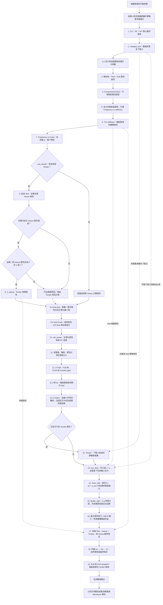

# 車輛初步設計估算：模型與計算說明

> 最新執行結果與完整 LaTeX 數值代入見 [自動更新報告](vehicle_initial_sizing_report.md)。本文件保留模型說明與建立時的範例數值。

## 計算流程



實線表示目前 `main()` 的執行順序；虛線表示前面結果向後傳遞。CG 幾何檢查超限時會印出判定，接續執行其餘分析；輸入值不符合函式限制時，會拋出 `ValueError`。Heave 或 Tender 無可行解時，獨立的 Roll Center 等計算仍會執行。

本文逐項對照 [vehicle_initial_sizing.py](vehicle_initial_sizing.py) 的現行公式。數值範例使用本文件建立時檔案開頭的參數，計算過程保留原始精度，表格僅為顯示而四捨五入。計算使用 Python 標準函式庫 `math`；保留 `print` 並在最後自動產生報告，不繪圖，也不自動讀取 CSV 或重跑原專案流程。報告產生器同樣只使用標準函式庫。

腳本初始參數區的 `use_tender` 控制是否使用 Tender 彈簧，預設為 `True`。設為 `False` 時，跳過第 8 節 Heave 反算、第 9 節 Tender 可行性與串聯設計，以及 Tender 串聯壓縮計算。後續直接採用原 Heave 主簧 `Ks_pitch_N_per_m`：Heave & Roll 比較改用 `(K_heave_main + K_roll)/2`，Heave 阻尼與 Pitch gradient 使用純主簧結果。這是關閉 Tender 的模式，不會標記成「Tender 無可行解」。

## 0. 符號、輸入與單位

### 0.1 質量與幾何

為避免把簧下質量 `mu` 與輪胎摩擦係數混淆，本文分別以 $m_u$ 與 $\mu_y$ 表示。

| 程式參數 | 本文符號 | 目前數值 | 意義 |
| --- | --- | ---: | --- |
| `ms` | $M_s$ | 260.55 kg | 全車四輪簧上質量總和 |
| `mu` | $m_u$ | 14.4 kg | 四輪平均的單輪簧下質量 |
| `h_cog` | $h$ | 0.300 m | 手動設定的重心離地高度 |
| `lf` | $l_f$ | 0.765 m | 手動設定的重心到前軸縱向距離 |
| `lr` | $l_r$ | 0.765 m | 手動設定的重心到後軸縱向距離 |
| `L` | $L$ | 1.530 m | 軸距，由 `lf + lr` 計算 |
| `tf` | $t_f$ | 1.250 m | 前輪距，即 1250 mm |
| `tr` | $t_r$ | 1.240 m | 後輪距，即 1240 mm |
| `t` | $t$ | $t_f=1.250$ m | 傾斜角與壓縮行程計算使用的輪距 |
| `wf` | $w_f$ | 0.50 | 前軸重量比例，由 `lr / L` 計算 |
| `wr` | $w_r$ | 0.50 | 後軸重量比例，由 `lf / L` 計算 |
| `kf` | $k_f$ | 0.55 | 後 RC 公式與 sus_load 使用的前軸彈簧剛性比例 |
| `kr` | $k_r$ | 0.45 | 後 RC 公式與 sus_load 使用的後軸彈簧剛性比例 |
| `g` | $g$ | 9.81 m/s² | 重力加速度 |

`calculate_weight_distribution()` 依靜態力矩平衡計算前後軸重量比例：

$$
L=l_f+l_r,\qquad
w_f=\frac{l_r}{l_f+l_r},\qquad
w_r=\frac{l_f}{l_f+l_r},\qquad
w_f+w_r=1
$$

前軸承載比例使用重心到後軸的距離，後軸承載比例使用重心到前軸的距離。例如 $l_f=0.60$ m、$l_r=0.93$ m 時，$L=1.53$ m，前後重量比約為 60.784%:39.216%。兩段距離皆須為大於零的有限值，且總和須為有限值，表示重心位於兩軸之間。

只需修改 `lf`、`lr`，軸距與重量比便會一起更新；初值兩段各 0.765 m，維持原本 1.53 m 軸距與 50:50 配重。

總質量、四分之一車質量及平均單輪簧上質量為：

$$
M=M_s+4m_u
=260.55+4(14.4)
=318.15\ \mathrm{kg}
$$

$$
m_q=\frac{M}{4}=79.5375\ \mathrm{kg},
\qquad
m_{s,q}=\frac{M_s}{4}=65.1375\ \mathrm{kg}
$$

$$
m_q=m_{s,q}+m_u
$$

$k_f:k_r=55:45$ 是指定的比例值，用於後 Roll Center 高度公式；sus_load 以 $k_r/k_f$ 作為後／前 Roll 彈簧比例，再乘上輪距與運動比的平方，取得軸端滾轉剛性。Tender 壓縮計算另外沿用原 Tender 的「前後相同彈簧組、下壓力各半」設定。

### 0.2 動態與剛性參數

| 程式參數 | 本文符號 | 目前數值 | 意義 |
| --- | --- | ---: | --- |
| `ax` | $a_{x,g}$ | 2.0 | 縱向加速度，以 $g$ 的倍數輸入；正值加速、負值煞車 |
| `ay` | $a_{y,g}$ | 2.2 | 側向加速度，以 $g$ 的倍數輸入；正值右側增載 |
| `a_acc` | $a_{\mathrm{acc},g}$ | 1.2 | Gear_rate 無空力直線加速目標，以 $g$ 的倍數輸入 |
| `brake_ax` | $z_t$ | 2.0 | Brake_ratio 減速度大小，以 $g$ 的倍數輸入；車身縱向加速度為負值 |
| `brake_driver_force_N` | $F_{\mathrm{foot}}$ | 500 N | 車手施加於煞車踏板的腳力 |
| `target_pitch_angle_deg` | $\theta_{p,\deg}$ | 1.0° | 允許俯仰角 |
| `target_roll_angle_deg` | $\phi_{r,\deg}$ | 2.0° | 允許側傾角 |
| `sus_travel` | $s_0$，亦為 FVSA 的 $d$ | 0.025 m | 目標壓縮行程與 FVSA 計算行程，即 25 mm |
| `MR` | $MR$ | 1.0 | 運動比，採用 $K_w=K_sMR^2$ 的定義 |
| `use_tender` | — | `True` | 是否使用 Tender；`False` 時直接採用原 Heave 主簧並跳過 Heave 反算與 Tender 設計 |
| `sprung_roll_inertia_kg_m2` | $I_{xx,s}$ | 7.917820044730256 kg·m² | Roll 臨界阻尼使用的簧上 CG 轉動慣量；手動初值取既有 COG 結果 |
| `Kt` | $K_t$ | 80,000 N/m | 單輪輪胎垂直剛性 |
| `kpi_deg` | $K$ | 8° | Caster 反解使用的主銷內傾角 |
| `min_turn_radius_m` | $R_{\min}$ | 3 m | 以目前軸距及指定單軌公式求最大需求等效前輪轉角 |
| `caster_direction_check_deg` | $C_{\mathrm{check}}$ | 10° | 較大 Caster 的方向驗證角度，只列印查核，不參與求解 |
| `N` | $N$ | 5.0 | 用調整前簧下頻率設定目標簧上頻率的除數 |
| `rc_chassis_stiffness_ratio` | $c$ | 10.0 | 前 RC 與 Anti dive 共用的車體／懸吊等效線性剛性比 |
| `wl_mu_y` | $\mu_y$ | 1.81526957993174 | 輪胎橫向摩擦係數，為檔案中的手動數值 |
| `mu_w` | $\mu_x$ | 1.6046564575663345 | 縱向輪胎摩擦係數，初值取目前 coefficient_of_friction 結果，供煞車可達性檢查 |
| `target_lap_time_s` | $T$ | 5.0 s | Skidpad 目標單圈時間 |
| `A_air` | $A$ | 1.0 m² | 計算目標空力係數的有效面積 |
| `air_density_kg_per_m3` | $\rho$ | 1.225 kg/m³ | 空氣密度，沿用原 Aero_Cl_Cd 設定 |
| `F_ref_ratio` | $\eta_F$ | 1.0 | Tender 與 sus_load 使用所需下壓力的比例 |
| `wl_aero_front_ratio` | $\eta_a$ | 0.5 | sus_load 的空力前軸分配比例，後軸為 $1-\eta_a$ |
| `cg_safety_factor` | $SF$ | 1.0 | CG 傾斜幾何安全係數 |

Gear_rate 的傳動參數獨立列在檔案開頭，以下轉速與車速初值取自目前儲存的設定，扭矩取自既有馬達曲線峰值。本腳本使用這些手動初值，不自動載入曲線或 CSV：

| 程式參數 | 目前數值 | 意義 |
| --- | ---: | --- |
| `R_tire` | 0.2 m | 輪胎有效滾動半徑 |
| `drive_motor_torque_Nm` | 22.30565254 Nm | 單顆馬達最大扭矩 |
| `drive_motor_rpm` | 15,000 rpm | 馬達最高轉速 |
| `drive_target_speed_kmh` | 110 km/h | 目標極速 |

原 Skidpad 模型的固定直徑 $D=18.25$ m、需求係數 $\gamma=1.4$；一般彈簧搜尋範圍為 20,000～80,000 N/m，共 2,000 點。RC 與 Anti dive 依 [roll_center_stiffness_derivation.md](roll_center_stiffness_derivation.md) 直接套用解析解。

傾斜角與壓縮行程的需求剛性使用 `abs(ax)`、`abs(ay)`；sus_load 輪載及三向力保留加速度正負號。

### 0.3 單位換算與剛性區別

$$
\theta_{\mathrm{rad}}=\theta_{\deg}\frac{\pi}{180}
$$

$$
s_{\mathrm{mm}}=1000s_{\mathrm{m}},
\qquad
K_{\mathrm{N/mm}}=\frac{K_{\mathrm{N/m}}}{1000},
\qquad
v_{\mathrm{km/h}}=3.6v_{\mathrm{m/s}}
$$

下壓力的等效公斤重顯示值依程式使用 $F/g$ 換算：

$$
F_{\mathrm{kgf,display}}=\frac{F_{\mathrm{N}}}{9.81}
$$

本文區分以下剛性：

| 符號 | 定義 |
| --- | --- |
| $K_{p,a},K_{r,a}$ | 由目標傾斜角求出的 Pitch／Roll 等效需求剛性 |
| $K_{p,d},K_{r,d}$ | 由目標壓縮行程求出的等效需求剛性 |
| $K_p,K_r$ | 前述兩種限制各自取較高值後的需求剛性 |
| $K_{s,p},K_{s,r}$ | 計入輪胎柔度後的 Pitch／Roll 彈簧剛性 |
| $K_s$ | Tire stiffness 的一般彈簧搜尋結果 |
| $K_w$ | 經 $MR^2$ 換算後的輪率 |
| $K_{\mathrm{ride}}$ | 輪率與輪胎串聯後的 ride rate |
| $K_t$ | 輪胎垂直剛性 |
| $K_{\mathrm{tender}}$ | Tender 彈簧剛性 |

所有有量綱的上述剛性均以 N/m 表示，除非特別註明 N/mm。正規化 RC 剛性則是無因次比值。

## 1. CG：重心高度與傾斜幾何上限

對應函式：`calculate_cg_safety()`。這是腳本第一項分析。

### 1.1 輪距與高度上限

先取前後較小輪距：

$$
t_{\min}=\min(t_f,t_r)
$$

對分析角度 $\beta\in\{45^\circ,60^\circ\}$，高度上限為：

$$
h_{\max}(\beta)=\frac{t_{\min}}{2\tan\beta\cdot SF}
$$

高度餘裕為：

$$
\Delta h(\beta)=h_{\max}(\beta)-h
$$

目前 $t_{\min}=1.240$ m、$h=0.300$ m、$SF=1$：

| 角度 | 高度上限 | 高度餘裕 | 判定 |
| --- | ---: | ---: | --- |
| 45° | 620.000 mm | 320.000 mm | 通過幾何檢查 |
| 60° | 357.957 mm | 57.957 mm | 通過幾何檢查 |

### 1.2 判定與輸入限制

程式先以 `math.isclose(h, limit, rel_tol=1e-12, abs_tol=1e-12)` 檢查是否位於上限，近似相等的判定為：

$$
|h-h_{\max}|\le
\max\left(
10^{-12}\max(|h|,|h_{\max}|),10^{-12}\ \mathrm{m}
\right)
$$

近似相等列為「臨界」；其他情況依餘裕正負判定。45°、60° 兩項均具有正餘裕，`cg_geometric_safe` 才為 `True`。

輪距須為正，$h\ge0$，$SF\ge1$。此項幾何檢查假設左右對稱、無懸吊變形；使用輸入的 $h$，不以後續 Tender 壓縮量回頭修正重心。整支腳本的其他階段會要求 $h>0$。

## 2. skidpad_test：達到目標圈速的空力下壓力

對應函式：`calculate_skidpad_downforce()`。

### 2.1 速度與向心加速度

圓周半徑、周長為：

$$
R=\frac{D}{2},
\qquad
C=\pi D
$$

目標單圈時間 $T$ 對應速度：

$$
v=\frac{C}{T}=\frac{\pi D}{T}
$$

$$
a_{y,\mathrm{skid}}=\frac{v^2}{R},
\qquad
a_{y,g,\mathrm{skid}}=\frac{a_{y,\mathrm{skid}}}{g}
$$

此處加速度由圈速與半徑計算；檔案開頭的 `ay` 另供傾斜角與行程剛性分析使用。

### 2.2 摩擦需求與下壓力反算

沿用原分析係數 $\gamma=1.4$：

$$
\mu_{\mathrm{required}}
=\gamma\frac{a_{y,\mathrm{skid}}}{g}
$$

以輪胎橫向能力與含係數後的側向需求平衡：

$$
\mu_y(Mg+F_{\mathrm{down,raw}})
=\gamma M a_{y,\mathrm{skid}}
$$

整理得到原公式下壓力：

$$
F_{\mathrm{down,raw}}
=\left(\frac{\mu_{\mathrm{required}}}{\mu_y}-1\right)Mg
$$

`F_ref` 與 `skidpad_target_downforce_N` 均保留這個有號數值。實際傳給 Tender 的額外下壓力為：

$$
F_{\mathrm{down}}
=\max(0,F_{\mathrm{down,raw}})
$$

若原公式為負，程式會印出輪胎摩擦力在此模型下已足夠，所需額外下壓力列為零。

### 2.3 目前結果

| 項目 | 數值 |
| --- | ---: |
| 目標單圈時間 $T$ | 5.000 s |
| 半徑 $R$ | 9.125 m |
| 速度 $v$ | 11.466813 m/s |
| `v_ref` | 41.280527 km/h |
| 向心加速度 | 14.409622 m/s²，約 1.469 g |
| 含係數後需求摩擦係數 | 2.056419 |
| 所需整車下壓力 | 414.616147 N |
| 等效公斤重顯示值 | 42.265 kgf |
| 空力有效面積 | 1.000 m² |
| 空氣密度 | 1.225 kg/m³ |
| 指定公式的目標係數 $C$ | 2.574095460 |
| 原 Aero_Cl_Cd 定義的係數 $Cl=2C$ | 5.148190920 |

這個下壓力對應目標車速約 41.281 km/h。輸入需符合 $M_s>0$、$m_u>0$、$\mu_y>0$，且 $4\le T\le6$ s。

### 2.4 空力有效面積與目標升力係數

對應函式：`calculate_aero_lift_coefficient()`。空力有效面積設定為 $A=1$ m²；空氣密度沿用 `analysis/Aero_Cl_Cd.py` 的 $\rho=1.225$ kg/m³，兩項都可在腳本開頭修改。

依指定的空力關係，以下壓力為正：

$$
F_{\mathrm{down}}=C\rho A v^2
$$

反解目標無因次係數：

$$
C=\frac{F_{\mathrm{down}}}{\rho A v^2}
$$

使用 Skidpad 的目標車速 $v$，單位必須為 m/s。所需下壓力取 `skidpad_required_aero_downforce_N`，即非負的完整需求；不乘 `F_ref_ratio`，因為該比例另用於下壓力施加與彈簧壓縮分析。

目前數值：

$$
C=\frac{414.616147129}
{1.225\times1\times11.466813186^2}
\approx2.574095460
$$

專案原本 `Aero_Cl_Cd` 使用的定義為：

$$
F_{\mathrm{down}}=\frac{1}{2}Cl\rho A v^2
$$

所以腳本另外列出同一需求下的對照係數：

$$
Cl=2C\approx5.148190920
$$

上述 $C$ 是指定公式的目標係數，$Cl$ 是原專案公式中以下壓力為正的係數。兩者對應同一面積、速度與下壓力。若不需要額外下壓力，輸入力為 0，兩個係數均為 0。

函式要求下壓力為非負有限值，速度、面積與密度為正有限值；回傳 `target_coefficient_C` 及 `standard_downforce_coefficient_Cl`。所有結果只計算並印出，不畫圖。


## 3. 傾斜角 stiffness：指定角度所需的剛性

對應函式：`calculate_stiffness()`。

### 3.1 共用計算形式

令 $b$ 為對應的跨度：Pitch 使用 $L$，Roll 使用 $t=t_f$。令 $\psi$ 為已轉成弧度的目標角度，$a_g$ 為對應的加速度倍數。

小角度近似下，半幅位移：

$$
s=\frac{b}{2}\psi
$$

慣性力矩及模型等效力：

$$
\mathcal{M}=M_sa_gg h,
\qquad
F_{\mathrm{eq}}=\frac{\mathcal{M}}{b/2}
$$

沿用原分析的等效線性剛性定義：

$$
K_a=\frac{F_{\mathrm{eq}}}{2s}
=\frac{2M_sa_gg h}{b^2\psi}
$$

此 $K_a$ 是後續剛性評估使用的等效需求量；程式在 Tire stiffness 階段再轉換為彈簧剛性。

### 3.2 Pitch 與 Roll

$$
\theta_p=1^\circ\frac{\pi}{180},
\qquad
s_p=\frac{L}{2}\theta_p,
\qquad
K_{p,a}=\frac{2M_sa_{x,g}g h}{L^2\theta_p}
$$

$$
\phi_r=2^\circ\frac{\pi}{180},
\qquad
s_r=\frac{t}{2}\phi_r,
\qquad
K_{r,a}=\frac{2M_sa_{y,g}g h}{t^2\phi_r}
$$

| 項目 | Pitch | Roll |
| --- | ---: | ---: |
| 目標角度 | 1° | 2° |
| 慣性力矩 | 1533.597300 N·m | 1686.957030 N·m |
| 半幅位移 | 13.351769 mm | 21.816616 mm |
| 等效需求剛性 | 75,072.538564 N/m | 61,859.531545 N/m |

目標角度直接代入，允許範圍為 0.1°～3.0°。此函式要求質量、高度、跨度為正，加速度倍數可為零但不可為負。

## 4. Compressed travel：指定行程所需剛性

對應函式：`calculate_compressed_travel()`。

以相同跨度 $b$ 與加速度倍數 $a_g$，模型的載荷轉移量為：

$$
\Delta F=\frac{M_sa_gg h}{b}
$$

目標行程 $s_0$ 對應剛性：

$$
K_d=\frac{\Delta F}{s_0}
=\frac{M_sa_gg h}{bs_0}
$$

對應的幾何角度以反正切計算：

$$
\psi_d=\arctan\left(\frac{2s_0}{b}\right),
\qquad
\psi_{d,\deg}=\psi_d\frac{180}{\pi}
$$

因此：

$$
K_{p,d}=\frac{M_sa_{x,g}g h}{Ls_0},
\qquad
K_{r,d}=\frac{M_sa_{y,g}g h}{ts_0}
$$

| 項目 | Pitch | Roll |
| --- | ---: | ---: |
| 目標行程 | 25 mm | 25 mm |
| 等效需求剛性 | 40,094.047059 N/m | 53,982.624960 N/m |
| 對應角度 | 1.871745° | 2.290610° |

傾斜角分析使用 $s=(b/2)\psi$ 的小角度近似；本階段由行程回算角度時使用 $\arctan$。行程直接代入，限制為 $0<s_0\le0.050$ m。

## 5. Frequency vs stiffness：取較高剛性並算頻率

對應函式：`calculate_natural_frequency()`；最大值比較由 `main()` 進行。

Pitch、Roll 分別比較：

$$
K_p=\max(K_{p,a},K_{p,d})
$$

$$
K_r=\max(K_{r,a},K_{r,d})
$$

| 方向 | 角度需求 | 行程需求 | 採用剛性 |
| --- | ---: | ---: | ---: |
| Pitch | 75,072.538564 | 40,094.047059 | 75,072.538564 N/m |
| Roll | 61,859.531545 | 53,982.624960 | 61,859.531545 N/m |

此階段沿用原 Frequency vs stiffness 的計算質量：

$$
m_{\mathrm{stiffness}}=\frac{M_s}{2}=130.275\ \mathrm{kg}
$$

$$
f_p=\frac{1}{2\pi}\sqrt{\frac{K_p}{M_s/2}},
\qquad
f_r=\frac{1}{2\pi}\sqrt{\frac{K_r}{M_s/2}}
$$

結果為：

$$
f_p=3.820587\ \mathrm{Hz},
\qquad
f_r=3.468110\ \mathrm{Hz}
$$

此階段使用的 $M_s/2$ 與第 7 節的四分之一車 $M_s/4$ 分別對應各自原分析設定。頻率函式要求質量與所用剛性均為正。

## 6. Tire stiffness：輪胎柔度與彈簧剛性

對應函式：`calculate_spring_rate()`、`calculate_tire_stiffness()`。

### 6.1 輪率、ride rate 與反算公式

彈簧經運動比換算為輪率：

$$
K_w=K_sMR^2
$$

輪率與輪胎柔度串聯：

$$
\frac{1}{K_{\mathrm{ride}}}=\frac{1}{K_w}+\frac{1}{K_t}
$$

$$
K_{\mathrm{ride}}=\frac{K_wK_t}{K_w+K_t}
$$

給定目標 ride rate $K_{\mathrm{ride,target}}$ 與這次反算使用的輪胎等效剛性 $K_{t,e}$，可反解：

$$
K_w=\frac{K_{\mathrm{ride,target}}K_{t,e}}
{K_{t,e}-K_{\mathrm{ride,target}}}
$$

$$
K_s=\frac{K_{\mathrm{ride,target}}K_{t,e}}
{(K_{t,e}-K_{\mathrm{ride,target}})MR^2}
$$

反算須符合 $0<K_{\mathrm{ride,target}}<K_{t,e}$，且 $MR>0$。

### 6.2 Pitch／Roll 彈簧剛性

原 Tire stiffness 對這兩個通道採用 $K_{t,e}=2K_t$：

$$
K_{s,p}=\frac{K_p(2K_t)}{(2K_t-K_p)MR^2}
$$

$$
K_{s,r}=\frac{K_r(2K_t)}{(2K_t-K_r)MR^2}
$$

目前結果：

$$
K_{s,p}=141\,433.712574\ \mathrm{N/m},
\qquad
K_{s,r}=100\,850.599177\ \mathrm{N/m}
$$

### 6.3 一般彈簧 Ks 的離散搜尋

另一個輸出 `Ks` 採以下目標：

$$
K_{\mathrm{ride,target,general}}=\frac{K_p+K_r}{4}
=34\,233.017527\ \mathrm{N/m}
$$

搜尋候選值：

$$
K_{s,j}=20\,000+
j\frac{80\,000-20\,000}{1999},
\qquad j=0,1,\ldots,1999
$$

每個候選值以單輪 $K_t$ 計算：

$$
K_{\mathrm{ride},j}
=\frac{(K_{s,j}MR^2)K_t}{K_{s,j}MR^2+K_t}
$$

選取目標誤差最小者：

$$
j^*=\operatorname{arg\,min}_j
\left|K_{\mathrm{ride},j}-K_{\mathrm{ride,target,general}}\right|,
\qquad
K_s=K_{s,j^*}
$$

目前：

$$
K_s=59\,829.914957\ \mathrm{N/m}
$$

$$
K_{\mathrm{ride,selected}}=34\,230.108758\ \mathrm{N/m}
$$

實際值與目標值略有差異，來源為離散取樣。搜尋固定在上述範圍內；若目標超出可達範圍，會選擇最接近的範圍端點。

後續 Frequency vs mass 使用 $K_{s,p}$、$K_{s,r}$；一般搜尋得到的 $K_s$ 作為獨立結果印出。

## 7. Frequency vs mass：目前簧上與簧下自然頻率

對應函式：`calculate_frequency_vs_mass()`。

### 7.1 質量比例

四分之一車簧下質量比例為：

$$
r_u=\frac{m_u}{m_q}
=\frac{m_u}{M_s/4+m_u}
$$

目前：

$$
100r_u=18.104668\%
$$

### 7.2 等效剛性

依原模型將 Pitch/heave 與 Roll 彈簧剛性相加後除以四：

$$
K_{s,eq,0}=\frac{K_{s,r}+K_{s,p}}{4}
$$

$$
K_{w,0}=K_{s,eq,0}MR^2,
\qquad
K_{\mathrm{ride},0}
=\frac{K_{w,0}K_t}{K_{w,0}+K_t}
$$

目前：

| 項目 | 數值 |
| --- | ---: |
| $K_{s,eq,0}$ | 60,571.077938 N/m |
| $K_{w,0}$ | 60,571.077938 N/m |
| $K_{\mathrm{ride},0}$ | 34,471.431151 N/m |

### 7.3 兩個模態的簡化頻率估算

簧上頻率使用 $m_{s,q}=M_s/4$：

$$
f_{s,0}=\frac{1}{2\pi}
\sqrt{\frac{K_{\mathrm{ride},0}}{M_s/4}}
$$

簧下 Wheel-hop 頻率為：

$$
f_{u,0}=\frac{1}{2\pi}
\sqrt{\frac{K_t+K_{w,0}}{m_u}}
$$

結果：

$$
f_{s,0}=3.661291\ \mathrm{Hz},
\qquad
f_{u,0}=15.724863\ \mathrm{Hz}
$$

這是原分析的未阻尼簡化估算。獨立腳本只計算目前輸入質量對應的數值，沒有另外產生質量比例掃描曲線。

## 8. 固定 Roll，反算 Heave 目標剛性

對應函式：`calculate_heave_reduction()`。

本節僅在 `use_tender = True` 時執行；`False` 時不呼叫此函式，也不使用頻率除數 `N` 設定新 Heave 剛性。

### 8.1 目標頻率

目前採用與原 Frequency vs mass 相同的模式：

$$
f_{s,\mathrm{target}}=\frac{f_{u,0}}{N}
$$

$$
f_{s,\mathrm{target}}
=\frac{15.724863}{5}
=3.144973\ \mathrm{Hz}
$$

$N$ 的基準為調整前的簧下頻率 $f_{u,0}$。目標值在本次反算中固定。

### 8.2 反算 ride rate、輪率及 Heave 剛性

$$
K_{\mathrm{ride,target}}
=(2\pi f_{s,\mathrm{target}})^2\frac{M_s}{4}
$$

$$
K_{w,\mathrm{target}}
=\frac{K_tK_{\mathrm{ride,target}}}
{K_t-K_{\mathrm{ride,target}}}
$$

$$
K_{s,eq,\mathrm{target}}
=\frac{K_{w,\mathrm{target}}}{MR^2}
$$

固定原 Roll 彈簧剛性 $K_{s,r}$，只改變 Pitch/heave 剛性：

$$
K_{s,h,\mathrm{target}}
=4K_{s,eq,\mathrm{target}}-K_{s,r}
$$

目前中間量：

$$
K_{\mathrm{ride,target}}
=25\,434.579414\ \mathrm{N/m}
$$

$$
K_{w,\mathrm{target}}
=37\,290.399878\ \mathrm{N/m}
$$

$$
K_{s,h,\mathrm{target}}
=48\,311.000335\ \mathrm{N/m}
$$

### 8.3 剛性倍率與降幅

主 heave 彈簧的原剛性為 $K_{s,p}$。倍率：

$$
\lambda_h=\frac{K_{s,h,\mathrm{target}}}{K_{s,p}}
$$

降低的剛性量與百分比：

$$
\Delta K_h=K_{s,p}-K_{s,h,\mathrm{target}}
$$

$$
p_{\mathrm{reduction}}
=\left(1-\lambda_h\right)100\%
$$

目前：

| 項目 | 數值 |
| --- | ---: |
| 原 heave 剛性 | 141,433.712574 N/m |
| 目標 heave 剛性 | 48,311.000335 N/m |
| `Ks_scale_target_frequency` | 0.341580515 |
| 降低量 | 93,122.712239 N/m |
| 降幅 | 65.841949% |

降幅若為負，程式改印「需增加剛性」。

### 8.4 調整後回算

用 $K_{s,h,\mathrm{target}}$ 取代第 7 節中的 $K_{s,p}$，並保留 $K_{s,r}$：

$$
K_{s,eq,1}=\frac{K_{s,r}+K_{s,h,\mathrm{target}}}{4}
$$

$$
K_{w,1}=K_{s,eq,1}MR^2,
\qquad
K_{\mathrm{ride},1}
=\frac{K_{w,1}K_t}{K_{w,1}+K_t}
$$

$$
f_{s,1}=\frac{1}{2\pi}
\sqrt{\frac{K_{\mathrm{ride},1}}{M_s/4}},
\qquad
f_{u,1}=\frac{1}{2\pi}
\sqrt{\frac{K_t+K_{w,1}}{m_u}}
$$

目前：

$$
f_{s,1}=3.144973\ \mathrm{Hz},
\qquad
f_{u,1}=14.363825\ \mathrm{Hz}
$$

調整後簧下頻率也隨輪率改變；此例 $f_{u,1}/f_{s,1}\approx4.567234$。腳本的目標定義始終是 $f_{s,\mathrm{target}}=f_{u,0}/N$。

此反算要求 $N>0$。若 $K_{\mathrm{ride,target}}\ge K_t$，或反算的 $K_{s,h,\mathrm{target}}\le0$，函式回傳 `can_reach_target=False` 與原因，保留其餘可獨立執行的分析。

## 9. 2_spring：串聯 Tender 剛性

對應函式：`calculate_tender_stiffness()`。

### 9.1 主簧與目標串聯剛性

使用原 Pitch/heave 彈簧作為主簧：

$$
K_{\mathrm{main}}=K_{s,p}
$$

目標串聯剛性：

$$
K_{\mathrm{series,target}}
=\lambda_hK_{\mathrm{main}}
=K_{s,h,\mathrm{target}}
$$

### 9.2 反算 Tender

串聯彈簧滿足：

$$
\frac{1}{K_{\mathrm{series}}}
=\frac{1}{K_{\mathrm{main}}}
+\frac{1}{K_{\mathrm{tender}}}
$$

$$
K_{\mathrm{series}}
=\frac{K_{\mathrm{main}}K_{\mathrm{tender}}}
{K_{\mathrm{main}}+K_{\mathrm{tender}}}
$$

令其等於目標，得到：

$$
K_{\mathrm{tender}}
=\frac{K_{\mathrm{series,target}}K_{\mathrm{main}}}
{K_{\mathrm{main}}-K_{\mathrm{series,target}}}
$$

Tender／主簧剛性比：

$$
\rho_t=\frac{K_{\mathrm{tender}}}{K_{\mathrm{main}}}
=\frac{\lambda_h}{1-\lambda_h}
$$

目前結果：

| 項目 | 數值 |
| --- | ---: |
| 主簧 $K_{\mathrm{main}}$ | 141,433.712574 N/m |
| 目標串聯剛性 | 48,311.000335 N/m |
| Tender 剛性 | 73,374.195953 N/m，即 73.374196 N/mm |
| `tender_to_heave_stiffness_ratio` | 0.518788587 |
| 加入 Tender 後 Heave 等效剛性 | 48,311.000335 N/m |

有限、正值的串聯 Tender 解要求 $K_{\mathrm{main}}>0$ 且 $0<\lambda_h<1$。目標剛性等於或高於主簧時，程式列出無法以此串聯方式達成，跳過 Tender 壓縮計算。串聯剛性適用於 Tender 尚未併圈的區間。

### 9.3 依車體／懸吊剛性比設定 Anti dive

對應函式：`calculate_anti_dive()`。與前 Roll Center 共用 `rc_chassis_stiffness_ratio`，目前假設車體等效線性剛性為懸吊的 10 倍：

$$
c=\frac{K_c}{K_s}=10
$$

依 [roll_center_stiffness_derivation.md](roll_center_stiffness_derivation.md)，令 $\alpha$ 為懸吊路徑比例、$1-\alpha$ 為車體幾何路徑比例。兩路能量模型為：

$$
U=\frac{1}{2}K_{eq}\theta^2,
\qquad
K_{eq}(\alpha)=\alpha^2K_s+(1-\alpha)^2K_c
$$

$$
\frac{dK_{eq}}{d\alpha}=2\alpha K_s-2(1-\alpha)K_c=0
$$

因此直接得到：

$$
\alpha^*=\frac{K_c}{K_s+K_c}=\frac{c}{1+c},
\qquad
1-\alpha^*=\frac{K_s}{K_s+K_c}=\frac{1}{1+c}
$$

依指定的類比方法，把 anti-dive 比例 $a$ 視為幾何承載路徑的分流比例，使用前 RC 模型的同一正規化形式：

$$
\kappa_{\mathrm{AD}}(a)
=\frac{K_{eq}}{K_s}
=(1-a)^2+ca^2,
\qquad 0\le a\le1
$$

對 $a$ 微分，求正規化等效剛性的最小點：

$$
\frac{d\kappa_{\mathrm{AD}}}{da}
=-2+2(1+c)a=0
$$

$$
a^*=1-\alpha^*=\frac{1}{1+c},
\qquad
\frac{d^2\kappa_{\mathrm{AD}}}{da^2}=2(1+c)>0
$$

因此設定：

$$
\mathrm{anti\_dive}=a^*
=\frac{1}{11}
=0.090909091
\quad\Rightarrow\quad9.091\%
$$

$$
\kappa_{\mathrm{AD,min}}
=\frac{c}{1+c}
=\frac{10}{11}
=0.909090909
$$

目前直接套用解析式的結果為：

| 解析量 | 數值 |
| --- | ---: |
| 懸吊路徑比例 $\alpha^*$ | 0.909090909（90.909%） |
| Anti dive，即幾何路徑比例 $1-\alpha^*$ | 0.090909091（9.091%） |
| 最小正規化等效剛性 | 0.909090909 |

後續 Anti-Scrub 使用此解析解。`calculate_anti_dive()` 回傳 `anti_dive`、`anti_dive_percent`、`anti_dive_suspension_fraction`、`anti_dive_normalized_min_stiffness`；輸入 $c$ 必須為正的有限值。

此為依指定類比模型求出的設定比例；實際懸吊硬點與煞車力分配未在本函式求解。`calculate_tender_stiffness()` 仍回傳 Tender 串聯剛性與 `K_heave_with_tender_N_per_m`；Anti dive 由上述正規化模型獨立計算，與 Tender 是否有可行解無關。

### 9.4 依指定加速度比計算 Anti-Scrub

使用 `ax = 2.0` g、`a_acc = 1.2` g，接續前述未四捨五入的 Anti dive，依指定公式計算：

$$
\mathrm{anti\_scrub}
=\mathrm{anti\_dive}\frac{a_{\mathrm{acc},g}}{a_{x,g}}
$$

$$
\mathrm{anti\_scrub\_percent}=100\,\mathrm{anti\_scrub}
$$

兩個加速度皆以 g 為單位輸入，比值中的單位相消。目前結果約為：

$$
\mathrm{anti\_scrub}
\approx0.090909\frac{1.2}{2.0}
\approx0.054545
\quad\Rightarrow\quad5.455\%
$$

`calculate_anti_scrub()` 回傳無因次比例 `anti_scrub` 與百分數 `anti_scrub_percent`；輸出接在 Anti dive 之後，使用 `calculate_anti_dive()` 的解析解。分母 `ax` 須為非零有限值，`a_acc` 須為非負有限值，輸入的 `anti_dive` 使用 0～1 的比例。此計算與 Tender 是否有可行解無關。

## 10. roll_center：正規化等效剛性與前 RC 高度

對應函式：`calculate_roll_center()`。

### 10.1 正規化模型

定義 RC 高度比與車架／懸吊剛性比：

$$
r_{\mathrm{RC}}=\frac{h_{\mathrm{RC,f}}}{h},
\qquad
c=\frac{K_c}{K_{s,\mathrm{RC}}}
$$

原模型比較的正規化等效剛性為：

$$
\kappa(r_{\mathrm{RC}})
=\frac{K_{eq}}{K_{s,\mathrm{RC}}}
=(1-r_{\mathrm{RC}})^2+cr_{\mathrm{RC}}^2
$$

$K_{s,\mathrm{RC}}$ 是此正規化模型的參考懸吊剛性。程式直接輸入比例 $c$，不另外計算 $K_c$ 的絕對剛性。

### 10.2 解析最小值

對高度比微分：

$$
\frac{d\kappa}{dr_{\mathrm{RC}}}
=-2(1-r_{\mathrm{RC}})+2cr_{\mathrm{RC}}=0
$$

$$
r_{\mathrm{RC}}^*=\frac{1}{1+c}
$$

$$
\frac{d^2\kappa}{dr_{\mathrm{RC}}^2}=2(1+c)>0
$$

所以此點為最小值：

$$
\kappa_{\min}=\frac{c}{1+c}
$$

以前述解析解作為前 RC：

$$
h_{\mathrm{RC,f}}=\frac{h}{1+c}
$$

目前 $c=10$、$h=0.3$ m：

$$
r_{\mathrm{RC}}^*=0.090909091,
\qquad
\kappa_{\min}=0.909090909
$$

$$
h_{\mathrm{RC,f}}
=0.027272727\ \mathrm{m}
=27.272727\ \mathrm{mm}
$$

### 10.3 與參考文件的懸吊路徑比例對照

依 [roll_center_stiffness_derivation.md](roll_center_stiffness_derivation.md)：

$$
\alpha=\frac{h-h_{\mathrm{RC,f}}}{h}
=1-r_{\mathrm{RC}}
$$

$$
K_{eq}=\alpha^2K_s+(1-\alpha)^2K_c
$$

由解析解直接代入：

$$
\alpha^*=\frac{K_c}{K_s+K_c}=\frac{c}{1+c},
\qquad
\frac{h_{\mathrm{RC,f}}}{h}
=1-\alpha^*
=\frac{K_s}{K_s+K_c}
=\frac{1}{1+c}
$$

目前解析結果：

| 項目 | 數值 |
| --- | ---: |
| 懸吊路徑比例 $\alpha^*$ | 0.909090909 |
| RC／CG 比例 $1-\alpha^*$ | 0.090909091 |
| 最小正規化等效剛性 | 0.909090909 |
| 前 RC 高度 | 27.272727 mm |

`calculate_roll_center()` 回傳 `rc_normalized_optimal_ratio`、`rc_normalized_min_stiffness`、`rc_suspension_fraction`、`rc_normalized_optimal_height_m`。後 RC 計算接續使用此解析高度；此階段要求 $h>0$、$c>0$。

## 11. 依指定比例計算後 Roll Center

對應函式：`calculate_weight_distribution()`、`calculate_rear_roll_center()`。

採用目前指定的公式：

$$
h_{\mathrm{RC,r}}
=h_{\mathrm{RC,f}}
\frac{w_f}{w_r}
\frac{t_r}{t_f}
\frac{k_f}{k_r}
$$

各比例皆為無因次。輪距可同時使用 m 或同時使用 mm，前後須採相同單位。

目前：

$$
\frac{w_f}{w_r}=\frac{0.50}{0.50}=1,
\qquad
\frac{t_r}{t_f}=\frac{1.240}{1.250}=0.992,
\qquad
\frac{k_f}{k_r}=\frac{0.55}{0.45}=1.222222222
$$

$$
h_{\mathrm{RC,r}}
=27.272727\times1\times0.992\times1.222222222
\approx33.066667\ \mathrm{mm}
$$

程式使用未四捨五入的前 RC 計算，結果以 33.067 mm 顯示。`main()` 使用由 `lf`、`lr` 計算的重量比例，因此 $w_f+w_r=1$，且 $w_f/w_r=l_r/l_f$。輸入比例與輪距須為正，前 RC 高度可為零。後 RC 函式本身依比例相除，未額外檢查 $w_f+w_r=1$ 或 $k_f+k_r=1$。

### 11.1 FVSA：最大 Roll 角與 Camber gain

對應函式：`calculate_fvsa()`。此項接在後 RC 高度之後，前後軸分別使用各自輪距 $t_f$、$t_r$，行程使用 `sus_travel`：

$$
d=s_0=0.025\ \mathrm{m}
$$

#### 最大 Roll 角

依指定公式，先以弧度計算：

$$
\theta=\arctan\left(\frac{2d}{t}\right)
$$

計算 FVSA 時保留 $\theta$ 的弧度值，最後才換成度數顯示：

$$
\theta_{\deg}=\theta\frac{180}{\pi}
$$

這個角度由允許行程與輪距求得；`target_roll_angle_deg` 另用於前面的角度剛性需求計算。

#### FVSA 計算值

完全依指定的運算順序：

$$
L_{\mathrm{FVSA}}
=\frac{1}{\tan\left(\frac{\theta}{2d}\right)}
$$

Python 的 `theta / 2 / d` 等同於 `theta / (2*d)`。本函式固定將 $d$、$t$ 以公尺數值代入；FVSA 計算值先按公尺約定輸出，再乘 1000 顯示毫米。

#### 單位位移的 Camber gain

`camber_change = atan(1 / FVSA)` 中的 `1` 按 1 m 位移解讀：

$$
\gamma_{1\mathrm{m}}
=\arctan\left(\frac{1}{L_{\mathrm{FVSA}}}\right)
$$

依此單位位移定義的比例換算為：

$$
G_{\mathrm{deg/m}}
=\gamma_{1\mathrm{m}}\frac{180}{\pi}
$$

$$
G_{\mathrm{deg/mm}}=\frac{G_{\mathrm{deg/m}}}{1000}
$$

最大 Camber 變化角依指定方式線性乘上行程：

$$
\Delta\gamma_{\max,\deg}
=G_{\mathrm{deg/m}}d
=G_{\mathrm{deg/mm}}(1000d)
$$

這裡計算的是角度變化的大小；公式沒有設定內外輪的 Camber 正負方向。

#### 單位約定

本節保留指定的數值公式。$\theta/(2d)$ 含長度數值，因此將 $d$、$t$ 的公尺數值直接改成毫米數值代入，會改變 $\tan$ 的引數與 FVSA 結果。函式固定接受公尺輸入，單位換算只在公式運算完成後進行。

輸出的 deg/mm 是上述 deg/m 的比例換算；最大變化也採用此線性外推，並未另用 $\arctan(d/L_{\mathrm{FVSA}})$ 重算整段行程角度。

#### 目前結果

| 項目 | 前軸 | 後軸 |
| --- | ---: | ---: |
| 行程 $d$ | 25 mm | 25 mm |
| 輪距 $t$ | 1250 mm | 1240 mm |
| 最大 Roll 角 $\theta$ | 2.290610° | 2.309063° |
| FVSA 計算值 | 0.972043272 m | 0.959593718 m |
| FVSA 毫米顯示值 | 972.043272 mm | 959.593718 mm |
| Camber gain | 45.812201 deg/m | 46.181256 deg/m |
| Camber gain 換算 | 0.045812201 deg/mm | 0.046181256 deg/mm |
| 最大 Camber 變化 | 1.145305° | 1.154531° |

`calculate_fvsa()` 回傳 `max_roll_angle_rad`、`max_roll_angle_deg`、`fvsa_length_m`、`fvsa_length_mm`、`camber_change_rad_per_m`、`camber_gain_deg_per_m`、`camber_gain_deg_per_mm`、`max_camber_change_deg`。行程與輪距必須為正的有限值；若指定公式的正切值或 FVSA 無法得到有限正長度，會回報 `ValueError`。

### 11.2 純 ay：輪胎壓縮差造成的額外 Roll

對應函式：`calculate_lateral_tire_roll()`。此項是無空力、無縱向加速度的獨立工況。前後軸各自使用左右兩輪模型，前後側向力依靜態承載質量比例分配：

$$
M=M_s+4m_u,
\qquad
m_f=Mw_f,
\qquad
m_r=Mw_r
$$

各軸分別以 $m_i$、$t_i$ 代入下列公式。採用共同的輸入重心高度 $h$ 與單輪輪胎剛性 $K_t$；此項不引入懸吊彈簧剛性或空力分配。前後軸為各自的兩輪估算，沒有額外施加兩軸 Roll 角必須相同的剛體相容條件。

#### 側向力與力矩平衡

程式的 `ay` 以 g 倍數輸入，先換算成實際加速度：

$$
a_y=a_{y,g}g
$$

單軸側向力與側傾力矩為：

$$
F_{y,i}=m_i a_y,
\qquad
\mathcal{M}_i=F_{y,i}h
$$

靜態垂向力與側傾力矩平衡：

$$
N_{L,i}+N_{R,i}=m_i g
$$

$$
(N_{R,i}-N_{L,i})\frac{t_i}{2}
=F_{y,i}h
$$

因此左右輪載差為：

$$
\Delta N_i=N_{R,i}-N_{L,i}
=\frac{2F_{y,i}h}{t_i}
$$

定義由一側轉移到另一側的量 $T_i$：

$$
T_i=\frac{F_{y,i}h}{t_i}
$$

注意 $\Delta N_i=2T_i$。每側輪載為：

$$
N_{L,i}=\frac{m_i g}{2}-T_i,
\qquad
N_{R,i}=\frac{m_i g}{2}+T_i
$$

沿用腳本符號：正 `ay` 使右輪增載、左輪卸載；負 `ay` 則相反。

#### 左右輪胎的總壓縮與增減量

單輪垂直剛性 $K_t$ 使用 N/m，因此線性總壓縮以公尺計算：

$$
\delta_{L,i}=\frac{N_{L,i}}{K_t},
\qquad
\delta_{R,i}=\frac{N_{R,i}}{K_t}
$$

無側向加速度時的單輪靜態壓縮為：

$$
\delta_{0,i}=\frac{m_i g}{2K_t}
$$

側向加速度引起的壓縮增減量：

$$
\Delta\delta_{L,i}=\delta_{L,i}-\delta_{0,i}
=-\frac{T_i}{K_t}
$$

$$
\Delta\delta_{R,i}=\delta_{R,i}-\delta_{0,i}
=\frac{T_i}{K_t}
$$

負的「增減量」代表相對靜態平衡位置卸載，不等同於總壓縮已為負。若總壓縮與總輪載為負，則超出輪胎只承受壓力的接地模型範圍。

#### 由壓縮差計算額外 Roll

兩側壓縮差：

$$
\Delta z_i=\delta_{R,i}-\delta_{L,i}
=\frac{2F_{y,i}h}{K_t t_i}
$$

依指定的「變形量除以輪距」小角度公式：

$$
\phi_{\mathrm{tire},i}
\approx\frac{\Delta z_i}{t_i}
=\frac{2m_i a_y h}{K_t t_i^2}
$$

$$
\phi_{\mathrm{tire},i,\deg}
=\phi_{\mathrm{tire},i}\frac{180}{\pi}
$$

$\phi_{\mathrm{tire},i}$ 為弧度；此處使用左右壓縮差，不是單側壓縮量。本節獨立輸出輪胎柔度造成的角度，第 11.3 節再依指定方式與前軸最大懸吊 Roll 及 FVSA Camber 變化疊加。

#### 接地限制

兩側法向輪載均不得為負，對此兩輪模型可得：

$$
|a_{y,g}|\le\frac{t_i}{2h}
$$

$$
ay_{\mathrm{limit},i}=\frac{t_i}{2h}
$$

$h=0$ 時，本模型的側傾力矩為零，對應界限為無限大。程式以 $10^{-12}\max(m_i g,1\ \mathrm{N})$ 作為輪載的浮點比較容差，並額外標示離地臨界。

超出接地限制時，函式保留原始輪載、線性壓縮與 `linear_tire_roll_angle_deg` 供查核；`contact_valid=False`，`tire_roll_angle_rad`、`tire_roll_angle_deg` 則回傳 `None`。此時需要其他模型處理輪胎離地後的姿態，不能把負總壓縮當成實際輪胎拉伸。

#### 目前數值

目前 $M=318.15$ kg、$w_f=w_r=0.5$、$h=0.3$ m、$ay=2.2$ g，$K_t=80000$ N/m：

| 項目 | 前軸 | 後軸 |
| --- | ---: | ---: |
| 承載質量 $m_i$ | 159.075 kg | 159.075 kg |
| 輪距 $t_i$ | 1.250 m | 1.240 m |
| 側向力 $F_{y,i}$ | 3433.156650 N | 3433.156650 N |
| 側傾力矩 $F_{y,i}h$ | 1029.946995 N·m | 1029.946995 N·m |
| 左輪原始輪載 $N_{L,i}$ | −43.694721 N | −50.339540 N |
| 右輪原始輪載 $N_{R,i}$ | 1604.220471 N | 1610.865290 N |
| 單輪靜態壓縮 $\delta_{0,i}$ | 9.753286 mm | 9.753286 mm |
| 左輪線性總壓縮 | −0.546184 mm | −0.629244 mm |
| 右輪線性總壓縮 | 20.052756 mm | 20.135816 mm |
| ay 引起的左輪增減量 | −10.299470 mm | −10.382530 mm |
| ay 引起的右輪增減量 | +10.299470 mm | +10.382530 mm |
| 右減左壓縮差 $\Delta z_i$ | 20.598940 mm | 20.765060 mm |
| 線性外推 Roll 角 | 0.944186° | 0.959476° |
| 接地界限 | 2.083333 g | 2.066667 g |
| 接地模型判定 | 無有效接地解 | 無有效接地解 |

表中的負輪載、負總壓縮及角度均為線性外推參考。實際有物理意義的接地 Roll 回傳值為 `None`，而不是把內輪輪載截零後繼續宣稱滿足原力矩平衡。

主要回傳量包括左右法向力、輪載差、載重轉移量、靜態壓縮、左右線性總壓縮、ay 引起的壓縮增減量、兩側壓縮差、線性外推 Roll、有效接地 Roll、接地狀態與加速度界限。輸入軸質量、輪距、$K_t$ 須為正；$h\ge0$；側向加速度須為有限值，可正可負。

### 11.3 Caster：前輪 Camber 歸零的解析解

對應函式：`calculate_caster_for_zero_camber()`。依指定疊加方式，初始靜態 Camber 設為 0，以前軸最大懸吊 Roll、純 ay 的輪胎額外傾斜角及 FVSA 最大 Camber 變化求轉向前角度：

$$
\gamma_b
=\phi_{\mathrm{roll},f}
+\phi_{\mathrm{tire},f}
-\Delta\gamma_{\mathrm{FVSA},f}
$$

本節的 $\phi_{\mathrm{roll},f}=\arctan(2d/t_f)$，取第 11.1 節行程 `sus_travel` 對應的最大 Roll，並與同一行程的 FVSA Camber 變化配對。它與第 3 節用來設計剛性的 `target_roll_angle_deg = 2.0` 是不同輸入；本節不另由 ay 重算懸吊彈性 Roll。輪胎角取第 11.2 節前軸結果，不能誤用後軸資料。

#### 最小轉彎半徑求最大需求轉角

對應函式：`calculate_required_steering_angle()`。最小轉彎半徑設定為 `min_turn_radius_m = 3.0` m，使用指定單軌等效關係：

$$
R=\frac{L}{\tan\theta}
$$

因此最小半徑所需的最大轉角為：

$$
\theta_{\max}=\arctan\left(\frac{L}{R_{\min}}\right)
$$

目前軸距 $L=l_f+l_r=1.53$ m：

$$
\theta_{\max}
=\arctan\left(\frac{1.53}{3}\right)
=0.471615568\ \mathrm{rad}
=27.021581591^\circ
$$

這裡的角度是單軌模型的**等效前輪轉角**。`main()` 每次使用當前 $l_f+l_r$ 與最小半徑重新求角度，作為後續 Camber 公式的 $\delta$；不再由固定 30° 參數提供。沿用已確認的正方向，所以目前 $\delta=+27.021581591^\circ$。

輪距不參與這條指定的單軌公式；左右輪各自的 Ackermann 角度仍屬其他幾何模型。函式回傳度數，軸距及半徑須為正的有限公尺數值。


#### 以較大的 Caster 確認轉向方向

原式仍為：

$$
\Delta\gamma_{\mathrm{raw}}
=\delta\sin C-(1-\cos\delta)\sin K
$$

$C$ 為 Caster、$K$ 為 KPI。所有三角函式及乘在 $\sin C$ 前的 $\delta$ 都使用弧度。`calculate_steering_camber()` 保留原式的有號結果。

固定較大的 Caster = 10°、KPI = 8°，帶入正負需求轉角，列印方向查核：

| 驗證轉向角 | 原式變化 | 絕對值 |
| --- | ---: | ---: |
| +27.021581591° | +3.821766913° | 3.821766913° |
| −27.021581591° | −5.562729889° | 5.562729889° |

正轉角一側的原式絕對值仍較小。求解沿用已確認的正方向，將最小半徑推得的正轉角傳入；這張比較只列印查核，不自動選邊。驗證用 `caster_direction_check_deg = 10.0` 不會修改需求轉角或座標符號。

需求轉角是前輪等效角，未乘上方向盤轉向比。

#### 固定的輪側座標符號

確認方向後，採固定座標換算：

$$
\Delta\gamma_{\mathrm{applied}}
=-\Delta\gamma_{\mathrm{raw}}
$$

亦即：

$$
\Delta\gamma_{\mathrm{applied}}
=-\delta\sin C+(1-\cos\delta)\sin K
$$

這個整式前的負號是固定定義。求解時直接使用設定的有號 $\delta$，不比較哪個方向較小，也不依原式結果的正負改變符號。此處不使用絕對值強制套用量為負。

例如原式值為正時，固定座標換算後為負；原式值為負時，換算後為正。這是同一個固定乘數 −1 的結果，與根據計算結果切換方向不同。輸出會同時列出原式值與套用量，避免兩種角度定義混淆。

這裡只確認指定近似公式及輪側座標的方向關係，未求解左右輪各自的 Ackermann 角度。

#### 固定方向下解析反解 Caster

要求最終 Camber 為零：

$$
0=\gamma_b-\left[\delta\sin C-(1-\cos\delta)\sin K\right]
$$

整理得：

$$
\sin C
=\frac{\gamma_b+(1-\cos\delta)\sin K}{\delta}
$$

$$
C=\arcsin\left(
\frac{\gamma_b+(1-\cos\delta)\sin K}{\delta}
\right)
$$

式中的 $\delta$ 保留設定的正負號。反正弦取 $-90^\circ\le C\le90^\circ$ 的主值；所需正弦值超出 $[-1,1]$ 時才回報無實數解，浮點邊界容差為 $10^{-12}$。不搜尋轉向方向、不建立絕對值的多分支解。

若 $\delta=0$，原 Camber 已為 0 時無法決定唯一 Caster，回報 `"underdetermined"`；原 Camber 非零則回報 `"unreachable"`。這些條件判斷只處理有效輸入與解的存在性，不調轉轉向方向或 Camber 符號。

#### 目前求解數值

| 項目 | 數值 |
| --- | ---: |
| 前軸行程最大 Roll | 2.290610043° |
| 前軸純 ay 輪胎 Roll 線性外推 | 0.944185855° |
| 扣除的 FVSA 最大 Camber 變化 | 1.145305021° |
| 轉向前 Camber $\gamma_b$ | 2.089490876° |
| KPI | 8° |
| 最小轉彎半徑 | 3 m |
| 由半徑求得的正方向轉角 | +27.021581591° |
| 所需 $\sin C$ | 0.109541048 |
| Caster 主值 | 6.288859678° |
| 固定方向的原式 Camber 變化 | +2.089490876° |
| 固定座標換算後的套用量 | −2.089490876° |
| 最終 Camber | 0° |

所選方向的原式分項為 Caster $+2.959972364^\circ$、KPI $-0.870481488^\circ$。先加總為原式值，再乘固定的 −1：

$$
\gamma_{\mathrm{final}}
=2.089490876^\circ-2.089490876^\circ
=0^\circ
$$

較大 Caster 的方向驗證與實際 Caster 反解是分開的數值輸出；前者不參與後者的方向選擇。

#### 接地狀態與回傳結果

目前 $ay=2.2$ g 超過前軸純 ay 接地模型的界限 2.083333 g，因此輪胎 Roll、Caster 與 Camber 歸零結果仍標為**線性外推參考**。「輪胎接地模型無有效解」與「Caster 算式無實數解」是不同判定；座標方向修正不會改變先前的負內輪輪載。

主要回傳量包括 `caster_deg`、保留設定值的 `steering_angle_deg`、`raw_steering_camber_change_deg`、固定為 −1 的 `camber_direction_factor`、`steering_camber_change_deg`、`final_camber_deg` 與 `solution_status`。輸入角度必須是有限數值。


## 12. Tender：下壓力造成的壓縮變形量

對應函式：`calculate_tender_compression()`。

### 12.1 工況與每組受力

沿用原 Tender 的無煞車工況。前後各一組相同的主簧＋Tender 彈簧組，所需整車下壓力由兩組平均承受：

$$
F_{\mathrm{applied}}=F_{\mathrm{down}}\eta_F
$$

$$
F_f=F_r=F_{\mathrm{assembly}}
=\frac{F_{\mathrm{applied}}}{2}
$$

此處的 $F_{\mathrm{assembly}}$ 是每個前／後模型彈簧組的力。

目前：

$$
F_{\mathrm{applied}}=414.616147\ \mathrm{N}
$$

$$
F_{\mathrm{assembly}}=207.308074\ \mathrm{N}
$$

### 12.2 主簧、Tender 與總壓縮

程式先將 N/m 轉為 N/mm：

$$
\widehat K_{\mathrm{main}}=\frac{K_{\mathrm{main}}}{1000},
\qquad
\widehat K_{\mathrm{tender}}
=\rho_t\widehat K_{\mathrm{main}}
=\frac{K_{\mathrm{tender}}}{1000}
$$

每組彈簧的壓縮量：

$$
s_{\mathrm{main,mm}}
=\frac{F_{\mathrm{assembly}}}{\widehat K_{\mathrm{main}}}
$$

$$
s_{\mathrm{tender,mm}}
=\frac{F_{\mathrm{assembly}}}{\widehat K_{\mathrm{tender}}}
$$

串聯總壓縮：

$$
s_{\mathrm{total,mm}}
=s_{\mathrm{main,mm}}+s_{\mathrm{tender,mm}}
=\frac{1000F_{\mathrm{assembly}}}{K_{\mathrm{series,target}}}
$$

前後參數與受力相同，因此：

$$
s_f=s_r=s_{\mathrm{total,mm}},
\qquad
s_{\mathrm{heave}}=\frac{s_f+s_r}{2}
=s_{\mathrm{total,mm}}
$$

目前：

| 項目 | 結果 |
| --- | ---: |
| 單組主簧壓縮量 | 1.465761 mm |
| 單組 Tender 壓縮量 | 2.825354 mm |
| 單組合計壓縮量 | 4.291115 mm |
| 前懸吊壓縮量 | 4.291115 mm |
| 後懸吊壓縮量 | 4.291115 mm |
| 車身 Heave | 4.291115 mm |

### 12.3 壓實設計點與零點

原 Tender 分析將 $F_{\mathrm{applied}}$ 定義為無煞車時前後 Tender 同時壓實的設計下壓力。因此：

$$
F_{\mathrm{bind,assembly}}=\frac{F_{\mathrm{applied}}}{2}
$$

$$
s_{\mathrm{bind,tender}}
=s_{\mathrm{tender,mm}},
\qquad
s_{\mathrm{bind,total}}
=s_{\mathrm{total,mm}}
$$

這些分別對應 `tender_bind_force_N`、`tender_bind_spring_stroke_mm`、`tender_bind_total_stroke_mm`；全車設計下壓力為 `tender_bind_vehicle_downforce_N`。

本項輸出是相對原平衡位置、由下壓力增加的壓縮行程。原模型的此工況沒有再加車重預壓、煞車載荷轉移或額外 $MR$ 換算。$k_f:k_r$ 的 55:45 設定也未改寫此「前後相同彈簧組」子模型。

輸入需滿足主簧剛性與 Tender／主簧比值為正、$F_{\mathrm{down}}\ge0$、$0\le\eta_F\le1$。下壓力為零時，計算壓縮量均為零。

## 13. sus_load：空力、加速度與四輪三向力

對應函式：`calculate_suspension_wheel_loads()`、`calculate_tire_force_demands()`。

### 13.1 工況與軸端剛性

輪載公式沿用 `analysis/wheel_load/models.py` 的 `wheel_load_stiffness()`。質量使用整車簧上與簧下質量之和，空力使用本腳本前面求得的非負下壓力，再乘施加比例：

$$
m=M_s+4m_u,\qquad
a_x=g\,a_{x,g},\qquad a_y=g\,a_{y,g}
$$

$$
F_{\mathrm{aero}}=\max(F_{\mathrm{down}},0)\,\eta_F
$$

空力前軸比例為 $\eta_a$，後軸為 $1-\eta_a$，下壓力的橫向作用點位於車身中心線。下壓力增加法向承載，不加入慣性質量；整車 x、y 方向需求仍為 $ma_x$、$ma_y$。本項未加入空氣阻力或側向空力。

以 Tire stiffness 的 `Ks_roll_N_per_m` 作為前軸 Roll 彈簧基準，後軸彈簧比例為 $\rho_\phi=k_r/k_f$。兩軸 Roll motion ratio 均沿用 `MR`：

$$
K_{\phi f}=K_{s,\mathrm{roll}}(MR\,t_f)^2,\qquad
K_{\phi r}=K_{s,\mathrm{roll}}\frac{k_r}{k_f}(MR\,t_r)^2
$$

$$
\beta_f=\frac{K_{\phi f}}{K_{\phi f}+K_{\phi r}}
$$

其中 $K_\phi$ 單位為 Nm/rad。初值前後彈簧比例為 55:45，但輪距不同，換算後前軸承擔的滾轉力矩比例為 55.397%。Heave 剛性在既有 sus_load 模型中只影響增量位移與 Pitch，不改變剛體平衡決定的前後軸載重轉移。

### 13.2 空力及 x、y 加速度下的四輪法向載重

座標為 x 向前、y 向左、z 向上。正 $a_x$ 使後軸增載，正 $a_y$ 使右輪增載。

$$
\Delta_x=\frac{ma_xh}{L}
$$

$$
N_f=mgw_f+F_{\mathrm{aero}}\eta_a-\Delta_x,\qquad
N_r=mgw_r+F_{\mathrm{aero}}(1-\eta_a)+\Delta_x
$$

$$
\Delta_f=\frac{\beta_fma_yh}{t_f},\qquad
\Delta_r=\frac{(1-\beta_f)ma_yh}{t_r}
$$

$$
F_{z,FL}^{raw}=\frac{N_f}{2}-\Delta_f,\qquad
F_{z,FR}^{raw}=\frac{N_f}{2}+\Delta_f
$$

$$
F_{z,RL}^{raw}=\frac{N_r}{2}-\Delta_r,\qquad
F_{z,RR}^{raw}=\frac{N_r}{2}+\Delta_r
$$

原始輪載滿足 $\sum_i F_{z,i}^{raw}=mg+F_{\mathrm{aero}}$，並維持前後與左右載重一階矩平衡。與既有 sus_load 一致，本項沒有另外加入 Roll Center 幾何轉移或簧下獨立轉移。

### 13.3 按輪載比例分配 x、y 方向需求力

依指定的估算方式，四輪 x、y 需求力按非負法向輪載占比分配：

$$
F_{z,i}^{+}=\max(F_{z,i}^{raw},0),\qquad
q_i=\frac{F_{z,i}^{+}}{\sum_j F_{z,j}^{+}}
$$

$$
F_{x,i}=q_i ma_x,\qquad
F_{y,i}=q_i ma_y,\qquad
F_{z,i}=F_{z,i}^{+}
$$

$$
F_i=\sqrt{F_{x,i}^2+F_{y,i}^2+F_{z,i}^2},\qquad
i_{\max}=\operatorname*{arg\,max}_i F_i
$$

比較範圍為目前這一組 `ax`、`ay` 與下壓力工況的四輪。此分配假設各輪使用相同的需求力／法向力比例，沒有指定前後驅動、煞車、轉向或偏航力矩控制；輸出為需求力估算，未以摩擦橢圓或輪胎力上限驗證其可達性。空力下壓力不直接乘上 `ax` 或 `ay`。

全部原始輪載非負時，三向力總和分別為 $ma_x$、$ma_y$、$mg+F_{\mathrm{aero}}$。若有負輪載，程式保留 `raw_Fz_N`、設定 `contact_valid=False`、`reference_only=True`，並將截零後的力與最大合力標為參考。截零後 $\sum_iF_{z,i}^{+}$ 會大於 $mg+F_{\mathrm{aero}}$，因此不是離地後重新平衡的解。

### 13.4 目前參數結果

目前使用 $m=318.15$ kg、`ax = 2.0 g`、`ay = 2.2 g`、$F_{\mathrm{aero}}=414.616$ N、空力前後分配 50:50。

| 輪胎 | 原始 Fz（N） | Fx 參考需求（N） | Fy 參考需求（N） | 截零 Fz（N） | 參考合力（N） |
| --- | ---: | ---: | ---: | ---: | ---: |
| FL 左前 | -640.954 | 0.000 | 0.000 | 0.000 | 0.000 |
| FR 右前 | 1,184.846 | 1,770.793 | 1,947.872 | 1,184.846 | 2,886.827 |
| RL 左後 | 754.945 | 1,128.291 | 1,241.120 | 754.945 | 1,839.392 |
| RR 右後 | 2,236.831 | 3,343.019 | 3,677.321 | 2,236.831 | 5,449.943 |

最大參考合力輪胎為 **RR 右後輪**。但 FL 原始輪載為負，這組輸入已超出四輪接地假設；表內截零後的三向力均為參考，不能當作滿足垂向平衡的實際接地結果。原始輪載總和為 3,535.668 N，截零後為 4,176.622 N。

## 14. Gear_rate：無空力加速與極速齒比

對應函式：`calculate_gear_rate()`。

### 14.1 無空力直線加速工況

本項使用 `a_acc = 1.2`，工況固定為 `ax = a_acc`、`ay = 0`、空力下壓力為 0 N。整車質量仍為 $m=M_s+4m_u$：

$$
a=a_{\mathrm{acc},g}\,g,\qquad
\Delta_x=\frac{mah}{L}
$$

$$
N_f=mgw_f-\Delta_x,\qquad
N_r=mgw_r+\Delta_x
$$

本節的 $w_f$ 為前軸配重、$w_r$ 為後軸配重，依重心到前後軸距離計算，與第 0.1、13 節一致。加速齒比工況使用自身的無空力軸載重；前面 sus_load 工況使用的 `ax`、`ay`、下壓力與空力分配不會加入此工況。

### 14.2 加速減速比

沿用 Gear_rate 的需求力與輪端扭矩計算，整車加速需求力按前後軸輪載比例分配，每軸兩輪均分：

$$
F_f=ma\frac{N_f}{mg},\qquad
F_r=ma\frac{N_r}{mg}
$$

$$
F_{\mathrm{wheel,max}}=\frac{\max(F_f,F_r)}{2},\qquad
T_{w,\mathrm{req}}=R_{\mathrm{tire}}F_{\mathrm{wheel,max}}
$$

$$
i_{\mathrm{acc}}=\frac{T_{w,\mathrm{req}}}{T_m}
$$

$T_m$ 是單顆馬達最大扭矩；此公式對應每輪一顆馬達的需求估算，未加入傳動效率、行駛阻力或馬達扭矩隨轉速下降的限制。加速度、輪胎半徑、馬達扭矩及轉速、目標極速須為正的有限值，且前後軸輪載皆須大於零；出現軸載重歸零或為負時，函式拒絕計算。

### 14.3 極速減速比與平均減速比

目標極速 $V_t$ 使用 km/h，輪速 $n_w$ 使用 rpm：

$$
n_w=\frac{V_t/3.6}{2\pi R_{\mathrm{tire}}}\,60,\qquad
i_{\mathrm{speed}}=\frac{n_m}{n_w}
$$

$$
i_{\mathrm{avg}}=\frac{i_{\mathrm{acc}}+i_{\mathrm{speed}}}{2}
$$

三個齒比均為馬達轉速／輪速的減速比。平均值依 Gear_rate 取算術平均，並非同時滿足兩項目標的最佳化解。

### 14.4 目前參數結果

| 項目 | 結果 |
| --- | ---: |
| 縱向加速度 | 1.2 g，即 11.772 m/s² |
| 空力下壓力 | 0 N |
| 前軸輪載 | 826.161 N |
| 後軸輪載 | 2,294.891 N |
| 前軸需求力 | 991.393 N |
| 後軸需求力 | 2,753.869 N |
| 最大單輪需求力 | 1,376.934 N |
| 最大單輪需求扭矩 | 275.387 Nm |
| 110 km/h 對應輪速 | 1,458.920 rpm |
| 加速減速比 `gear_ratio_accel` | 12.346059:1 |
| 極速減速比 `gear_ratio_top_speed` | 10.281576:1 |
| 平均減速比 `gear_ratio_avg` | **11.313817:1** |

## 15. Brake_ratio：2 g 煞車工況與前後煞車比

對應函式：`calculate_brake_ratio()`。

### 15.1 指定 2 g 的理想分配需求

依 `analysis/braking/models.py` 的 `axle_loads()` 與 `ideal_distribution()`，以正值 $z$ 表示減速度的 $g$ 倍數。設定 `brake_ax = 2.0`，對應車身加速度 `ax = -2.0 g`；本項為無空力直線煞車，`ay = 0`、下壓力為 0 N。

$$
W=(M_s+4m_u)g,\qquad
\Delta_x=\frac{Wzh}{L}
$$

$$
N_f(z)=Ww_f+\Delta_x,\qquad
N_r(z)=Ww_r-\Delta_x
$$

$$
B_f(z)=zN_f(z),\qquad B_r(z)=zN_r(z)
$$

$$
\beta_{f,\mathrm{point}}=\frac{B_f}{B_f+B_r}=\frac{N_f}{W},\qquad
\beta_{r,\mathrm{point}}=\frac{N_r}{W}
$$

$B_f,B_r$ 為前後軸煞車力大小，方向皆與車速相反；前後比為輪胎接地煞車力比例。指定工況若使後軸輪載為負，程式拒絕以兩軸接地模型計算；後軸剛好零載重時為臨界，前軸理想比例為 100%。

### 15.2 摩擦與後軸接地限制

無空力、前後輪相同摩擦係數、理想分配下，輪胎摩擦限制與後軸離地界限為：

$$
z_{\mu}=\mu_x,\qquad
z_{\mathrm{lift}}=\frac{w_rL}{h}=\frac{l_f}{h}
$$

$$
z_{\mathrm{physical}}=\min(\mu_x,z_{\mathrm{lift}}),\qquad
z_{\mathrm{design}}=\min(z_t,z_{\mathrm{physical}})
$$

$h=0$ 時後軸離地界限為無限大。指定工況達到 $z_t$ 所需的縱向摩擦係數至少為 $\mu_x=z_t$。程式保留指定 2 g 的設計需求；`target_achievable` 標示摩擦與接地條件是否容許，再另外輸出本次可達工況 $z_{\mathrm{design}}$ 的端點煞車比。

`mu_w` 是檔案開頭的手動初值，取自目前輪胎摩擦分析的縱向結果；本腳本不自動讀取或更新該分析。可達性檢查未計煞車硬體能力、空力、坡度或瞬態效應。

### 15.3 沿用 Brake_ratio 的十點固定比例回歸

依現有 Brake_ratio 的邏輯，在可達範圍內取 10 點：

$$
z_0=\min(0.1,z_{\mathrm{design}}/10),\qquad
z_j=z_0+\frac{j}{9}(z_{\mathrm{design}}-z_0),\qquad j=0,\ldots,9
$$

$$
k=\frac{\sum_jB_{f,j}B_{r,j}}{\sum_jB_{f,j}^2},\qquad
\beta_{f,\mathrm{fit}}=\frac{1}{1+k},\qquad
\beta_{r,\mathrm{fit}}=1-\beta_{f,\mathrm{fit}}
$$

這組固定比對應 `brake_ideal_front_ratio`、`brake_ideal_rear_ratio`，用於近似整段理想曲線；指定 2 g 的端點比與可達上限端點比則分別保留在 `requested_point`、`limit_point`。踏板 Balance bar 推力與油壓比例仍須依煞車硬體另行換算。

### 15.4 目前參數結果

| 指定 2 g 工況 | 結果 |
| --- | ---: |
| 煞車載重轉移 | 1,223.942 N |
| 前軸輪載 | 2,784.468 N |
| 後軸輪載 | 336.584 N |
| 前軸煞車力需求 | 5,568.935 N |
| 後軸煞車力需求 | 673.168 N |
| 理想前後煞車比 | **89.216%:10.784%** |
| 所需縱向摩擦係數 | 至少 2.0 |
| 後軸離地界限 | 2.550 g |

目前 `mu_w = 1.6046564575663345`，無空力條件下 2 g 超出摩擦限制，故以上為理想設計需求。本次可達上限為 **1.604656 g**，端點前後煞車比為 **81.464%:18.536%**；0.1～1.604656 g 十點回歸所得固定前後比為 **75.306%:24.694%**。

## 16. 煞車機構整體等效機械利益

對應函式：`calculate_brake_mechanical_advantage()`。

在第 15 節算出前後煞車比與需求力後，使用指定 `brake_ax = 2.0` 工況的前後軸煞車力總和，作為最大總煞車力需求；車手腳力設定為 `brake_driver_force_N = 500.0` N：

$$
B_{\mathrm{total,req}}=B_f+B_r
=(M_s+4m_u)\,g\,z_t
$$

$$
MA_{\mathrm{brake}}=\frac{B_{\mathrm{total,req}}}{F_{\mathrm{foot}}}
$$

目前計算使用未四捨五入的前後軸需求力：

$$
B_{\mathrm{total,req}}
=5568.935029412+673.167970588
=6242.103\ \mathrm{N}
$$

$$
MA_{\mathrm{brake}}
=\frac{6242.103}{500}
=\boxed{12.484206}
$$

因此所需煞車機構整體等效機械利益約為 **12.484:1**。前後煞車力同時作用，總需求採兩軸相加；本值是踏板端至四輪接地總煞車力的等效力放大倍率。踏板槓桿、油壓、卡鉗、碟盤與輪胎半徑等硬體傳動仍須另行分配此總體倍率。

此處沿用指定 2 g 的理想設計需求，輪胎可達性判定仍保留在第 15 節。腳力須為正的有限數值，前後軸需求力須為非負的有限數值；依指定公式直接相除，不另加安全係數或效率倍率。

## 17. 前後 Roll、Heave + Tender 與純 Heave 臨界阻尼

對應函式：`calculate_critical_damping()`、`calculate_suspension_critical_damping()`。

### 17.1 模型與輸入

每軸有一支 Heave 阻尼器、一支 Roll 阻尼器；彈簧與阻尼器共用 `MR`。輸出為**各支阻尼器端**係數，並同時顯示 N·s/m 及 N·s/mm。採固定輪端、剛性簧上車體的單自由度參考，不在此處加入輪胎、簧下、Pitch 耦合或車架彈性模態。

前後簧上質量沿用腳本的靜態重量比例分配：

$$
m_{s,f}=M_s w_f,\qquad m_{s,r}=M_s w_r
$$

目前各為 130.275 kg；不將簧下質量或空力下壓力加入慣性質量。

Roll 使用 `sprung_roll_inertia_kg_m2 = 7.917820044730256` kg·m²，初值取自 `data/results/cog_movable/result.csv` 的 `hl_sprung_roll_inertia_kg_m2`，為**僅簧上元件、繞簧上重心**的 Ixx。它與含簧下的全車 Ixx 不同。此為獨立腳本的手動初值，不在執行時自動讀取 CSV；車體質量分布改變時應同步更新。

### 17.2 線性單自由度臨界條件

對線性自由振動方程：

$$
m\ddot x+c\dot x+kx=0
$$

特徵方程 $m\lambda^2+c\lambda+k=0$ 在判別式為零時具有重合實根：

$$
c^2-4mk=0
$$

$$
c_{\mathrm{crit}}=2\sqrt{km},\qquad
\zeta=\frac{c}{2\sqrt{km}}=1
$$

函式 `calculate_critical_damping(m, k)` 回傳此線性臨界係數；質量與剛性都必須是正的有限值。

### 17.3 Heave + Tender 與純 Heave

沿用前後相同彈簧組的 Tender 子模型：

$$
K_{h,f}=K_{h,r}=K_{\mathrm{main}}
$$

Tender 尚未併圈時，使用主簧與 Tender 的**串聯**剛性：

$$
K_{ht,f}=K_{ht,r}
=\frac{K_{\mathrm{main}}K_t^{\mathrm{tender}}}
{K_{\mathrm{main}}+K_t^{\mathrm{tender}}}
$$

$K_t^{\mathrm{tender}}$ 是 Tender 彈簧剛性，與輪胎剛性 $K_t$ 不同。程式直接沿用 `K_heave_with_tender_N_per_m`。純 Heave 使用原始 `Ks_pitch_N_per_m` 主簧，亦對應 Tender 併圈後的小振幅切線剛性，不使用前面反算後的低剛性目標。

對任一階段的每軸彈簧剛性 $K_{s,i}$，採彈簧／阻尼器行程 $x_{d,i}=MR\,z_i$：

$$
K_{z,i}=K_{s,i}MR^2
$$

$$
c_{z,i,\mathrm{crit}}=2\sqrt{K_{z,i}m_{s,i}}
$$

$$
c_{d,i,\mathrm{crit}}
=\frac{c_{z,i,\mathrm{crit}}}{MR^2}
$$

最後一式由功率等效 $c_{z,i}\dot z_i^2=c_{d,i}\dot x_{d,i}^2$ 得到，避免將車身端係數直接誤當阻尼器端係數。這裡前後 Heave 彈簧相同，沒有將 Roll 的 55:45 比例套到 Heave 子模型。

目前 $MR=1$，所以車身端與阻尼器端數值相同。實際單一固定阻尼設定不會同時等於串聯階段與併圈階段的臨界值；此處分別輸出兩種剛性階段的設計參考。

### 17.4 Roll 整車臨界角阻尼與前後分配

沿用第 13 節的前後 Roll 彈簧與角剛性定義：

$$
K_{s,\phi f}=K_{s,\mathrm{roll}},\qquad
K_{s,\phi r}=K_{s,\mathrm{roll}}\frac{k_r}{k_f}
$$

$$
a_f=MR\,t_f,\qquad a_r=MR\,t_r
$$

$$
K_{\phi f}=K_{s,\phi f}a_f^2,\qquad
K_{\phi r}=K_{s,\phi r}a_r^2
$$

$$
K_{\phi}=K_{\phi f}+K_{\phi r}
$$

採單一整車 Roll 座標 $\phi$，以前述簧上慣量求臨界角阻尼：

$$
I_{xx,s}\ddot\phi+C_{\phi}\dot\phi+K_{\phi}\phi=0
$$

$$
C_{\phi,\mathrm{crit}}
=2\sqrt{K_{\phi}I_{xx,s}}
$$

$C_{\phi}$ 單位為 N·m·s/rad，與線性阻尼 N·s/m 不同。單一整車模態只決定前後角阻尼的總和；此處沿用專案 `analysis/hl_damping/damper.py` 的 Roll 1DOF 分配方式，依各軸角剛性比例分配：

$$
\beta_f=\frac{K_{\phi f}}{K_{\phi}},\qquad
\beta_r=\frac{K_{\phi r}}{K_{\phi}}
$$

$$
C_{\phi f}=\beta_f C_{\phi,\mathrm{crit}},\qquad
C_{\phi r}=\beta_r C_{\phi,\mathrm{crit}}
$$

阻尼器行程 $x_{d,i}=a_i\phi$，故前後 Roll 阻尼器端係數為：

$$
c_{\phi d,f}=\frac{C_{\phi f}}{a_f^2},\qquad
c_{\phi d,r}=\frac{C_{\phi r}}{a_r^2}
$$

回代可確認：

$$
c_{\phi d,f}a_f^2+c_{\phi d,r}a_r^2
=C_{\phi,\mathrm{crit}}
$$

表中的前後 Roll 值是**同一整車 Roll 模態**的前後阻尼器分配，不是假設前後車體可各自獨立 Roll。這組分配在本單自由度模型中使整車 $\zeta_\phi=1$。本節使用懸吊角剛性，未再與輪胎角剛性串聯，也未加入重力引起的幾何剛性。

### 17.5 目前數值

| 輸入／中間量 | 數值 |
| --- | ---: |
| 前／後軸簧上質量 | 130.275／130.275 kg |
| 前／後純 Heave 主簧 | 141433.712574／141433.712574 N/m |
| 前／後 Heave + Tender 串聯剛性 | 48311.000335／48311.000335 N/m |
| 前／後 Roll 彈簧 | 100850.599177／82514.126599 N/m |
| 前／後 Roll 角剛性 | 157579.061214／126873.721059 N·m/rad |
| Roll 總角剛性 | 284452.782273 N·m/rad |
| 簧上 Roll 慣量 | 7.917820045 kg·m² |
| 整車 Roll 臨界角阻尼 | 3001.496921 N·m·s/rad |
| 前／後分配角阻尼 | 1662.747199／1338.749722 N·m·s/rad |

$k_f:k_r=55:45$ 用於前後線性 Roll 彈簧比例；因輪距不同，本節的角剛性分配為 55.397265%／44.602735%。

| 模式 | 前阻尼器 N·s/m | 後阻尼器 N·s/m | 前阻尼器 N·s/mm | 後阻尼器 N·s/mm |
| --- | ---: | ---: | ---: | ---: |
| Roll | 1064.158207 | 870.674897 | 1.064158 | 0.870675 |
| Heave + Tender（串聯、未併圈） | 5017.455757 | 5017.455757 | 5.017456 | 5.017456 |
| 純 Heave（原主簧、Tender 併圈後） | 8584.934922 | 8584.934922 | 8.584935 | 8.584935 |

阻尼單位換算：

$$
c_{\mathrm{N\,s/mm}}=\frac{c_{\mathrm{N\,s/m}}}{1000}
$$

若前序沒有可行 Tender，`heave_with_tender` 回傳 `None`，主程式略過該列；Roll 與純 Heave 仍正常計算。前後重量比例須介於 0 與 1，質量、慣量、運動比、輪距及主簧／Roll 剛性均須為正的有限值；串聯剛性須為低於主簧的有限正值或 `None`。

`calculate_suspension_critical_damping()` 回傳 Roll 總剛性與總臨界角阻尼，以及 `roll`、`heave_with_tender`、`pure_heave` 的前後軸資料；Heave 資料保留車身端及阻尼器端係數，Roll 資料保留分配比例、角剛性、角阻尼及阻尼器端係數。


## 18. 四種指定 Ks：Spring rate → Wheel rate → Ride rate

對應函式：`calculate_rate_chain()`、`calculate_rate_cases()`。本節分別為前、後軸建立四個單輪線性等效比較案例：

$$
K_s^{(1)}=\frac{K_{\mathrm{heave+tender}}+K_{\mathrm{roll}}}{2}
$$

$$
K_s^{(2)}=K_{\mathrm{heave+tender}},\qquad
K_s^{(3)}=K_{\mathrm{roll}},\qquad
K_s^{(4)}=K_{\mathrm{heaveonly}}
$$

其中 Heave + Tender 是第 9 節未併圈的串聯剛性；Heave only 是原主簧剛性。前後 Heave 彈簧相同，後軸 Roll 彈簧使用前軸值乘 $k_r/k_f$。

若 `use_tender = False`，前兩組中的 Heave 改為原主簧：$K_s^{(1)}=(K_{\mathrm{heaveonly}}+K_{\mathrm{roll}})/2$、$K_s^{(2)}=K_{\mathrm{heaveonly}}$，其餘兩組不變。為相容原結果結構，第二組的內部欄名仍保留 `heave_with_tender`，終端與報告改標示為 Heave。`parameters.active_heave_spring_N_per_m` 記錄本次採用的 Heave 剛性。

本節直接採用這次指定的除以 **2**。第 7 節的 Frequency vs mass 使用除以 4 的另一個等效 Ks 定義；兩者輸出各自保留並標明計算模式。

### 18.1 質量與運動比座標

單輪簧上質量為：

$$
m_{w,f}=\frac{M_s w_f}{2},\qquad
m_{w,r}=\frac{M_s w_r}{2}
$$

目前前後均為 65.1375 kg。運動比定義為彈簧端行程 $x_s=MR\,x_w$，所以彈簧座標的等效質量為：

$$
m_{s,\mathrm{coord}}=\frac{m_w}{MR^2}
$$

此換算來自動能相等；不能在改變 MR 後，仍將同一個 $m_w$ 同時當成彈簧端與輪端座標質量。

### 18.2 剛性、自然頻率與臨界阻尼

剛性換算：

$$
K_w=K_sMR^2
$$

$$
K_r=\frac{K_wK_t}{K_w+K_t}
$$

此處 $K_t$ 是**單輪**輪胎垂直剛性，目前為 80000 N/m。各階段的自然頻率：

$$
f_{Ks}=\frac{1}{2\pi}\sqrt{\frac{K_s}{m_{s,\mathrm{coord}}}},
\qquad
f_{Kw}=\frac{1}{2\pi}\sqrt{\frac{K_w}{m_w}}
$$

$$
f_{Kr}=\frac{1}{2\pi}\sqrt{\frac{K_r}{m_w}}
$$

因此 $f_{Ks}=f_{Kw}$：兩者是相同懸吊振動的不同座標；加入輪胎柔度後的 $f_{Kr}$ 較低。

對應的線性單自由度臨界阻尼為：

$$
c_{Ks}=2\sqrt{K_s m_{s,\mathrm{coord}}},
\qquad
c_{Kw}=2\sqrt{K_w m_w},
\qquad
c_{Kr}=2\sqrt{K_r m_w}
$$

可核對座標換算：

$$
c_{Kw}=c_{Ks}MR^2
$$

$c_{Kr}$ 是 ride 等效單自由度的臨界參考係數；它的座標與實際避震器相對速度不同，不能直接視為實體阻尼器所需係數。本節 K_roll 案例也是將指定簧率作單輪線性 Ks 比較；整車 Roll 的轉動座標定義見第 17 節。

### 18.3 目前剛性結果

目前 $MR=1$，所以 $K_s=K_w$。以下剛性單位皆為 N/m：

| 軸別 | Ks 案例 | Ks | Kw | Kr |
| --- | --- | ---: | ---: | ---: |
| 前 | (Heave + Tender + Roll)/2 | 74580.799756 | 74580.799756 | 38597.704177 |
| 前 | Heave + Tender | 48311.000335 | 48311.000335 | 30121.190052 |
| 前 | Roll | 100850.599177 | 100850.599177 | 44611.673784 |
| 前 | Heave only | 141433.712574 | 141433.712574 | 51097.445255 |
| 後 | (Heave + Tender + Roll)/2 | 65412.563467 | 65412.563467 | 35987.296782 |
| 後 | Heave + Tender | 48311.000335 | 48311.000335 | 30121.190052 |
| 後 | Roll | 82514.126599 | 82514.126599 | 40618.808137 |
| 後 | Heave only | 141433.712574 | 141433.712574 | 51097.445255 |

### 18.4 目前頻率與臨界阻尼結果

目前 $MR=1$，所以 $c_{Ks}=c_{Kw}$。頻率單位 Hz，阻尼單位 N·s/m：

| 軸別 | Ks 案例 | fKs = fKw | fKr | cKs = cKw | cKr |
| --- | --- | ---: | ---: | ---: | ---: |
| 前 | (Heave + Tender + Roll)/2 | 5.385402 | 3.874229 | 4408.177330 | 3171.219296 |
| 前 | Heave + Tender | 4.334386 | 3.422478 | 3547.876990 | 2801.441784 |
| 前 | Roll | 6.262444 | 4.165133 | 5126.072923 | 3409.335948 |
| 前 | Heave only | 7.416194 | 4.457632 | 6070.465700 | 3648.758606 |
| 後 | (Heave + Tender + Roll)/2 | 5.043537 | 3.740927 | 4128.346329 | 3062.105514 |
| 後 | Heave + Tender | 4.334386 | 3.422478 | 3547.876990 | 2801.441784 |
| 後 | Roll | 5.664593 | 3.974369 | 4636.707419 | 3253.187738 |
| 後 | Heave only | 7.416194 | 4.457632 | 6070.465700 | 3648.758606 |

若 Tender 沒有可行解，前後的第一、第二案例標為 `None` 並略過；Roll 與 Heave only 仍會計算。各個案例保留三段剛性、三段頻率、三段臨界阻尼與兩種座標質量。受檢質量、剛性、MR 都須為正有限值，前軸重量比例介於 0 與 1。

## 19. Roll 與 Pitch gradient

對應函式：`calculate_roll_pitch_gradients()`。Gradient 定義為每增加 1 g 加速度時的準靜態小角度變化，單位 **deg/g**；直接用解析式求斜率，不掃描加速度或作數值微分。

慣性力沿用 sus_load／Tender 的整車質量：

$$
M=M_s+4m_u=318.15\ \mathrm{kg}
$$

空力改變預壓與 Tender 所處階段，不加到慣性質量。以下分開列出串聯與併圈後的固定切線剛性；跨越併圈點時，應切換相應的局部 Gradient。

### 19.1 Roll axis 與力矩

CG 處的 Roll axis 高度由前後 RC 沿軸距線性內插：

$$
h_{\mathrm{RA}}=\frac{l_r}{L}h_{\mathrm{RC},f}
+\frac{l_f}{L}h_{\mathrm{RC},r}
=w_f h_{\mathrm{RC},f}+w_r h_{\mathrm{RC},r}
$$

Roll 力臂與每 g 力矩：

$$
h_{\mathrm{roll}}=h_{\mathrm{cog}}-h_{\mathrm{RA}},
\qquad
\mathcal{M}_{\phi,1g}=Mg h_{\mathrm{roll}}
$$

目前 $h_{\mathrm{RA}}=30.169697$ mm，力臂為 0.269830303 m。

### 19.2 Roll gradient 與輪胎柔度

沿用第 17 節的每軸單支 Roll 彈簧角剛性：

$$
K_{\phi s,i}=K_{s,\mathrm{roll},i}(MR\,t_i)^2
$$

兩側輪胎位於 $\pm t_i/2$，各自的垂直剛性為 $K_t$，因此輪胎角剛性為：

$$
K_{\phi t,i}=2K_t\left(\frac{t_i}{2}\right)^2
=\frac{K_t t_i^2}{2}
$$

依專案 HL Roll 模型，懸吊與輪胎角剛性先在各軸串聯，再將前後兩軸相加：

$$
K_{\phi r,i}
=\frac{K_{\phi s,i}K_{\phi t,i}}
{K_{\phi s,i}+K_{\phi t,i}}
$$

$$
K_{\phi s}=\sum_i K_{\phi s,i},\qquad
K_{\phi r}=\sum_i K_{\phi r,i}
$$

Gradient 為：

$$
G_{\mathrm{roll,susp}}
=\frac{Mg h_{\mathrm{roll}}}{K_{\phi s}}\frac{180}{\pi}
$$

$$
G_{\mathrm{roll,tires}}
=\frac{Mg h_{\mathrm{roll}}}{K_{\phi r}}\frac{180}{\pi}
$$

這裡的 Roll stiffness 已是 N·m/rad，故除法結果直接為 rad/g；最後才換算為 deg/g。

### 19.3 Pitch gradient：Tender 兩階段

每軸一組相同 Heave 彈簧，分別代入串聯剛性或主簧剛性，令軸端剛性為：

$$
K_{z,f}=K_{z,r}=K_hMR^2
$$

每 g 縱向加速度造成前後等量反向載重轉移：

$$
T_{1g}=\frac{Mg h_{\mathrm{cog}}}{L}
$$

前後位移差除以軸距，得到 Pitch 小角度斜率：

$$
\theta_{1g}
=\frac{T_{1g}}{L}
\left(\frac{1}{K_{z,f}}+\frac{1}{K_{z,r}}\right)
$$

等效 Pitch 角剛性為：

$$
K_{\theta s}
=\frac{L^2}{1/K_{z,f}+1/K_{z,r}}
=\frac{K_hMR^2L^2}{2}
$$

每軸兩條輪胎並聯為 $2K_t$，其對應 Pitch 角剛性為：

$$
K_{\theta t}=K_tL^2
$$

分別求懸吊與輪胎的角度柔度：

$$
G_{\mathrm{pitch,susp}}
=\frac{Mg h_{\mathrm{cog}}}{K_{\theta s}}\frac{180}{\pi}
$$

$$
G_{\mathrm{pitch,tire}}
=\frac{Mg h_{\mathrm{cog}}}{K_{\theta t}}\frac{180}{\pi}
$$

$$
G_{\mathrm{pitch,total}}
=G_{\mathrm{pitch,susp}}+G_{\mathrm{pitch,tire}}
$$

這裡使用前後兩組軸端 Heave 彈簧，而第 18 節是把指定 Ks 當成單輪等效輸入；兩種模型的幾何座標與彈簧數量均在公式中分別定義。

### 19.4 煞車方向的 Anti-dive 修正

沿用目前整體等效 Anti-dive 分流比例 $a$，只降低懸吊路徑的變形；輪胎仍承受完整的縱向載重轉移：

$$
G_{\mathrm{pitch,anti}}
=(1-a)G_{\mathrm{pitch,susp}}+G_{\mathrm{pitch,tire}}
$$

不能將整個含輪胎 Gradient 都乘上 $1-a$，因為那樣也會一併降低輪胎變形。此欄為煞車方向的等效參考，$a=1/11=9.090909\%$。

### 19.5 目前數值

| Gradient 項目 | 數值 deg/g |
| --- | ---: |
| Roll，僅懸吊 | 0.169631 |
| Roll，含輪胎柔度 | 0.559935 |
| Pitch，Heave + Tender，僅懸吊 | 0.948737 |
| Pitch，Heave + Tender，含輪胎 | 1.235202 |
| Pitch，Heave + Tender，含輪胎及目前 Anti-dive | 1.148954 |
| Pitch，純 Heave，僅懸吊 | 0.324070 |
| Pitch，純 Heave，含輪胎 | 0.610535 |
| Pitch，純 Heave，含輪胎及目前 Anti-dive | 0.581074 |

這些是以最終彈簧、MR、輪胎及 RC 算出的剛性階段斜率；前面的 `target_roll_angle_deg`、`target_pitch_angle_deg` 是設計剛性的輸入目標。Gradient 子模型採剛性車體及準靜態輪胎柔度；實際工況仍須另看接地及行程限制。

函式回傳 Roll axis 高度、力臂、懸吊／含輪胎 Roll 角剛性與 Gradient，以及每個 Heave 階段的 Pitch 角剛性和三種 Gradient。Tender 不可行時，串聯 Pitch 列為 `None`，純 Heave 和 Roll 仍計算。質量、剛性、MR、軸距與輪距須為正有限值；高度非負有限，Anti-dive 介於 0 與 1。


## 20. 函式與結果對照

| 函式 | 本文位置 | 主要工作 |
| --- | --- | --- |
| `calculate_weight_distribution` | 第 0.1 節 | 由重心到前後軸距離計算靜態重量比例 |
| `calculate_cg_safety` | 第 1 節 | CG 高度上限、餘裕、通過／臨界／超限 |
| `calculate_skidpad_downforce` | 第 2 節 | 車速、向心加速度、摩擦需求、整車下壓力 |
| `calculate_aero_lift_coefficient` | 第 2.4 節 | 依指定面積、密度與目標車速反解空力係數，列出原專案 Cl 對照 |
| `calculate_stiffness` | 第 3 節 | 由 Pitch／Roll 角度求等效需求剛性 |
| `calculate_compressed_travel` | 第 4 節 | 由行程求剛性，並回算角度 |
| `calculate_natural_frequency` | 第 5 節 | 用 $M_s/2$ 求頻率 |
| `calculate_spring_rate` | 第 6 節 | 由 ride rate 反解彈簧剛性 |
| `calculate_tire_stiffness` | 第 6 節 | 一般 Ks 搜尋、Pitch／Roll 彈簧剛性 |
| `calculate_frequency_vs_mass` | 第 7 節 | 四分之一車簧上／簧下頻率 |
| `calculate_heave_reduction` | 第 8 節 | 以目前簧下頻率／N 反算 Heave |
| `calculate_tender_stiffness` | 第 9 節 | 主簧串聯 Tender 的反算與等效 Heave 剛性 |
| `calculate_critical_damping` | 第 17 節 | 線性單自由度的臨界阻尼係數 |
| `calculate_suspension_critical_damping` | 第 17 節 | 前後 Heave 兩階段臨界阻尼、整車 Roll 臨界角阻尼及前後阻尼器分配 |
| `calculate_rate_chain` | 第 18 節 | 單輪等效 Ks、Kw、Kr 與對應座標的頻率、臨界阻尼 |
| `calculate_rate_cases` | 第 18 節 | 前後四種指定 Ks 輸入，保留除以 2 的新組合定義 |
| `calculate_roll_pitch_gradients` | 第 19 節 | RC 力臂、Roll 輪胎串聯與 Tender 兩階段 Pitch gradient |
| `calculate_anti_dive` | 第 9.3 節 | 與前 RC 相同的正規化兩路模型，求 Anti dive 設定值 |
| `calculate_anti_scrub` | 第 9.4 節 | 依指定公式 Anti dive × a_acc / ax 計算 Anti-Scrub |
| `calculate_roll_center` | 第 10 節 | 正規化剛性最小點與前 RC 高度 |
| `calculate_rear_roll_center` | 第 11 節 | 指定比例的後 RC 高度 |
| `calculate_fvsa` | 第 11.1 節 | 依指定公式求最大 Roll 角、FVSA、單位位移 Camber gain 與最大變化角 |
| `calculate_tender_compression` | 第 12 節 | 空力下壓力造成的增量壓縮 |
| `calculate_lateral_tire_roll` | 第 11.2 節 | 純 ay 力矩平衡、左右輪胎壓縮差、接地界限與額外 Roll |
| `calculate_steering_camber` | 第 11.3 節 | 計算指定 Caster、KPI 與有號轉向角的原式 Camber 變化 |
| `calculate_required_steering_angle` | 第 11.3 節 | 由軸距與最小轉彎半徑解析求最大需求單軌等效前輪轉角 |
| `calculate_caster_for_zero_camber` | 第 11.3 節 | 依固定有號轉向角與固定座標負號解析反解 Caster，不自動調轉方向 |
| `calculate_suspension_wheel_loads` | 第 13 節 | 依 sus_load 剛性分配計算空力與雙向加速度下的四輪輪載 |
| `calculate_tire_force_demands` | 第 13 節 | 按輪載占比分配整車 x、y 需求力，找出三向合力最大的輪胎 |
| `calculate_gear_rate` | 第 14 節 | a_acc 無空力直線加速齒比、極速齒比與算術平均減速比 |
| `calculate_brake_ratio` | 第 15 節 | 2 g 理想煞車分配、摩擦與接地限制、可達工況及十點固定比回歸 |
| `calculate_brake_mechanical_advantage` | 第 16 節 | 最大前後軸總煞車力需求除以車手腳力，求整體等效機械利益 |
| `main` | 開頭流程圖、第 22 節 | 執行並印出分析，保存當次參數與結果，再產生報告；回傳同次計算快照 |
| `render_markdown_report` | 第 22 節、vehicle_initial_sizing_report.py | 將計算快照轉成包含公式、數值代入與完整結果索引的 Markdown |
| `write_markdown_report` | 第 22 節、vehicle_initial_sizing_report.py | 以 UTF-8 完整重建報告，完成後取代上一份檔案 |

目前腳本沒有將這些階段組成反覆收斂的整車迭代：CG 使用輸入重心；Skidpad 求一次所需下壓力；Heave 以原簧下頻率求一次目標；Tender 再計算該下壓力下的行程。

## 21. 執行方式與修改位置

在專案主資料夾執行：

```powershell
.\.venv\Scripts\python.exe -B -X utf8 "Initial settings/vehicle_initial_sizing.py"
```

或使用可用的 Python：

```powershell
python "Initial settings/vehicle_initial_sizing.py"
```

參數集中在 `vehicle_initial_sizing.py` 檔案開頭。修改參數後重新執行，終端輸出與 `vehicle_initial_sizing_report.md` 會同時更新。原分析檔案與 CSV 的變更不會自動同步到這支獨立腳本；本模型說明的範例數值是靜態參考，當次數值以自動報告為準。

所有函式對受檢輸入使用有限數值檢查；NaN、無限大或不符合個別限制的數值會被拒絕。計算中間量使用未四捨五入數值，`print` 的格式只影響顯示精度。

## 22. 自動更新 Markdown 計算報告

正常執行 `python "Initial settings/vehicle_initial_sizing.py"` 時，最後會在腳本同一資料夾產生或覆寫 [vehicle_initial_sizing_report.md](vehicle_initial_sizing_report.md)。

1. 修改腳本開頭的 `ms`、幾何尺寸、輪胎剛性等輸入。
2. 重新執行腳本。
3. 終端仍會印出分析，報告中的參數、公式代入、表格與計算結果一併重新生成。

Markdown 本身不執行公式；數值更新由 Python 執行時完成，不需要手動修改報告數字。報告頂端標記產生時間，並註明自動產生內容會在下次執行時被覆寫。

報告產生器位於 `vehicle_initial_sizing_report.py`。它使用 `main()` 已完成的同一份參數與結果快照，不再次呼叫分析模型，也不從本說明文件擷取或替換固定範例數字。報告包含流程圖、全部分析的符號公式與數值代入、主要結果、可行性判定，以及完整數值索引。

Heave、Tender、Caster 無解或輪胎離地等狀態會原樣標記；缺少有效解的欄位顯示「無可用解」，不填成 0。改變車重會更新相依計算；`sprung_roll_inertia_kg_m2` 仍是獨立的手動慣量輸入，不會僅憑車重推估新慣量。

報告以 UTF-8 寫入暫存檔，完整生成後才取代上一份報告。若參數檢查或計算失敗，上一份完成的報告保留。報告預設位置依腳本所在資料夾決定，不依啟動時所在目錄改變。

從 Python 呼叫時可用 `main(report_path=...)` 指定路徑；`main(write_report=False)` 可只計算並印出。兩者都回傳當次計算快照，方便測試或其他程式接續使用。

