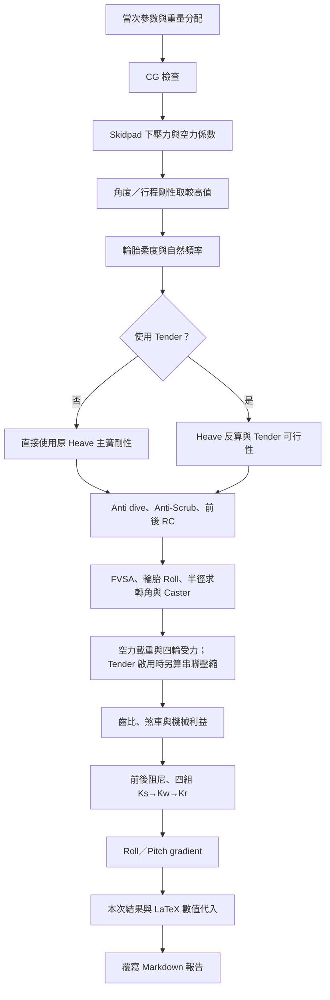

# 車輛初步設計估算報告

產生時間：2026-10-29T21:12:15+08:00（Asia/Taipei）。本報告由 `vehicle_initial_sizing.py` 本次執行結果自動產生。

修改腳本開頭的車重、幾何或其他參數後重新執行，整份報告的參數、數值代入與結果會重新生成。手動編輯本報告的內容會在下次執行時被覆寫。公式內角度使用 rad，度數另行換算；計算保留原始精度，報告數字顯示最多 12 位有效數字。

## 計算流程



## 0. 本次輸入、質量與幾何

| 參數 | 本次值 | 單位／定義 |
| --- | --- | --- |
| use_tender | 是 | 是否使用 Tender 彈簧 |
| ms | 260.55 | kg（全車簧上） |
| mu | 14.4 | kg（單輪簧下） |
| h_cog | 0.3 | m |
| lf | 0.765 | m |
| lr | 0.765 | m |
| ax | 2 | g |
| ay | 2.2 | g |
| a_acc | 1.2 | g |
| brake_ax | 2 | g |
| target_lap_time_s | 5 | s |
| drive_target_speed_kmh | 110 | km/h |
| sus_travel | 0.025 | m |
| tf | 1.25 | m |
| tr | 1.24 | m |
| t | 1.25 | m |
| A_air | 1 | m² |
| air_density_kg_per_m3 | 1.225 | kg/m³ |
| kf | 0.55 | 比例／無因次 |
| kr | 0.45 | 比例／無因次 |
| target_pitch_angle_deg | 1 | deg |
| target_roll_angle_deg | 2 | deg |
| kpi_deg | 8 | deg |
| min_turn_radius_m | 3 | m |
| caster_direction_check_deg | 10 | deg |
| MR | 1 | 無因次 |
| sprung_roll_inertia_kg_m2 | 7.91782004473 | kg·m² |
| Kt | 80000 | N/m（單輪） |
| wl_mu_y | 1.81526957993 | 比例／無因次 |
| mu_w | 1.60465645757 | 比例／無因次 |
| R_tire | 0.2 | m |
| drive_motor_torque_Nm | 22.30565254 | N·m |
| drive_motor_rpm | 15000 | rpm |
| N | 5 | 比例／無因次 |
| rc_chassis_stiffness_ratio | 10 | 比例／無因次 |
| F_ref_ratio | 1 | 比例／無因次 |
| wl_aero_front_ratio | 0.5 | 比例／無因次 |
| cg_safety_factor | 1 | 比例／無因次 |
| brake_driver_force_N | 500 | N |
| g | 9.81 | m/s² |
| L | 1.53 | m |
| wf | 0.5 | 比例／無因次 |
| wr | 0.5 | 比例／無因次 |
| steering_angle_deg | 27.0215815912 | deg（由半徑導出） |
| active_heave_spring_N_per_m | 48311.0003349 | N/m（本次採用的 Heave 剛性） |

$$
L=l_f+l_r
$$

$$
L=0.765+0.765=1.53\ \mathrm{m}
$$

$$
w_f=\frac{l_r}{L},\quad w_r=\frac{l_f}{L}
$$

$$
w_f=\frac{0.765}{1.53}=0.5,\quad w_r=\frac{0.765}{1.53}=0.5
$$

$$
M=M_s+4m_u
$$

$$
M=260.55+4\cdot14.4=318.15\ \mathrm{kg}
$$

$$
m_{s,q}=\frac{M_s}{4}
$$

$$
m_{s,q}=\frac{260.55}{4}=65.1375\ \mathrm{kg}
$$

## 1. CG：重心高度與傾斜幾何檢查

$$
h_{\max}=\frac{\min(t_f,t_r)}{2S_F\tan\beta},\quad \mathrm{margin}=h_{\max}-h
$$

$$
\beta=45^\circ
$$

$$
h_{\max}=\frac{1.24}{2\cdot1\cdot\tan(0.785398163397)}=0.62\ \mathrm{m}
$$

$$
\mathrm{margin}=h_{\max}-h
$$

$$
\mathrm{margin}=0.62-0.3=0.32\ \mathrm{m}
$$

45° 判定：**通過幾何檢查**。

$$
\beta=60^\circ
$$

$$
h_{\max}=\frac{1.24}{2\cdot1\cdot\tan(1.0471975512)}=0.357957166898\ \mathrm{m}
$$

$$
\mathrm{margin}=h_{\max}-h
$$

$$
\mathrm{margin}=0.357957166898-0.3=0.0579571668976\ \mathrm{m}
$$

60° 判定：**通過幾何檢查**。

這是左右對稱、無懸吊變形的幾何檢查。

## 2. Skidpad：目標圈速與所需下壓力

$$
R_{\mathrm{skid}}=\frac{D}{2},\quad v=\frac{\pi D}{T}
$$

$$
R_{\mathrm{skid}}=\frac{18.25}{2}=9.125\ \mathrm{m},\quad v=\frac{\pi\cdot18.25}{5}=11.4668131856\ \mathrm{m/s}
$$

$$
a_y=\frac{v^2}{R_{\mathrm{skid}}},\quad \mu_{\mathrm{req}}=\eta\frac{a_y}{g}
$$

$$
a_y=\frac{11.4668131856^2}{9.125}=14.4096224256\ \mathrm{m/s^2},\quad\mu_{\mathrm{req}}=1.4\frac{14.4096224256}{9.81}=2.05641910253
$$

$$
F_{\mathrm{raw}}=\left(\frac{\mu_{\mathrm{req}}}{\mu_y}-1\right)Mg
$$

$$
F_{\mathrm{raw}}=\left(\frac{2.05641910253}{1.81526957993}-1\right)\cdot318.15\cdot9.81=414.616147129\ \mathrm{N}
$$

$$
F_{\mathrm{down}}=\max(0,F_{\mathrm{raw}})
$$

$$
F_{\mathrm{down}}=\max(0,414.616147129)=414.616147129\ \mathrm{N}
$$

## 2.4 空力有效面積與目標係數

$$
F=C\rho Av^2,\qquad C=\frac{F}{\rho Av^2}
$$

$$
C=\frac{414.616147129}{1.225\cdot1\cdot11.4668131856^2}=2.57409545977
$$

$$
F=\frac{1}{2} Cl\rho Av^2,\qquad Cl=2C
$$

$$
Cl=2\cdot2.57409545977=5.14819091953
$$

係數以下壓力為正；C 採指定公式，Cl 對照原 Aero_Cl_Cd 定義。完整需求不乘下壓力施加比例。

## 3. 指定 Pitch／Roll 角度所需剛性

$$
s=\frac{\ell}{2}\theta,\quad \mathcal{M}=M_s|a_g|gh,\quad K=\frac{\mathcal{M}}{\ell s}
$$

### Pitch

$$
s=\frac{\ell}{2}\theta
$$

$$
s=\frac{1.53}{2}\cdot0.0174532925199=0.0133517687778\ \mathrm{m}
$$

$$
K=\frac{M_s|a_g|gh}{\ell s}
$$

$$
K=\frac{260.55\cdot2\cdot9.81\cdot0.3}{1.53\cdot0.0133517687778}=75072.5385644\ \mathrm{N/m}
$$

### Roll

$$
s=\frac{\ell}{2}\theta
$$

$$
s=\frac{1.25}{2}\cdot0.0349065850399=0.0218166156499\ \mathrm{m}
$$

$$
K=\frac{M_s|a_g|gh}{\ell s}
$$

$$
K=\frac{260.55\cdot2.2\cdot9.81\cdot0.3}{1.25\cdot0.0218166156499}=61859.5315449\ \mathrm{N/m}
$$

此處 K 是原角度分析的等效需求剛性；與單支彈簧簧率不同。

## 4. Compressed travel：行程限制

### Pitch

$$
K_{\mathrm{travel}}=\frac{M_s|a_g|gh}{\ell d}
$$

$$
K_{\mathrm{travel}}=\frac{260.55\cdot2\cdot9.81\cdot0.3}{1.53\cdot0.025}=40094.0470588\ \mathrm{N/m}
$$

$$
\theta_{\mathrm{travel}}=\arctan\left(\frac{2d}{\ell}\right)\frac{180}{\pi}
$$

$$
\theta_{\mathrm{travel}}=\arctan\left(\frac{2\cdot0.025}{1.53}\right)\frac{180}{\pi}=1.87174496529^\circ
$$

### Roll

$$
K_{\mathrm{travel}}=\frac{M_s|a_g|gh}{\ell d}
$$

$$
K_{\mathrm{travel}}=\frac{260.55\cdot2.2\cdot9.81\cdot0.3}{1.25\cdot0.025}=53982.62496\ \mathrm{N/m}
$$

$$
\theta_{\mathrm{travel}}=\arctan\left(\frac{2d}{\ell}\right)\frac{180}{\pi}
$$

$$
\theta_{\mathrm{travel}}=\arctan\left(\frac{2\cdot0.025}{1.25}\right)\frac{180}{\pi}=2.29061004264^\circ
$$

## 5. Frequency vs stiffness：較高需求剛性

### Pitch

$$
K_{\mathrm{selected}}=\max(K_{\mathrm{angle}},K_{\mathrm{travel}})
$$

$$
K_{\mathrm{selected}}=\max(75072.5385644,40094.0470588)=75072.5385644\ \mathrm{N/m}
$$

$$
f_n=\frac{1}{2\pi}\sqrt{\frac{K_{\mathrm{selected}}}{M_s/2}}
$$

$$
f_n=\frac{1}{2\pi}\sqrt{\frac{75072.5385644}{260.55/2}}=3.82058742194\ \mathrm{Hz}
$$

### Roll

$$
K_{\mathrm{selected}}=\max(K_{\mathrm{angle}},K_{\mathrm{travel}})
$$

$$
K_{\mathrm{selected}}=\max(61859.5315449,53982.62496)=61859.5315449\ \mathrm{N/m}
$$

$$
f_n=\frac{1}{2\pi}\sqrt{\frac{K_{\mathrm{selected}}}{M_s/2}}
$$

$$
f_n=\frac{1}{2\pi}\sqrt{\frac{61859.5315449}{260.55/2}}=3.46811032219\ \mathrm{Hz}
$$

## 6. Tire stiffness：輪胎柔度與彈簧簧率

$$
K_w=K_sMR^2,\qquad K_r=\frac{K_wK_t}{K_w+K_t}
$$

### Pitch：使用兩條輪胎的等效剛性

$$
K_{s,j}=\frac{K_j(2K_t)}{(2K_t-K_j)MR^2}
$$

$$
K_{s,j}=\frac{75072.5385644\cdot(2\cdot80000)}{(2\cdot80000-75072.5385644)\cdot1^2}=141433.712574\ \mathrm{N/m}
$$

### Roll：使用兩條輪胎的等效剛性

$$
K_{s,j}=\frac{K_j(2K_t)}{(2K_t-K_j)MR^2}
$$

$$
K_{s,j}=\frac{61859.5315449\cdot(2\cdot80000)}{(2\cdot80000-61859.5315449)\cdot1^2}=100850.599177\ \mathrm{N/m}
$$

$$
K_{\mathrm{ride,target}}=\frac{K_p+K_{\mathrm{roll}}}{4}
$$

$$
K_{\mathrm{ride,target}}=\frac{75072.5385644+61859.5315449}{4}=34233.0175273\ \mathrm{N/m}
$$

一般 Ks 沿用原模型：20,000～80,000 N/m 之間 2,000 個等距候選，選 ride rate 誤差最小者。

$$
K_s^*=\mathrm{argmin}_{K_s}\left|\frac{K_sMR^2K_t}{K_sMR^2+K_t}-K_{\mathrm{ride,target}}\right|
$$

$$
K_s^*=59829.9149575\ \mathrm{N/m},\qquad K_{\mathrm{ride,actual}}=34230.1087579\ \mathrm{N/m}
$$

## 7. Frequency vs mass：簧上與簧下頻率

$$
K_{s,\mathrm{eq}}=\frac{K_{s,\mathrm{roll}}+K_{s,\mathrm{pitch}}}{4}
$$

$$
K_{s,\mathrm{eq}}=\frac{100850.599177+141433.712574}{4}=60571.0779376\ \mathrm{N/m}
$$

$$
K_w=K_{s,\mathrm{eq}}MR^2,\quad K_r=\frac{K_wK_t}{K_w+K_t}
$$

$$
K_w=60571.0779376\cdot1^2=60571.0779376,\quad K_r=\frac{60571.0779376\cdot80000}{60571.0779376+80000}=34471.4311514\ \mathrm{N/m}
$$

$$
f_s=\frac{1}{2\pi}\sqrt{\frac{K_r}{M_s/4}},\quad f_u=\frac{1}{2\pi}\sqrt{\frac{K_t+K_w}{m_u}}
$$

$$
f_s=\frac{1}{2\pi}\sqrt{\frac{34471.4311514}{260.55/4}}=3.66129098065\ \mathrm{Hz},\quad{}f_u=\frac{1}{2\pi}\sqrt{\frac{80000+60571.0779376}{14.4}}=15.7248630992\ \mathrm{Hz}
$$

$$
\mathrm{unsprung\ ratio}=\frac{m_u}{M_s/4+m_u}\cdot100
$$

$$
\mathrm{unsprung\ ratio}=\frac{14.4}{260.55/4+14.4}\cdot100=18.1046676096\%
$$

## 8. 固定 Roll，反算 Heave

$$
f_{\mathrm{target}}=\frac{f_{u,0}}{N}
$$

$$
f_{\mathrm{target}}=\frac{15.7248630992}{5}=3.14497261984\ \mathrm{Hz}
$$

$$
K_{r,\mathrm{target}}=(2\pi f_{\mathrm{target}})^2\frac{M_s}{4}
$$

$$
K_{r,\mathrm{target}}=(2\pi\cdot3.14497261984)^2\frac{260.55}{4}=25434.5794143\ \mathrm{N/m}
$$

$$
K_{h,\mathrm{target}}=\frac{4K_{r,\mathrm{target}}K_t}{(K_t-K_{r,\mathrm{target}})MR^2}-K_{s,\mathrm{roll}}
$$

$$
K_{h,\mathrm{target}}
$$

$$
K_{h,\mathrm{target}}=\frac{4\cdot25434.5794143\cdot80000}{(80000-25434.5794143)\cdot1^2}-100850.599177=48311.0003349\ \mathrm{N/m}
$$

$$
\lambda_h=\frac{K_{h,\mathrm{target}}}{K_{\mathrm{main}}},\quad\Delta K_h=K_{\mathrm{main}}-K_{h,\mathrm{target}}
$$

$$
\lambda_h=\frac{48311.0003349}{141433.712574}=0.341580514687,\quad\Delta K_h=141433.712574-48311.0003349=93122.7122387\ \mathrm{N/m}
$$

$$
\mathrm{reduction}=(1-\lambda_h)100
$$

$$
\mathrm{reduction}=(1-0.341580514687)\cdot100=65.8419485313\%
$$

以新 Heave 和固定 Roll 代回第 7 節的同一公式，回算頻率如下。

| 調整後簧上頻率 Hz | 調整後簧下頻率 Hz |
| --- | --- |
| 3.14497261984 | 14.3638254547 |

## 9. 主 Heave 與 Tender 串聯

$$
K_{\mathrm{series}}=\frac{K_{\mathrm{main}}K_{\mathrm{tender}}}{K_{\mathrm{main}}+K_{\mathrm{tender}}},\quad{}K_{\mathrm{tender}}=\frac{K_{\mathrm{series,target}}K_{\mathrm{main}}}{K_{\mathrm{main}}-K_{\mathrm{series,target}}}
$$

$$
K_{\mathrm{tender}}
$$

$$
K_{\mathrm{tender}}=\frac{48311.0003349\cdot141433.712574}{141433.712574-48311.0003349}=73374.1959534\ \mathrm{N/m}
$$

$$
\rho_t=\frac{K_{\mathrm{tender}}}{K_{\mathrm{main}}}
$$

$$
\rho_t=\frac{73374.1959534}{141433.712574}=0.518788587376,\quad K_{\mathrm{series}}=48311.0003349\ \mathrm{N/m}
$$

串聯剛性僅適用於 Tender 未併圈階段。

## 9.3 Anti dive 與 9.4 Anti-Scrub

$$
c=\frac{K_c}{K_s},\quad \frac{K_{\mathrm{eq}}}{K_s}=(1-a)^2+ca^2
$$

$$
\frac{d(K_{\mathrm{eq}}/K_s)}{da}=2(a-1)+2ca=0,\quad a=\frac{1}{1+c},\quad\alpha=\frac{c}{1+c}
$$

$$
a=\frac{1}{1+10}=0.0909090909091,\quad \alpha=\frac{10}{1+10}=0.909090909091
$$

$$
\left(\frac{K_{\mathrm{eq}}}{K_s}\right)_{\min}=\frac{c}{1+c}
$$

$$
\left(\frac{K_{\mathrm{eq}}}{K_s}\right)_{\min}=\frac{10}{1+10}=0.909090909091
$$

$$
\mathrm{AntiScrub}=a\frac{a_{\mathrm{acc}}}{a_x}
$$

$$
\mathrm{AntiScrub}=0.0909090909091\frac{1.2}{2}=0.0545454545455
$$

此為指定的正規化兩路模型設定；幾何硬點與實際煞車力路徑不在此求解。

## 10. 前 Roll Center 與 11. 後 Roll Center

$$
r=\frac{h_{\mathrm{RC},f}}{h}=\frac{1}{1+c},\quad h_{\mathrm{RC},f}=rh
$$

$$
h_{\mathrm{RC},f}=\frac{0.3}{1+10}=0.0272727272727\ \mathrm{m}
$$

$$
h_{\mathrm{RC},r}=h_{\mathrm{RC},f}\frac{w_f}{w_r}\frac{t_r}{t_f}\frac{k_f}{k_r}
$$

$$
h_{\mathrm{RC},r}=0.0272727272727\frac{0.5}{0.5}\frac{1.24}{1.25}\frac{0.55}{0.45}=0.0330666666667\ \mathrm{m}
$$

## 11.1 FVSA 與 Camber gain

保留指定的公尺數值公式。tan 的引數使用公尺數值約定，不能將 d 改成毫米後直接代入；deg/mm 是單位比例換算，最大 Camber 變化採指定的線性外推。

### 前軸

$$
\theta=\arctan\left(\frac{2d}{t}\right)
$$

$$
\theta=\arctan\left(\frac{2\cdot0.025}{1.25}\right)=0.0399786871233\ \mathrm{rad}=2.29061004264^\circ
$$

$$
L_{\mathrm{FVSA}}=\frac{1}{\tan(\theta/(2d))}
$$

$$
L_{\mathrm{FVSA}}=\frac{1}{\tan(0.0399786871233/(2\cdot0.025))}=0.972043272039\ \mathrm{m}
$$

$$
G_\gamma=\arctan\left(\frac{1}{L_{\mathrm{FVSA}}}\right)\frac{180}{\pi}
$$

$$
G_\gamma=\arctan\left(\frac{1}{0.972043272039}\right)\frac{180}{\pi}=45.8122008528\ \mathrm{deg/m}
$$

$$
\Delta\gamma_{\mathrm{FVSA}}=G_\gamma d
$$

$$
\Delta\gamma_{\mathrm{FVSA}}=45.8122008528\cdot0.025=1.14530502132^\circ,\quad G_\gamma=0.0458122008528\ \mathrm{deg/mm}
$$

### 後軸

$$
\theta=\arctan\left(\frac{2d}{t}\right)
$$

$$
\theta=\arctan\left(\frac{2\cdot0.025}{1.24}\right)=0.0403007483038\ \mathrm{rad}=2.30906278903^\circ
$$

$$
L_{\mathrm{FVSA}}=\frac{1}{\tan(\theta/(2d))}
$$

$$
L_{\mathrm{FVSA}}=\frac{1}{\tan(0.0403007483038/(2\cdot0.025))}=0.959593717895\ \mathrm{m}
$$

$$
G_\gamma=\arctan\left(\frac{1}{L_{\mathrm{FVSA}}}\right)\frac{180}{\pi}
$$

$$
G_\gamma=\arctan\left(\frac{1}{0.959593717895}\right)\frac{180}{\pi}=46.1812557805\ \mathrm{deg/m}
$$

$$
\Delta\gamma_{\mathrm{FVSA}}=G_\gamma d
$$

$$
\Delta\gamma_{\mathrm{FVSA}}=46.1812557805\cdot0.025=1.15453139451^\circ,\quad G_\gamma=0.0461812557805\ \mathrm{deg/mm}
$$

## 11.2 純 ay 的輪胎壓縮與額外 Roll

這是各軸獨立的兩輪模型，無 ax、無空力；各軸承載質量依前後重量比例分配。

### 前軸

$$
m_i=Mw_i,\quad F_{y,i}=m_i a_{y,g}g
$$

$$
m_i=318.15\cdot0.5=159.075\ \mathrm{kg},\quad F_{y,i}=159.075\cdot2.2\cdot9.81=3433.15665\ \mathrm{N}
$$

$$
T_i=\frac{F_{y,i}h}{t_i},\quad N_L=\frac{m_ig}{2}-T_i,\quad N_R=\frac{m_ig}{2}+T_i
$$

$$
T_i=\frac{3433.15665\cdot0.3}{1.25}=823.957596\ \mathrm{N},\quad{}N_L=\frac{159.075\cdot9.81}{2}-823.957596=-43.694721,\quad N_R=\frac{159.075\cdot9.81}{2}+823.957596=1604.220471\ \mathrm{N}
$$

$$
\delta_L=\frac{N_L}{K_t},\quad\delta_R=\frac{N_R}{K_t}
$$

$$
\delta_L=\frac{-43.694721}{80000}=-0.0005461840125\ \mathrm{m},\quad\delta_R=\frac{1604.220471}{80000}=0.0200527558875\ \mathrm{m}
$$

$$
\phi_{\mathrm{tire}}=\frac{\delta_R-\delta_L}{t_i}
$$

$$
\phi_{\mathrm{tire}}=\frac{0.0200527558875-(-0.0005461840125)}{1.25}=0.01647915192\ \mathrm{rad}=0.944185854971^\circ
$$

**接地失效：存在負輪載。** 上述負壓縮及 Roll 為線性外推參考；有效接地 Roll 為 None，不代表輪胎可承受拉力。

| 靜態單輪壓縮 m | ay 引起左側增量 m | ay 引起右側增量 m | 接地界限 g | 離地臨界 |
| --- | --- | --- | --- | --- |
| 0.0097532859375 | -0.01029946995 | 0.01029946995 | 2.08333333333 | 否 |

### 後軸

$$
m_i=Mw_i,\quad F_{y,i}=m_i a_{y,g}g
$$

$$
m_i=318.15\cdot0.5=159.075\ \mathrm{kg},\quad F_{y,i}=159.075\cdot2.2\cdot9.81=3433.15665\ \mathrm{N}
$$

$$
T_i=\frac{F_{y,i}h}{t_i},\quad N_L=\frac{m_ig}{2}-T_i,\quad N_R=\frac{m_ig}{2}+T_i
$$

$$
T_i=\frac{3433.15665\cdot0.3}{1.24}=830.602415323\ \mathrm{N},\quad{}N_L=\frac{159.075\cdot9.81}{2}-830.602415323=-50.3395403226,\quad N_R=\frac{159.075\cdot9.81}{2}+830.602415323=1610.86529032\ \mathrm{N}
$$

$$
\delta_L=\frac{N_L}{K_t},\quad\delta_R=\frac{N_R}{K_t}
$$

$$
\delta_L=\frac{-50.3395403226}{80000}=-0.000629244254032\ \mathrm{m},\quad\delta_R=\frac{1610.86529032}{80000}=0.020135816129\ \mathrm{m}
$$

$$
\phi_{\mathrm{tire}}=\frac{\delta_R-\delta_L}{t_i}
$$

$$
\phi_{\mathrm{tire}}=\frac{0.020135816129-(-0.000629244254032)}{1.24}=0.016746016438\ \mathrm{rad}=0.959476065552^\circ
$$

**接地失效：存在負輪載。** 上述負壓縮及 Roll 為線性外推參考；有效接地 Roll 為 None，不代表輪胎可承受拉力。

| 靜態單輪壓縮 m | ay 引起左側增量 m | ay 引起右側增量 m | 接地界限 g | 離地臨界 |
| --- | --- | --- | --- | --- |
| 0.0097532859375 | -0.0103825301915 | 0.0103825301915 | 2.06666666667 | 否 |

## 11.3 最小半徑轉角、方向查核與 Caster

$$
R=\frac{L}{\tan\delta},\quad \delta_{\max}=\arctan\left(\frac{L}{R_{\min}}\right)
$$

$$
\delta_{\max}=\arctan\left(\frac{1.53}{3}\right)=0.471615567862\ \mathrm{rad}=27.0215815912^\circ
$$

單軌等效前輪角取已確認的正方向。方向查核只列印比較，不修改設定；整式的座標負號固定為 −1。

| 方向驗證 Caster deg | 轉向角 deg | 原式 Camber 變化 deg |
| --- | --- | --- |
| 10 | 27.0215815912 | 3.82176691323 |
| 10 | -27.0215815912 | -5.56272988874 |

$$
\gamma_b=\phi_{\mathrm{roll}}+\phi_{\mathrm{tire}}-\Delta\gamma_{\mathrm{FVSA}}
$$

$$
\gamma_b=2.29061004264+0.944185854971-1.14530502132=2.08949087629^\circ
$$

$$
\Delta\gamma_{\mathrm{raw}}=\delta\sin C-(1-\cos\delta)\sin K,\quad{}\Delta\gamma_{\mathrm{applied}}=-\Delta\gamma_{\mathrm{raw}}
$$

$$
\sin C=\frac{\gamma_b+(1-\cos\delta)\sin K}{\delta}
$$

$$
C=\arcsin\left(\frac{\gamma_b+(1-\cos\delta)\sin K}{\delta}\right)
$$

$$
C=\arcsin\left(\frac{0.0364684954816+(1-\cos(0.471615567862))\sin(0.13962634016)}{0.471615567862}\right)=0.109761307578\ \mathrm{rad}=6.28885967803^\circ
$$

$$
\gamma_{\mathrm{final}}=\gamma_b-\Delta\gamma_{\mathrm{raw}}
$$

$$
\gamma_{\mathrm{final}}=2.08949087629-(2.08949087629)=0^\circ
$$

**Caster 算式有實數解，接地模型失效。** 本節 Camber 與 Caster 僅為線性外推參考。

## 12. 下壓力造成的 Tender 壓縮

$$
F_{\mathrm{applied}}=F_{\mathrm{down}}\eta_F,\quad F_{\mathrm{assembly}}=\frac{F_{\mathrm{applied}}}{2}
$$

$$
F_{\mathrm{assembly}}
$$

$$
F_{\mathrm{assembly}}=\frac{414.616147129\cdot1}{2}=207.308073565\ \mathrm{N}
$$

$$
d_{\mathrm{main}}=\frac{F_{\mathrm{assembly}}}{K_{\mathrm{main}}/1000},\quad{}d_{\mathrm{tender}}=\frac{F_{\mathrm{assembly}}}{K_{\mathrm{tender}}/1000}
$$

$$
d_{\mathrm{main}}=\frac{207.308073565}{141.433712574}=1.4657613789\ \mathrm{mm},\quad{}d_{\mathrm{tender}}=\frac{207.308073565}{73.3741959534}=2.82535393909\ \mathrm{mm}
$$

$$
d_{\mathrm{total}}=d_{\mathrm{main}}+d_{\mathrm{tender}}
$$

$$
d_{\mathrm{total}}=1.4657613789+2.82535393909=4.29111531799\ \mathrm{mm}
$$

前後各一組相同彈簧，Heave 等於同一總壓縮量；零點為原平衡位置，只算空力增量。沿用 Tender 設計，此下壓力為併圈切換點，不把它當成任意工況下都已併圈。

## 13. 空力及 ax／ay 下的四輪受力

$$
D=F_{\mathrm{down}}\eta_F,\quad T_x=\frac{Ma_{x,g}gh}{L}
$$

$$
D=414.616147129\cdot1=414.616147129\ \mathrm{N},\quad T_x=\frac{318.15\cdot2\cdot9.81\cdot0.3}{1.53}=1223.94176471\ \mathrm{N}
$$

$$
N_f=Mgw_f+D\eta_a-T_x,\quad N_r=Mgw_r+D(1-\eta_a)+T_x
$$

$$
N_f=318.15\cdot9.81\cdot0.5+414.616147129\cdot0.5-(1223.94176471)=543.892058859\ \mathrm{N}
$$

$$
N_r=Mgw_r+D(1-\eta_a)+T_x
$$

$$
N_r=318.15\cdot9.81\cdot0.5+414.616147129(1-0.5)+(1223.94176471)=2991.77558827\ \mathrm{N}
$$

$$
K_{\phi f}=K_{s,\mathrm{roll}}(MRt_f)^2,\quad{}K_{\phi r}=K_{s,\mathrm{roll}}\frac{k_r}{k_f}(MRt_r)^2
$$

$$
\beta_f=\frac{K_{\phi f}}{K_{\phi f}+K_{\phi r}}
$$

$$
\beta_f=\frac{157579.061214}{157579.061214+126873.721059}=0.553972648658
$$

$$
T_f=\frac{\beta_f Ma_{y,g}gh}{t_f},\quad T_r=\frac{(1-\beta_f)Ma_{y,g}gh}{t_r}
$$

$$
T_f=\frac{0.553972648658\cdot318.15\cdot2.2\cdot9.81\cdot0.3}{1.25}=912.899943676,\quad{}T_r=\frac{(1-0.553972648658)\cdot318.15\cdot2.2\cdot9.81\cdot0.3}{1.24}=740.942790649\ \mathrm{N}
$$

$$
N_{FL}=\frac{N_f}{2}-T_f,\quad N_{FR}=\frac{N_f}{2}+T_f,\quad{}N_{RL}=\frac{N_r}{2}-T_r,\quad N_{RR}=\frac{N_r}{2}+T_r
$$

$$
N_{FL}
$$

$$
N=\frac{543.892058859}{2}+(-1)\cdot(912.899943676)=-640.953914247\ \mathrm{N}
$$

$$
N_{FR}
$$

$$
N=\frac{543.892058859}{2}+(1)\cdot(912.899943676)=1184.84597311\ \mathrm{N}
$$

$$
N_{RL}
$$

$$
N=\frac{2991.77558827}{2}+(-1)\cdot(740.942790649)=754.945003486\ \mathrm{N}
$$

$$
N_{RR}
$$

$$
N=\frac{2991.77558827}{2}+(1)\cdot(740.942790649)=2236.83058478\ \mathrm{N}
$$

$$
F_{x,\mathrm{total}}=Ma_{x,g}g,\quad F_{y,\mathrm{total}}=Ma_{y,g}g
$$

$$
F_{x,\mathrm{total}}=318.15\cdot2\cdot9.81=6242.103,\quad{}F_{y,\mathrm{total}}=318.15\cdot2.2\cdot9.81=6866.3133\ \mathrm{N}
$$

$$
N_i^+=\max(0,N_i),\quad q_i=\frac{N_i^+}{\sum_jN_j^+},\quad{}F_{x,i}=q_iF_{x,\mathrm{total}},\quad F_{y,i}=q_iF_{y,\mathrm{total}}
$$

**接地失效，以下三向需求力為參考。** 原始負輪載保留；截零後的總正向力與原始垂向力平衡不同。

| 輪位 | 原始 Fz N | 分配後 Fx N | 分配後 Fy N | 截零 Fz N | 合力 N | 載重占比 |
| --- | --- | --- | --- | --- | --- | --- |
| FL | -640.953914247 | 0 | 0 | 0 | 0 | 0 |
| FR | 1184.84597311 | 1770.79261182 | 1947.871873 | 1184.84597311 | 2886.82720087 | 0.283685259891 |
| RL | 754.945003486 | 1128.29098874 | 1241.12008762 | 754.945003486 | 1839.39163461 | 0.180754945688 |
| RR | 2236.83058478 | 3343.01939943 | 3677.32133938 | 2236.83058478 | 5449.94330274 | 0.535559794421 |

$$
F_{FL}=\sqrt{F_x^2+F_y^2+F_z^2}
$$

$$
F=\sqrt{(0)^2+(0)^2+(0)^2}=0\ \mathrm{N}
$$

$$
F_{FR}=\sqrt{F_x^2+F_y^2+F_z^2}
$$

$$
F=\sqrt{(1770.79261182)^2+(1947.871873)^2+(1184.84597311)^2}=2886.82720087\ \mathrm{N}
$$

$$
F_{RL}=\sqrt{F_x^2+F_y^2+F_z^2}
$$

$$
F=\sqrt{(1128.29098874)^2+(1241.12008762)^2+(754.945003486)^2}=1839.39163461\ \mathrm{N}
$$

$$
F_{RR}=\sqrt{F_x^2+F_y^2+F_z^2}
$$

$$
F=\sqrt{(3343.01939943)^2+(3677.32133938)^2+(2236.83058478)^2}=5449.94330274\ \mathrm{N}
$$

最大參考合力輪位：**RR**。

## 14. 無空力加速與極速齒比

工況為 ax = a_acc、ay = 0、下壓力 = 0；前後軸按輪載分配需求力，每軸兩輪、每輪一顆馬達。

$$
T_x=\frac{Ma_{\mathrm{acc}}gh}{L},\quad N_f=Mgw_f-T_x,\quad N_r=Mgw_r+T_x
$$

$$
T_x=\frac{318.15\cdot1.2\cdot9.81\cdot0.3}{1.53}=734.365058824,\quad{}N_f=318.15\cdot9.81\cdot0.5-734.365058824=826.160691176,\quad N_r=318.15\cdot9.81\cdot0.5+734.365058824=2294.89080882\ \mathrm{N}
$$

$$
F_{x,f}=Ma_{\mathrm{acc}}g\frac{N_f}{Mg},\quad F_{x,r}=Ma_{\mathrm{acc}}g\frac{N_r}{Mg}
$$

$$
F_{x,f}=1.2\cdot826.160691176=991.392829412,\quad F_{x,r}=1.2\cdot2294.89080882=2753.86897059\ \mathrm{N}
$$

$$
T_w=\frac{\max(F_{x,f},F_{x,r})}{2}R_t,\quad i_{\mathrm{acc}}=\frac{T_w}{T_{\mathrm{motor}}}
$$

$$
T_w=\frac{\max(991.392829412,2753.86897059)}{2}\cdot0.2=275.386897059\ \mathrm{Nm},\quad{}i_{\mathrm{acc}}=\frac{275.386897059}{22.30565254}=12.3460587654
$$

$$
n_w=\frac{v_{\mathrm{km/h}}/3.6}{2\pi R_t}60,\quad i_{\mathrm{speed}}=\frac{n_{\mathrm{motor}}}{n_w}
$$

$$
n_w=\frac{110/3.6}{2\pi\cdot0.2}60=1458.92031168\ \mathrm{rpm},\quad{}i_{\mathrm{speed}}=\frac{15000}{1458.92031168}=10.2815759572
$$

$$
i_{\mathrm{avg}}=\frac{i_{\mathrm{acc}}+i_{\mathrm{speed}}}{2}
$$

$$
i_{\mathrm{avg}}=\frac{12.3460587654+10.2815759572}{2}=11.3138173613
$$

## 15. 無空力煞車力、前後比與回歸

z 是正的煞車減速度 g 倍數，車身 ax = −z。指定需求與輪胎摩擦可達性分開列出。

$$
T_b=\frac{Mgzh}{L},\quad N_f=Mgw_f+T_b,\quad N_r=Mgw_r-T_b,\quad B_f=zN_f,\quad B_r=zN_r
$$

### 指定工況

$$
T_b=\frac{Mgzh}{L}
$$

$$
T_b=\frac{318.15\cdot9.81\cdot2\cdot0.3}{1.53}=1223.94176471\ \mathrm{N}
$$

$$
N_f=Mgw_f+T_b,\quad N_r=Mgw_r-T_b
$$

$$
N_f=318.15\cdot9.81\cdot0.5+1223.94176471=2784.46751471,\quad N_r=318.15\cdot9.81\cdot0.5-1223.94176471=336.583985294\ \mathrm{N}
$$

$$
B_f=zN_f,\quad B_r=zN_r
$$

$$
B_f=2\cdot2784.46751471=5568.93502941,\quad B_r=2\cdot336.583985294=673.167970588\ \mathrm{N}
$$

$$
\beta_f=\frac{N_f}{Mg},\quad\beta_r=\frac{N_r}{Mg}
$$

$$
\beta_f=\frac{2784.46751471}{318.15\cdot9.81}=0.892156862745,\quad\beta_r=\frac{336.583985294}{318.15\cdot9.81}=0.107843137255
$$

### 可達設計上限

$$
T_b=\frac{Mgzh}{L}
$$

$$
T_b=\frac{318.15\cdot9.81\cdot1.60465645757\cdot0.3}{1.53}=982.00302821\ \mathrm{N}
$$

$$
N_f=Mgw_f+T_b,\quad N_r=Mgw_r-T_b
$$

$$
N_f=318.15\cdot9.81\cdot0.5+982.00302821=2542.52877821,\quad N_r=318.15\cdot9.81\cdot0.5-982.00302821=578.52272179\ \mathrm{N}
$$

$$
B_f=zN_f,\quad B_r=zN_r
$$

$$
B_f=1.60465645757\cdot2542.52877821=4079.8852225,\quad B_r=1.60465645757\cdot578.52272179=928.330221369\ \mathrm{N}
$$

$$
\beta_f=\frac{N_f}{Mg},\quad\beta_r=\frac{N_r}{Mg}
$$

$$
\beta_f=\frac{2542.52877821}{318.15\cdot9.81}=0.814638521091,\quad\beta_r=\frac{578.52272179}{318.15\cdot9.81}=0.185361478909
$$

$$
z_{\mathrm{lift}}=\frac{l_f}{h},\quad z_{\mathrm{physical}}=\min(\mu_x,z_{\mathrm{lift}}),\quad{}z_{\mathrm{design}}=\min(z_{\mathrm{requested}},z_{\mathrm{physical}})
$$

$$
z_{\mathrm{lift}}=2.55,\quad z_{\mathrm{physical}}=\min(1.60465645757,2.55)=1.60465645757,\quad{}z_{\mathrm{design}}=\min(2,1.60465645757)=1.60465645757
$$

指定減速度可達：**否**。

### 十點通過原點的最小平方擬合

| 減速度 g | 前煞車力 N | 後煞車力 N | 前比 | 後比 |
| --- | --- | --- | --- | --- |
| 0.1 | 162.172283824 | 149.932866176 | 0.519607843137 | 0.480392156863 |
| 0.267184050841 | 460.634550714 | 373.260631938 | 0.552389029577 | 0.447610970423 |
| 0.434368101681 | 793.30661029 | 562.378605015 | 0.585170216016 | 0.414829783984 |
| 0.601552152522 | 1160.18846255 | 717.286785407 | 0.617951402455 | 0.382048597545 |
| 0.768736203363 | 1561.2801075 | 837.985173113 | 0.650732588895 | 0.349267411105 |
| 0.935920254204 | 1996.58154513 | 924.473768135 | 0.683513775334 | 0.316486224666 |
| 1.10310430504 | 2466.09277544 | 976.752570471 | 0.716294961773 | 0.283705038227 |
| 1.27028835588 | 2969.81379845 | 994.821580122 | 0.749076148213 | 0.250923851787 |
| 1.43747240673 | 3507.74461413 | 978.680797088 | 0.781857334652 | 0.218142665348 |
| 1.60465645757 | 4079.8852225 | 928.330221369 | 0.814638521091 | 0.185361478909 |

$$
k=\frac{\sum B_fB_r}{\sum B_f^2},\quad\beta_{f,\mathrm{fit}}=\frac{1}{1+k},\quad\beta_{r,\mathrm{fit}}=1-\beta_{f,\mathrm{fit}}
$$

$$
k=\frac{17212335.4218}{52488933.4072}=0.327923131687,\quad\beta_{f,\mathrm{fit}}=\frac{1}{1+0.327923131687}=0.753055637136,\quad\beta_{r,\mathrm{fit}}=1-0.753055637136=0.246944362864
$$

## 16. 煞車機構整體等效機械利益

$$
MA=\frac{B_f+B_r}{F_{\mathrm{foot}}}
$$

$$
MA=\frac{5568.93502941+673.167970588}{500}=\frac{6242.103}{500}=12.484206
$$

此倍率是腳力至四輪接地總煞車力的整體等效值；硬體槓桿、液壓與制動半徑仍需另行分配。

## 17. Roll、Heave + Tender 與純 Heave 的前後臨界阻尼

每軸各一支 Roll 和 Heave 阻尼器；彈簧與阻尼器共用 MR。此節採固定輪端的單自由度參考。

$$
c_{\mathrm{crit}}=2\sqrt{km},\quad \zeta=\frac{c}{2\sqrt{km}}=1
$$

$$
K_\phi=K_{\phi f}+K_{\phi r},\quad C_{\phi,\mathrm{crit}}=2\sqrt{K_\phi I_{xx,s}}
$$

$$
K_\phi=157579.061214+126873.721059=284452.782273\ \mathrm{Nm/rad},\quad C_{\phi,\mathrm{crit}}=2\sqrt{284452.782273\cdot7.91782004473}=3001.49692071\ \mathrm{Nm\,s/rad}
$$

Ixx 為手動指定的簧上 CG 慣量；修改車體質量分布時需同步更新此輸入，質量改動不會自動推估新的慣量。

### 前軸 Roll

$$
K_{\phi i}=K_{s,i}(MRt_i)^2
$$

$$
K_{\phi i}=100850.599177(1\cdot1.25)^2=157579.061214\ \mathrm{Nm/rad}
$$

$$
C_{\phi i}=C_{\phi,\mathrm{crit}}\frac{K_{\phi i}}{K_\phi},\quad{}c_{\mathrm{damper},i}=\frac{C_{\phi i}}{(MRt_i)^2}
$$

$$
C_{\phi i}=3001.49692071\frac{157579.061214}{284452.782273}=1662.7471991,\quad{}c_{\mathrm{damper},i}=\frac{1662.7471991}{(1\cdot1.25)^2}=1064.15820743\ \mathrm{N\,s/m}
$$

### 後軸 Roll

$$
K_{\phi i}=K_{s,i}(MRt_i)^2
$$

$$
K_{\phi i}=82514.1265992(1\cdot1.24)^2=126873.721059\ \mathrm{Nm/rad}
$$

$$
C_{\phi i}=C_{\phi,\mathrm{crit}}\frac{K_{\phi i}}{K_\phi},\quad{}c_{\mathrm{damper},i}=\frac{C_{\phi i}}{(MRt_i)^2}
$$

$$
C_{\phi i}=3001.49692071\frac{126873.721059}{284452.782273}=1338.74972161,\quad{}c_{\mathrm{damper},i}=\frac{1338.74972161}{(1\cdot1.24)^2}=870.674896986\ \mathrm{N\,s/m}
$$

### Heave + Tender

前軸

$$
m_i=M_sw_i,\quad K_{z,i}=K_{s,i}MR^2
$$

$$
m_i=260.55\cdot0.5=130.275\ \mathrm{kg},\quad K_{z,i}=48311.0003349\cdot1^2=48311.0003349\ \mathrm{N/m}
$$

$$
c_{z,i}=2\sqrt{K_{z,i}m_i},\quad c_{d,i}=\frac{c_{z,i}}{MR^2}
$$

$$
c_{z,i}=2\sqrt{48311.0003349\cdot130.275}=5017.45575711,\quad c_{d,i}=\frac{5017.45575711}{1^2}=5017.45575711\ \mathrm{N\,s/m}
$$

後軸

$$
m_i=M_sw_i,\quad K_{z,i}=K_{s,i}MR^2
$$

$$
m_i=260.55\cdot0.5=130.275\ \mathrm{kg},\quad K_{z,i}=48311.0003349\cdot1^2=48311.0003349\ \mathrm{N/m}
$$

$$
c_{z,i}=2\sqrt{K_{z,i}m_i},\quad c_{d,i}=\frac{c_{z,i}}{MR^2}
$$

$$
c_{z,i}=2\sqrt{48311.0003349\cdot130.275}=5017.45575711,\quad c_{d,i}=\frac{5017.45575711}{1^2}=5017.45575711\ \mathrm{N\,s/m}
$$

### 純 Heave

前軸

$$
m_i=M_sw_i,\quad K_{z,i}=K_{s,i}MR^2
$$

$$
m_i=260.55\cdot0.5=130.275\ \mathrm{kg},\quad K_{z,i}=141433.712574\cdot1^2=141433.712574\ \mathrm{N/m}
$$

$$
c_{z,i}=2\sqrt{K_{z,i}m_i},\quad c_{d,i}=\frac{c_{z,i}}{MR^2}
$$

$$
c_{z,i}=2\sqrt{141433.712574\cdot130.275}=8584.93492242,\quad c_{d,i}=\frac{8584.93492242}{1^2}=8584.93492242\ \mathrm{N\,s/m}
$$

後軸

$$
m_i=M_sw_i,\quad K_{z,i}=K_{s,i}MR^2
$$

$$
m_i=260.55\cdot0.5=130.275\ \mathrm{kg},\quad K_{z,i}=141433.712574\cdot1^2=141433.712574\ \mathrm{N/m}
$$

$$
c_{z,i}=2\sqrt{K_{z,i}m_i},\quad c_{d,i}=\frac{c_{z,i}}{MR^2}
$$

$$
c_{z,i}=2\sqrt{141433.712574\cdot130.275}=8584.93492242,\quad c_{d,i}=\frac{8584.93492242}{1^2}=8584.93492242\ \mathrm{N\,s/m}
$$

## 18. 四種指定 Ks：前後 Ks → Kw → Kr、自然頻率及臨界阻尼

$$
K_s^{(1)}=\frac{K_{ht}+K_{\mathrm{roll}}}{2},\quad K_s^{(2)}=K_{ht},\quad{}K_s^{(3)}=K_{\mathrm{roll}},\quad K_s^{(4)}=K_{\mathrm{heaveonly}}
$$

Kht 為 Heave 與 Tender 的串聯值。

本節依指定除以 2，各 Ks 作單輪線性等效比較；第 7 節原 Frequency vs mass 的除以 4 模式仍另行保留。

$$
m_w=\frac{M_sw_i}{2},\quad m_{s,\mathrm{coord}}=\frac{m_w}{MR^2},\quad{}K_w=K_sMR^2,\quad K_r=\frac{K_wK_t}{K_w+K_t}
$$

$$
f_{Ks}=\frac{1}{2\pi}\sqrt{\frac{K_s}{m_{s,\mathrm{coord}}}},\quad{}f_{Kw}=\frac{1}{2\pi}\sqrt{\frac{K_w}{m_w}},\quad f_{Kr}=\frac{1}{2\pi}\sqrt{\frac{K_r}{m_w}}
$$

$$
c_{Ks}=2\sqrt{K_sm_{s,\mathrm{coord}}},\quad c_{Kw}=2\sqrt{K_wm_w},\quad c_{Kr}=2\sqrt{K_rm_w}
$$

### 前軸：(Kht + Kroll)/2

$$
K_s=\frac{K_{ht}+K_{\mathrm{roll}}}{2}
$$

$$
K_s=\frac{48311.0003349+100850.599177}{2}=74580.7997559\ \mathrm{N/m}
$$

$$
m_w=\frac{M_sw_i}{2},\quad m_{s,\mathrm{coord}}=\frac{m_w}{MR^2}
$$

$$
m_w=\frac{260.55\cdot0.5}{2}=65.1375,\quad{}m_{s,\mathrm{coord}}=\frac{65.1375}{1^2}=65.1375\ \mathrm{kg}
$$

$$
K_w=K_sMR^2,\quad K_r=\frac{K_wK_t}{K_w+K_t}
$$

$$
K_w=74580.7997559\cdot1^2=74580.7997559,\quad K_r=\frac{74580.7997559\cdot80000}{74580.7997559+80000}=38597.7041773\ \mathrm{N/m}
$$

$$
f_{Ks}=\frac{1}{2\pi}\sqrt{\frac{K}{m}},\quad c_{Ks}=2\sqrt{Km}
$$

$$
f=\frac{1}{2\pi}\sqrt{\frac{74580.7997559}{65.1375}}=5.38540174371\ \mathrm{Hz},\quad{}c=2\sqrt{74580.7997559\cdot65.1375}=4408.17733042\ \mathrm{N\,s/m}
$$

$$
f_{Kw}=\frac{1}{2\pi}\sqrt{\frac{K}{m}},\quad c_{Kw}=2\sqrt{Km}
$$

$$
f=\frac{1}{2\pi}\sqrt{\frac{74580.7997559}{65.1375}}=5.38540174371\ \mathrm{Hz},\quad{}c=2\sqrt{74580.7997559\cdot65.1375}=4408.17733042\ \mathrm{N\,s/m}
$$

$$
f_{Kr}=\frac{1}{2\pi}\sqrt{\frac{K}{m}},\quad c_{Kr}=2\sqrt{Km}
$$

$$
f=\frac{1}{2\pi}\sqrt{\frac{38597.7041773}{65.1375}}=3.87422933478\ \mathrm{Hz},\quad{}c=2\sqrt{38597.7041773\cdot65.1375}=3171.21929601\ \mathrm{N\,s/m}
$$

### 前軸：Kht

$$
K_s
$$

$$
K_s=48311.0003349\ \mathrm{N/m}
$$

$$
m_w=\frac{M_sw_i}{2},\quad m_{s,\mathrm{coord}}=\frac{m_w}{MR^2}
$$

$$
m_w=\frac{260.55\cdot0.5}{2}=65.1375,\quad{}m_{s,\mathrm{coord}}=\frac{65.1375}{1^2}=65.1375\ \mathrm{kg}
$$

$$
K_w=K_sMR^2,\quad K_r=\frac{K_wK_t}{K_w+K_t}
$$

$$
K_w=48311.0003349\cdot1^2=48311.0003349,\quad K_r=\frac{48311.0003349\cdot80000}{48311.0003349+80000}=30121.1900516\ \mathrm{N/m}
$$

$$
f_{Ks}=\frac{1}{2\pi}\sqrt{\frac{K}{m}},\quad c_{Ks}=2\sqrt{Km}
$$

$$
f=\frac{1}{2\pi}\sqrt{\frac{48311.0003349}{65.1375}}=4.33438618664\ \mathrm{Hz},\quad{}c=2\sqrt{48311.0003349\cdot65.1375}=3547.87699015\ \mathrm{N\,s/m}
$$

$$
f_{Kw}=\frac{1}{2\pi}\sqrt{\frac{K}{m}},\quad c_{Kw}=2\sqrt{Km}
$$

$$
f=\frac{1}{2\pi}\sqrt{\frac{48311.0003349}{65.1375}}=4.33438618664\ \mathrm{Hz},\quad{}c=2\sqrt{48311.0003349\cdot65.1375}=3547.87699015\ \mathrm{N\,s/m}
$$

$$
f_{Kr}=\frac{1}{2\pi}\sqrt{\frac{K}{m}},\quad c_{Kr}=2\sqrt{Km}
$$

$$
f=\frac{1}{2\pi}\sqrt{\frac{30121.1900516}{65.1375}}=3.42247789425\ \mathrm{Hz},\quad{}c=2\sqrt{30121.1900516\cdot65.1375}=2801.44178378\ \mathrm{N\,s/m}
$$

### 前軸：Kroll

$$
K_s
$$

$$
K_s=100850.599177\ \mathrm{N/m}
$$

$$
m_w=\frac{M_sw_i}{2},\quad m_{s,\mathrm{coord}}=\frac{m_w}{MR^2}
$$

$$
m_w=\frac{260.55\cdot0.5}{2}=65.1375,\quad{}m_{s,\mathrm{coord}}=\frac{65.1375}{1^2}=65.1375\ \mathrm{kg}
$$

$$
K_w=K_sMR^2,\quad K_r=\frac{K_wK_t}{K_w+K_t}
$$

$$
K_w=100850.599177\cdot1^2=100850.599177,\quad K_r=\frac{100850.599177\cdot80000}{100850.599177+80000}=44611.6737841\ \mathrm{N/m}
$$

$$
f_{Ks}=\frac{1}{2\pi}\sqrt{\frac{K}{m}},\quad c_{Ks}=2\sqrt{Km}
$$

$$
f=\frac{1}{2\pi}\sqrt{\frac{100850.599177}{65.1375}}=6.26244363386\ \mathrm{Hz},\quad{}c=2\sqrt{100850.599177\cdot65.1375}=5126.07292335\ \mathrm{N\,s/m}
$$

$$
f_{Kw}=\frac{1}{2\pi}\sqrt{\frac{K}{m}},\quad c_{Kw}=2\sqrt{Km}
$$

$$
f=\frac{1}{2\pi}\sqrt{\frac{100850.599177}{65.1375}}=6.26244363386\ \mathrm{Hz},\quad{}c=2\sqrt{100850.599177\cdot65.1375}=5126.07292335\ \mathrm{N\,s/m}
$$

$$
f_{Kr}=\frac{1}{2\pi}\sqrt{\frac{K}{m}},\quad c_{Kr}=2\sqrt{Km}
$$

$$
f=\frac{1}{2\pi}\sqrt{\frac{44611.6737841}{65.1375}}=4.16513274797\ \mathrm{Hz},\quad{}c=2\sqrt{44611.6737841\cdot65.1375}=3409.33594773\ \mathrm{N\,s/m}
$$

### 前軸：Kheaveonly

$$
K_s
$$

$$
K_s=141433.712574\ \mathrm{N/m}
$$

$$
m_w=\frac{M_sw_i}{2},\quad m_{s,\mathrm{coord}}=\frac{m_w}{MR^2}
$$

$$
m_w=\frac{260.55\cdot0.5}{2}=65.1375,\quad{}m_{s,\mathrm{coord}}=\frac{65.1375}{1^2}=65.1375\ \mathrm{kg}
$$

$$
K_w=K_sMR^2,\quad K_r=\frac{K_wK_t}{K_w+K_t}
$$

$$
K_w=141433.712574\cdot1^2=141433.712574,\quad K_r=\frac{141433.712574\cdot80000}{141433.712574+80000}=51097.4452552\ \mathrm{N/m}
$$

$$
f_{Ks}=\frac{1}{2\pi}\sqrt{\frac{K}{m}},\quad c_{Ks}=2\sqrt{Km}
$$

$$
f=\frac{1}{2\pi}\sqrt{\frac{141433.712574}{65.1375}}=7.41619361332\ \mathrm{Hz},\quad{}c=2\sqrt{141433.712574\cdot65.1375}=6070.46569969\ \mathrm{N\,s/m}
$$

$$
f_{Kw}=\frac{1}{2\pi}\sqrt{\frac{K}{m}},\quad c_{Kw}=2\sqrt{Km}
$$

$$
f=\frac{1}{2\pi}\sqrt{\frac{141433.712574}{65.1375}}=7.41619361332\ \mathrm{Hz},\quad{}c=2\sqrt{141433.712574\cdot65.1375}=6070.46569969\ \mathrm{N\,s/m}
$$

$$
f_{Kr}=\frac{1}{2\pi}\sqrt{\frac{K}{m}},\quad c_{Kr}=2\sqrt{Km}
$$

$$
f=\frac{1}{2\pi}\sqrt{\frac{51097.4452552}{65.1375}}=4.45763168847\ \mathrm{Hz},\quad{}c=2\sqrt{51097.4452552\cdot65.1375}=3648.75860551\ \mathrm{N\,s/m}
$$

### 後軸：(Kht + Kroll)/2

$$
K_s=\frac{K_{ht}+K_{\mathrm{roll}}}{2}
$$

$$
K_s=\frac{48311.0003349+82514.1265992}{2}=65412.5634671\ \mathrm{N/m}
$$

$$
m_w=\frac{M_sw_i}{2},\quad m_{s,\mathrm{coord}}=\frac{m_w}{MR^2}
$$

$$
m_w=\frac{260.55\cdot0.5}{2}=65.1375,\quad{}m_{s,\mathrm{coord}}=\frac{65.1375}{1^2}=65.1375\ \mathrm{kg}
$$

$$
K_w=K_sMR^2,\quad K_r=\frac{K_wK_t}{K_w+K_t}
$$

$$
K_w=65412.5634671\cdot1^2=65412.5634671,\quad K_r=\frac{65412.5634671\cdot80000}{65412.5634671+80000}=35987.2967823\ \mathrm{N/m}
$$

$$
f_{Ks}=\frac{1}{2\pi}\sqrt{\frac{K}{m}},\quad c_{Ks}=2\sqrt{Km}
$$

$$
f=\frac{1}{2\pi}\sqrt{\frac{65412.5634671}{65.1375}}=5.04353655759\ \mathrm{Hz},\quad{}c=2\sqrt{65412.5634671\cdot65.1375}=4128.3463289\ \mathrm{N\,s/m}
$$

$$
f_{Kw}=\frac{1}{2\pi}\sqrt{\frac{K}{m}},\quad c_{Kw}=2\sqrt{Km}
$$

$$
f=\frac{1}{2\pi}\sqrt{\frac{65412.5634671}{65.1375}}=5.04353655759\ \mathrm{Hz},\quad{}c=2\sqrt{65412.5634671\cdot65.1375}=4128.3463289\ \mathrm{N\,s/m}
$$

$$
f_{Kr}=\frac{1}{2\pi}\sqrt{\frac{K}{m}},\quad c_{Kr}=2\sqrt{Km}
$$

$$
f=\frac{1}{2\pi}\sqrt{\frac{35987.2967823}{65.1375}}=3.74092672242\ \mathrm{Hz},\quad{}c=2\sqrt{35987.2967823\cdot65.1375}=3062.10551363\ \mathrm{N\,s/m}
$$

### 後軸：Kht

$$
K_s
$$

$$
K_s=48311.0003349\ \mathrm{N/m}
$$

$$
m_w=\frac{M_sw_i}{2},\quad m_{s,\mathrm{coord}}=\frac{m_w}{MR^2}
$$

$$
m_w=\frac{260.55\cdot0.5}{2}=65.1375,\quad{}m_{s,\mathrm{coord}}=\frac{65.1375}{1^2}=65.1375\ \mathrm{kg}
$$

$$
K_w=K_sMR^2,\quad K_r=\frac{K_wK_t}{K_w+K_t}
$$

$$
K_w=48311.0003349\cdot1^2=48311.0003349,\quad K_r=\frac{48311.0003349\cdot80000}{48311.0003349+80000}=30121.1900516\ \mathrm{N/m}
$$

$$
f_{Ks}=\frac{1}{2\pi}\sqrt{\frac{K}{m}},\quad c_{Ks}=2\sqrt{Km}
$$

$$
f=\frac{1}{2\pi}\sqrt{\frac{48311.0003349}{65.1375}}=4.33438618664\ \mathrm{Hz},\quad{}c=2\sqrt{48311.0003349\cdot65.1375}=3547.87699015\ \mathrm{N\,s/m}
$$

$$
f_{Kw}=\frac{1}{2\pi}\sqrt{\frac{K}{m}},\quad c_{Kw}=2\sqrt{Km}
$$

$$
f=\frac{1}{2\pi}\sqrt{\frac{48311.0003349}{65.1375}}=4.33438618664\ \mathrm{Hz},\quad{}c=2\sqrt{48311.0003349\cdot65.1375}=3547.87699015\ \mathrm{N\,s/m}
$$

$$
f_{Kr}=\frac{1}{2\pi}\sqrt{\frac{K}{m}},\quad c_{Kr}=2\sqrt{Km}
$$

$$
f=\frac{1}{2\pi}\sqrt{\frac{30121.1900516}{65.1375}}=3.42247789425\ \mathrm{Hz},\quad{}c=2\sqrt{30121.1900516\cdot65.1375}=2801.44178378\ \mathrm{N\,s/m}
$$

### 後軸：Kroll

$$
K_s
$$

$$
K_s=82514.1265992\ \mathrm{N/m}
$$

$$
m_w=\frac{M_sw_i}{2},\quad m_{s,\mathrm{coord}}=\frac{m_w}{MR^2}
$$

$$
m_w=\frac{260.55\cdot0.5}{2}=65.1375,\quad{}m_{s,\mathrm{coord}}=\frac{65.1375}{1^2}=65.1375\ \mathrm{kg}
$$

$$
K_w=K_sMR^2,\quad K_r=\frac{K_wK_t}{K_w+K_t}
$$

$$
K_w=82514.1265992\cdot1^2=82514.1265992,\quad K_r=\frac{82514.1265992\cdot80000}{82514.1265992+80000}=40618.8081373\ \mathrm{N/m}
$$

$$
f_{Ks}=\frac{1}{2\pi}\sqrt{\frac{K}{m}},\quad c_{Ks}=2\sqrt{Km}
$$

$$
f=\frac{1}{2\pi}\sqrt{\frac{82514.1265992}{65.1375}}=5.66459340116\ \mathrm{Hz},\quad{}c=2\sqrt{82514.1265992\cdot65.1375}=4636.70741857\ \mathrm{N\,s/m}
$$

$$
f_{Kw}=\frac{1}{2\pi}\sqrt{\frac{K}{m}},\quad c_{Kw}=2\sqrt{Km}
$$

$$
f=\frac{1}{2\pi}\sqrt{\frac{82514.1265992}{65.1375}}=5.66459340116\ \mathrm{Hz},\quad{}c=2\sqrt{82514.1265992\cdot65.1375}=4636.70741857\ \mathrm{N\,s/m}
$$

$$
f_{Kr}=\frac{1}{2\pi}\sqrt{\frac{K}{m}},\quad c_{Kr}=2\sqrt{Km}
$$

$$
f=\frac{1}{2\pi}\sqrt{\frac{40618.8081373}{65.1375}}=3.97436890689\ \mathrm{Hz},\quad{}c=2\sqrt{40618.8081373\cdot65.1375}=3253.18773823\ \mathrm{N\,s/m}
$$

### 後軸：Kheaveonly

$$
K_s
$$

$$
K_s=141433.712574\ \mathrm{N/m}
$$

$$
m_w=\frac{M_sw_i}{2},\quad m_{s,\mathrm{coord}}=\frac{m_w}{MR^2}
$$

$$
m_w=\frac{260.55\cdot0.5}{2}=65.1375,\quad{}m_{s,\mathrm{coord}}=\frac{65.1375}{1^2}=65.1375\ \mathrm{kg}
$$

$$
K_w=K_sMR^2,\quad K_r=\frac{K_wK_t}{K_w+K_t}
$$

$$
K_w=141433.712574\cdot1^2=141433.712574,\quad K_r=\frac{141433.712574\cdot80000}{141433.712574+80000}=51097.4452552\ \mathrm{N/m}
$$

$$
f_{Ks}=\frac{1}{2\pi}\sqrt{\frac{K}{m}},\quad c_{Ks}=2\sqrt{Km}
$$

$$
f=\frac{1}{2\pi}\sqrt{\frac{141433.712574}{65.1375}}=7.41619361332\ \mathrm{Hz},\quad{}c=2\sqrt{141433.712574\cdot65.1375}=6070.46569969\ \mathrm{N\,s/m}
$$

$$
f_{Kw}=\frac{1}{2\pi}\sqrt{\frac{K}{m}},\quad c_{Kw}=2\sqrt{Km}
$$

$$
f=\frac{1}{2\pi}\sqrt{\frac{141433.712574}{65.1375}}=7.41619361332\ \mathrm{Hz},\quad{}c=2\sqrt{141433.712574\cdot65.1375}=6070.46569969\ \mathrm{N\,s/m}
$$

$$
f_{Kr}=\frac{1}{2\pi}\sqrt{\frac{K}{m}},\quad c_{Kr}=2\sqrt{Km}
$$

$$
f=\frac{1}{2\pi}\sqrt{\frac{51097.4452552}{65.1375}}=4.45763168847\ \mathrm{Hz},\quad{}c=2\sqrt{51097.4452552\cdot65.1375}=3648.75860551\ \mathrm{N\,s/m}
$$

| 軸別 | 案例 | Ks N/m | Kw N/m | Kr N/m | fKr Hz | cKr N·s/m |
| --- | --- | --- | --- | --- | --- | --- |
| 前軸 | (Kht + Kroll)/2 | 74580.7997559 | 74580.7997559 | 38597.7041773 | 3.87422933478 | 3171.21929601 |
| 前軸 | Kht | 48311.0003349 | 48311.0003349 | 30121.1900516 | 3.42247789425 | 2801.44178378 |
| 前軸 | Kroll | 100850.599177 | 100850.599177 | 44611.6737841 | 4.16513274797 | 3409.33594773 |
| 前軸 | Kheaveonly | 141433.712574 | 141433.712574 | 51097.4452552 | 4.45763168847 | 3648.75860551 |
| 後軸 | (Kht + Kroll)/2 | 65412.5634671 | 65412.5634671 | 35987.2967823 | 3.74092672242 | 3062.10551363 |
| 後軸 | Kht | 48311.0003349 | 48311.0003349 | 30121.1900516 | 3.42247789425 | 2801.44178378 |
| 後軸 | Kroll | 82514.1265992 | 82514.1265992 | 40618.8081373 | 3.97436890689 | 3253.18773823 |
| 後軸 | Kheaveonly | 141433.712574 | 141433.712574 | 51097.4452552 | 4.45763168847 | 3648.75860551 |

fKs = fKw 是座標一致性的結果。Kr 的臨界阻尼為 ride 等效單自由度參考，不直接代表實體阻尼器係數；Kroll 案例也不是以轉動慣量求得的整車 Roll 模態頻率。

## 19. Roll 與 Pitch gradient

以整車慣性力及各固定切線剛性階段求準靜態小角度斜率，單位 deg/g；空力不增加慣性質量。

跨越 Tender 併圈點時改用相應階段，空力影響載重及所處階段。

$$
h_{\mathrm{RA}}=w_fh_{\mathrm{RC},f}+w_rh_{\mathrm{RC},r},\quad h_\phi=h-h_{\mathrm{RA}}
$$

$$
h_{\mathrm{RA}}=0.5\cdot0.0272727272727+0.5\cdot0.0330666666667=0.0301696969697\ \mathrm{m},\quad{}h_\phi=0.3-0.0301696969697=0.26983030303\ \mathrm{m}
$$

$$
K_{\phi s,i}=K_{s,i}(MRt_i)^2,\quad K_{\phi t,i}=\frac{K_tt_i^2}{2},\quad{}K_{\phi r,i}=\frac{K_{\phi s,i}K_{\phi t,i}}{K_{\phi s,i}+K_{\phi t,i}}
$$

前軸

$$
K_{\phi s,i},\quad K_{\phi t,i},\quad K_{\phi r,i}
$$

$$
K_{\phi s,i}=100850.599177(1\cdot1.25)^2=157579.061214,\quad{}K_{\phi t,i}=\frac{80000\cdot1.25^2}{2}=62500,\quad{}K_{\phi r,i}=\frac{157579.061214\cdot62500}{157579.061214+62500}=44750.6967339\ \mathrm{Nm/rad}
$$

後軸

$$
K_{\phi s,i},\quad K_{\phi t,i},\quad K_{\phi r,i}
$$

$$
K_{\phi s,i}=82514.1265992(1\cdot1.24)^2=126873.721059,\quad{}K_{\phi t,i}=\frac{80000\cdot1.24^2}{2}=61504,\quad{}K_{\phi r,i}=\frac{126873.721059\cdot61504}{126873.721059+61504}=41423.3769054\ \mathrm{Nm/rad}
$$

$$
G_{\mathrm{roll}}=\frac{Mgh_\phi}{K_{\phi,\mathrm{total}}}\frac{180}{\pi}
$$

僅懸吊

$$
G_{\mathrm{roll}}
$$

$$
G_{\mathrm{roll}}=\frac{318.15\cdot9.81\cdot0.26983030303}{284452.782273}\frac{180}{\pi}=0.169630562584\ \mathrm{deg/g}
$$

含輪胎柔度

$$
G_{\mathrm{roll}}
$$

$$
G_{\mathrm{roll}}=\frac{318.15\cdot9.81\cdot0.26983030303}{86174.0736393}\frac{180}{\pi}=0.559935064547\ \mathrm{deg/g}
$$

$$
T_{1g}=\frac{Mgh}{L},\quad{}\theta_{1g}=\frac{T_{1g}}{L}\left(\frac{1}{K_{z,f}}+\frac{1}{K_{z,r}}\right)
$$

$$
K_{\theta s}=\frac{L^2}{1/K_{z,f}+1/K_{z,r}}=\frac{K_hMR^2L^2}{2},\quad K_{\theta t}=K_tL^2
$$

$$
G_{\mathrm{pitch},s}=\frac{Mgh}{K_{\theta s}}\frac{180}{\pi},\quad{}G_{\mathrm{pitch},t}=\frac{Mgh}{K_{\theta t}}\frac{180}{\pi}
$$

$$
G_{\mathrm{pitch,total}}=G_{\mathrm{pitch},s}+G_{\mathrm{pitch},t},\quad{}G_{\mathrm{pitch,anti}}=(1-a)G_{\mathrm{pitch},s}+G_{\mathrm{pitch},t}
$$

### Pitch：Heave + Tender

$$
K_{\theta s}=\frac{K_hMR^2L^2}{2},\quad K_{\theta t}=K_tL^2
$$

$$
K_{\theta s}=\frac{48311.0003349\cdot1^2\cdot1.53^2}{2}=56545.610342,\quad{}K_{\theta t}=80000\cdot1.53^2=187272\ \mathrm{Nm/rad}
$$

$$
G_{\mathrm{pitch},s}
$$

$$
G_{\mathrm{pitch},s}=\frac{318.15\cdot9.81\cdot0.3}{56545.610342}\frac{180}{\pi}=0.948737192037\ \mathrm{deg/g}
$$

$$
G_{\mathrm{pitch},t}
$$

$$
G_{\mathrm{pitch},t}=\frac{318.15\cdot9.81\cdot0.3}{187272}\frac{180}{\pi}=0.286465267514\ \mathrm{deg/g}
$$

$$
G_{\mathrm{pitch,total}},\quad G_{\mathrm{pitch,anti}}
$$

$$
G_{\mathrm{pitch,total}}=0.948737192037+0.286465267514=1.23520245955,\quad{}G_{\mathrm{pitch,anti}}=(1-0.0909090909091)\cdot0.948737192037+0.286465267514=1.14895362391\ \mathrm{deg/g}
$$

### Pitch：純 Heave

$$
K_{\theta s}=\frac{K_hMR^2L^2}{2},\quad K_{\theta t}=K_tL^2
$$

$$
K_{\theta s}=\frac{141433.712574\cdot1^2\cdot1.53^2}{2}=165541.088882,\quad{}K_{\theta t}=80000\cdot1.53^2=187272\ \mathrm{Nm/rad}
$$

$$
G_{\mathrm{pitch},s}
$$

$$
G_{\mathrm{pitch},s}=\frac{318.15\cdot9.81\cdot0.3}{165541.088882}\frac{180}{\pi}=0.324070138358\ \mathrm{deg/g}
$$

$$
G_{\mathrm{pitch},t}
$$

$$
G_{\mathrm{pitch},t}=\frac{318.15\cdot9.81\cdot0.3}{187272}\frac{180}{\pi}=0.286465267514\ \mathrm{deg/g}
$$

$$
G_{\mathrm{pitch,total}},\quad G_{\mathrm{pitch,anti}}
$$

$$
G_{\mathrm{pitch,total}}=0.324070138358+0.286465267514=0.610535405872,\quad{}G_{\mathrm{pitch,anti}}=(1-0.0909090909091)\cdot0.324070138358+0.286465267514=0.581074484203\ \mathrm{deg/g}
$$

Anti-dive 欄為煞車方向的等效分流，只減少懸吊變形；輪胎變形保留完整負載轉移的部分。Pitch 每軸一組彈簧，與第 18 節單輪等效案例的座標及彈簧數量不同。

## 20. 完整結果索引

以下逐欄列出同次計算保存的完整結果。None 以「無可用解」顯示，布林狀態與負輪載均保留；各欄位的單位沿用名稱後綴及前文定義。

### cg

| 結果欄位 | 本次數值／狀態 |
| --- | --- |
| cg_min_track_m | 1.24 |
| cg_height_limit_45_m | 0.62 |
| cg_height_margin_45_m | 0.32 |
| cg_safe_45 | 是 |
| cg_status_45 | 通過幾何檢查 |
| cg_height_limit_60_m | 0.357957166898 |
| cg_height_margin_60_m | 0.0579571668976 |
| cg_safe_60 | 是 |
| cg_status_60 | 通過幾何檢查 |
| cg_geometric_safe | 是 |

### skidpad

| 結果欄位 | 本次數值／狀態 |
| --- | --- |
| F_ref | 414.616147129 |
| v_ref | 41.2805274682 |
| skidpad_target_lap_time_s | 5 |
| skidpad_target_downforce_N | 414.616147129 |
| skidpad_target_required_mu | 2.05641910253 |
| skidpad_total_mass_kg | 318.15 |
| skidpad_diameter_m | 18.25 |
| skidpad_safety_factor | 1.4 |
| skidpad_target_speed_m_per_s | 11.4668131856 |
| skidpad_target_lateral_acceleration_m_per_s2 | 14.4096224256 |
| skidpad_required_aero_downforce_N | 414.616147129 |

### aero

| 結果欄位 | 本次數值／狀態 |
| --- | --- |
| target_coefficient_C | 2.57409545977 |
| standard_downforce_coefficient_Cl | 5.14819091953 |

### angle_stiffness

| 結果欄位 | 本次數值／狀態 |
| --- | --- |
| pitch.stiffness_N_per_m | 75072.5385644 |
| pitch.displacement_m | 0.0133517687778 |
| roll.stiffness_N_per_m | 61859.5315449 |
| roll.displacement_m | 0.0218166156499 |

### compressed_travel

| 結果欄位 | 本次數值／狀態 |
| --- | --- |
| pitch.stiffness_N_per_m | 40094.0470588 |
| pitch.angle_deg | 1.87174496529 |
| roll.stiffness_N_per_m | 53982.62496 |
| roll.angle_deg | 2.29061004264 |

### selected_stiffness

| 結果欄位 | 本次數值／狀態 |
| --- | --- |
| pitch.stiffness_N_per_m | 75072.5385644 |
| pitch.frequency_Hz | 3.82058742194 |
| roll.stiffness_N_per_m | 61859.5315449 |
| roll.frequency_Hz | 3.46811032219 |

### tire

| 結果欄位 | 本次數值／狀態 |
| --- | --- |
| Ks | 59829.9149575 |
| Ks_pitch_N_per_m | 141433.712574 |
| Ks_roll_N_per_m | 100850.599177 |
| target_ride_rate_N_per_m | 34233.0175273 |
| actual_ride_rate_N_per_m | 34230.1087579 |

### frequency_mass

| 結果欄位 | 本次數值／狀態 |
| --- | --- |
| m_total_vehicle_kg | 318.15 |
| quarter_sprung_mass_kg | 65.1375 |
| unsprung_mass_ratio_target_percent | 18.1046676096 |
| equivalent_spring_stiffness_N_per_m | 60571.0779376 |
| wheel_rate_N_per_m | 60571.0779376 |
| ride_rate_N_per_m | 34471.4311514 |
| frequency_sprung_target_Hz | 3.66129098065 |
| frequency_unsprung_target_Hz | 15.7248630992 |

### heave

| 結果欄位 | 本次數值／狀態 |
| --- | --- |
| target_natural_frequency_Hz | 3.14497261984 |
| current_sprung_frequency_Hz | 3.66129098065 |
| current_unsprung_frequency_Hz | 15.7248630992 |
| can_reach_target | 是 |
| Ks_required_target_frequency_N_per_m | 48311.0003349 |
| Ks_scale_target_frequency | 0.341580514687 |
| heave_stiffness_reduction_N_per_m | 93122.7122387 |
| heave_stiffness_reduction_percent | 65.8419485313 |
| adjusted_sprung_frequency_Hz | 3.14497261984 |
| adjusted_unsprung_frequency_Hz | 14.3638254547 |

### tender

| 結果欄位 | 本次數值／狀態 |
| --- | --- |
| K_heave_main_N_per_m | 141433.712574 |
| K_tender_required_N_per_m | 73374.1959534 |
| tender_to_heave_stiffness_ratio | 0.518788587376 |
| K_series_target_N_per_m | 48311.0003349 |
| K_heave_with_tender_N_per_m | 48311.0003349 |

### anti_dive

| 結果欄位 | 本次數值／狀態 |
| --- | --- |
| anti_dive | 0.0909090909091 |
| anti_dive_percent | 9.09090909091 |
| anti_dive_suspension_fraction | 0.909090909091 |
| anti_dive_normalized_min_stiffness | 0.909090909091 |

### anti_scrub

| 結果欄位 | 本次數值／狀態 |
| --- | --- |
| anti_scrub | 0.0545454545455 |
| anti_scrub_percent | 5.45454545455 |

### front_rc

| 結果欄位 | 本次數值／狀態 |
| --- | --- |
| rc_normalized_optimal_ratio | 0.0909090909091 |
| rc_normalized_min_stiffness | 0.909090909091 |
| rc_suspension_fraction | 0.909090909091 |
| rc_normalized_optimal_height_m | 0.0272727272727 |

### rear_rc_height_m

| 結果欄位 | 本次數值／狀態 |
| --- | --- |
|  | 0.0330666666667 |

### fvsa

| 結果欄位 | 本次數值／狀態 |
| --- | --- |
| 前軸.max_roll_angle_rad | 0.0399786871233 |
| 前軸.max_roll_angle_deg | 2.29061004264 |
| 前軸.fvsa_length_m | 0.972043272039 |
| 前軸.fvsa_length_mm | 972.043272039 |
| 前軸.camber_change_rad_per_m | 0.799573742466 |
| 前軸.camber_gain_deg_per_m | 45.8122008528 |
| 前軸.camber_gain_deg_per_mm | 0.0458122008528 |
| 前軸.max_camber_change_deg | 1.14530502132 |
| 後軸.max_roll_angle_rad | 0.0403007483038 |
| 後軸.max_roll_angle_deg | 2.30906278903 |
| 後軸.fvsa_length_m | 0.959593717895 |
| 後軸.fvsa_length_mm | 959.593717895 |
| 後軸.camber_change_rad_per_m | 0.806014966076 |
| 後軸.camber_gain_deg_per_m | 46.1812557805 |
| 後軸.camber_gain_deg_per_mm | 0.0461812557805 |
| 後軸.max_camber_change_deg | 1.15453139451 |

### lateral_tire_roll

| 結果欄位 | 本次數值／狀態 |
| --- | --- |
| 前軸.axle_mass_kg | 159.075 |
| 前軸.lateral_force_N | 3433.15665 |
| 前軸.roll_moment_Nm | 1029.946995 |
| 前軸.axle_weight_N | 1560.52575 |
| 前軸.left_normal_load_N | -43.694721 |
| 前軸.right_normal_load_N | 1604.220471 |
| 前軸.normal_load_difference_N | 1647.915192 |
| 前軸.lateral_load_transfer_N | 823.957596 |
| 前軸.static_compression_m | 0.0097532859375 |
| 前軸.left_linear_compression_m | -0.0005461840125 |
| 前軸.right_linear_compression_m | 0.0200527558875 |
| 前軸.left_compression_change_m | -0.01029946995 |
| 前軸.right_compression_change_m | 0.01029946995 |
| 前軸.deformation_difference_m | 0.0205989399 |
| 前軸.linear_tire_roll_angle_rad | 0.01647915192 |
| 前軸.linear_tire_roll_angle_deg | 0.944185854971 |
| 前軸.tire_roll_angle_rad | —（無可用解） |
| 前軸.tire_roll_angle_deg | —（無可用解） |
| 前軸.contact_valid | 否 |
| 前軸.at_lift_boundary | 否 |
| 前軸.ay_contact_limit_g | 2.08333333333 |
| 後軸.axle_mass_kg | 159.075 |
| 後軸.lateral_force_N | 3433.15665 |
| 後軸.roll_moment_Nm | 1029.946995 |
| 後軸.axle_weight_N | 1560.52575 |
| 後軸.left_normal_load_N | -50.3395403226 |
| 後軸.right_normal_load_N | 1610.86529032 |
| 後軸.normal_load_difference_N | 1661.20483065 |
| 後軸.lateral_load_transfer_N | 830.602415323 |
| 後軸.static_compression_m | 0.0097532859375 |
| 後軸.left_linear_compression_m | -0.000629244254032 |
| 後軸.right_linear_compression_m | 0.020135816129 |
| 後軸.left_compression_change_m | -0.0103825301915 |
| 後軸.right_compression_change_m | 0.0103825301915 |
| 後軸.deformation_difference_m | 0.0207650603831 |
| 後軸.linear_tire_roll_angle_rad | 0.016746016438 |
| 後軸.linear_tire_roll_angle_deg | 0.959476065552 |
| 後軸.tire_roll_angle_rad | —（無可用解） |
| 後軸.tire_roll_angle_deg | —（無可用解） |
| 後軸.contact_valid | 否 |
| 後軸.at_lift_boundary | 否 |
| 後軸.ay_contact_limit_g | 2.06666666667 |

### caster

| 結果欄位 | 本次數值／狀態 |
| --- | --- |
| base_camber_deg | 2.08949087629 |
| steering_angle_deg | 27.0215815912 |
| kpi_deg | 8 |
| kpi_camber_change_deg | -0.870481487754 |
| required_caster_sine | 0.109541047923 |
| solution_status | solved |
| has_real_solution | 是 |
| caster_deg | 6.28885967803 |
| raw_steering_camber_change_deg | 2.08949087629 |
| camber_direction_factor | -1 |
| caster_camber_change_deg | 2.95997236404 |
| steering_camber_change_deg | -2.08949087629 |
| final_camber_deg | 0 |
| reason |  |

### steering_checks

| 結果欄位 | 本次數值／狀態 |
| --- | --- |
| [0].steering_angle_deg | 27.0215815912 |
| [0].raw_camber_change_deg | 3.82176691323 |
| [1].steering_angle_deg | -27.0215815912 |
| [1].raw_camber_change_deg | -5.56272988874 |

### compression

| 結果欄位 | 本次數值／狀態 |
| --- | --- |
| tender_bind_vehicle_downforce_N | 414.616147129 |
| tender_bind_force_N | 207.308073565 |
| main_spring_compression_mm | 1.4657613789 |
| tender_bind_spring_stroke_mm | 2.82535393909 |
| tender_bind_total_stroke_mm | 4.29111531799 |
| front_compression_mm | 4.29111531799 |
| rear_compression_mm | 4.29111531799 |
| heave_mm | 4.29111531799 |

### wheel_loads

| 結果欄位 | 本次數值／狀態 |
| --- | --- |
| total_mass_kg | 318.15 |
| total_normal_load_N | 3535.66764713 |
| front_axle_load_N | 543.892058859 |
| rear_axle_load_N | 2991.77558827 |
| longitudinal_transfer_N | 1223.94176471 |
| front_roll_fraction | 0.553972648658 |
| front_lateral_transfer_N | 912.899943676 |
| rear_lateral_transfer_N | 740.942790649 |
| wheel_loads_N.FL | -640.953914247 |
| wheel_loads_N.FR | 1184.84597311 |
| wheel_loads_N.RL | 754.945003486 |
| wheel_loads_N.RR | 2236.83058478 |
| contact_valid | 否 |

### tire_forces

| 結果欄位 | 本次數值／狀態 |
| --- | --- |
| wheel_forces.FL.raw_Fz_N | -640.953914247 |
| wheel_forces.FL.Fx_N | 0 |
| wheel_forces.FL.Fy_N | 0 |
| wheel_forces.FL.Fz_N | 0 |
| wheel_forces.FL.force_magnitude_N | 0 |
| wheel_forces.FL.load_fraction | 0 |
| wheel_forces.FR.raw_Fz_N | 1184.84597311 |
| wheel_forces.FR.Fx_N | 1770.79261182 |
| wheel_forces.FR.Fy_N | 1947.871873 |
| wheel_forces.FR.Fz_N | 1184.84597311 |
| wheel_forces.FR.force_magnitude_N | 2886.82720087 |
| wheel_forces.FR.load_fraction | 0.283685259891 |
| wheel_forces.RL.raw_Fz_N | 754.945003486 |
| wheel_forces.RL.Fx_N | 1128.29098874 |
| wheel_forces.RL.Fy_N | 1241.12008762 |
| wheel_forces.RL.Fz_N | 754.945003486 |
| wheel_forces.RL.force_magnitude_N | 1839.39163461 |
| wheel_forces.RL.load_fraction | 0.180754945688 |
| wheel_forces.RR.raw_Fz_N | 2236.83058478 |
| wheel_forces.RR.Fx_N | 3343.01939943 |
| wheel_forces.RR.Fy_N | 3677.32133938 |
| wheel_forces.RR.Fz_N | 2236.83058478 |
| wheel_forces.RR.force_magnitude_N | 5449.94330274 |
| wheel_forces.RR.load_fraction | 0.535559794421 |
| total_Fx_N | 6242.103 |
| total_Fy_N | 6866.3133 |
| clipped_total_Fz_N | 4176.62156138 |
| contact_valid | 否 |
| reference_only | 是 |
| most_loaded_wheel | RR |

### gear

| 結果欄位 | 本次數值／狀態 |
| --- | --- |
| total_mass_kg | 318.15 |
| gear_rate_acceleration_g | 1.2 |
| gear_rate_target_speed_kmh | 110 |
| front_axle_load_N | 826.160691176 |
| rear_axle_load_N | 2294.89080882 |
| longitudinal_transfer_N | 734.365058824 |
| total_Fx_N | 3745.2618 |
| front_axle_Fx_N | 991.392829412 |
| rear_axle_Fx_N | 2753.86897059 |
| maximum_wheel_Fx_N | 1376.93448529 |
| wheel_torque_required_Nm | 275.386897059 |
| target_wheel_rpm | 1458.92031168 |
| gear_ratio_accel | 12.3460587654 |
| gear_ratio_top_speed | 10.2815759572 |
| gear_ratio_avg | 11.3138173613 |

### brake

| 結果欄位 | 本次數值／狀態 |
| --- | --- |
| total_mass_kg | 318.15 |
| requested_point.deceleration_g | 2 |
| requested_point.front_axle_load_N | 2784.46751471 |
| requested_point.rear_axle_load_N | 336.583985294 |
| requested_point.longitudinal_transfer_N | 1223.94176471 |
| requested_point.front_brake_force_N | 5568.93502941 |
| requested_point.rear_brake_force_N | 673.167970588 |
| requested_point.front_ratio | 0.892156862745 |
| requested_point.rear_ratio | 0.107843137255 |
| limit_point.deceleration_g | 1.60465645757 |
| limit_point.front_axle_load_N | 2542.52877821 |
| limit_point.rear_axle_load_N | 578.52272179 |
| limit_point.longitudinal_transfer_N | 982.00302821 |
| limit_point.front_brake_force_N | 4079.8852225 |
| limit_point.rear_brake_force_N | 928.330221369 |
| limit_point.front_ratio | 0.814638521091 |
| limit_point.rear_ratio | 0.185361478909 |
| samples[0].deceleration_g | 0.1 |
| samples[0].front_axle_load_N | 1621.72283824 |
| samples[0].rear_axle_load_N | 1499.32866176 |
| samples[0].longitudinal_transfer_N | 61.1970882353 |
| samples[0].front_brake_force_N | 162.172283824 |
| samples[0].rear_brake_force_N | 149.932866176 |
| samples[0].front_ratio | 0.519607843137 |
| samples[0].rear_ratio | 0.480392156863 |
| samples[1].deceleration_g | 0.267184050841 |
| samples[1].front_axle_load_N | 1724.03460934 |
| samples[1].rear_axle_load_N | 1397.01689066 |
| samples[1].longitudinal_transfer_N | 163.508859344 |
| samples[1].front_brake_force_N | 460.634550714 |
| samples[1].rear_brake_force_N | 373.260631938 |
| samples[1].front_ratio | 0.552389029577 |
| samples[1].rear_ratio | 0.447610970423 |
| samples[2].deceleration_g | 0.434368101681 |
| samples[2].front_axle_load_N | 1826.34638045 |
| samples[2].rear_axle_load_N | 1294.70511955 |
| samples[2].longitudinal_transfer_N | 265.820630452 |
| samples[2].front_brake_force_N | 793.30661029 |
| samples[2].rear_brake_force_N | 562.378605015 |
| samples[2].front_ratio | 0.585170216016 |
| samples[2].rear_ratio | 0.414829783984 |
| samples[3].deceleration_g | 0.601552152522 |
| samples[3].front_axle_load_N | 1928.65815156 |
| samples[3].rear_axle_load_N | 1192.39334844 |
| samples[3].longitudinal_transfer_N | 368.13240156 |
| samples[3].front_brake_force_N | 1160.18846255 |
| samples[3].rear_brake_force_N | 717.286785407 |
| samples[3].front_ratio | 0.617951402455 |
| samples[3].rear_ratio | 0.382048597545 |
| samples[4].deceleration_g | 0.768736203363 |
| samples[4].front_axle_load_N | 2030.96992267 |
| samples[4].rear_axle_load_N | 1090.08157733 |
| samples[4].longitudinal_transfer_N | 470.444172669 |
| samples[4].front_brake_force_N | 1561.2801075 |
| samples[4].rear_brake_force_N | 837.985173113 |
| samples[4].front_ratio | 0.650732588895 |
| samples[4].rear_ratio | 0.349267411105 |
| samples[5].deceleration_g | 0.935920254204 |
| samples[5].front_axle_load_N | 2133.28169378 |
| samples[5].rear_axle_load_N | 987.769806223 |
| samples[5].longitudinal_transfer_N | 572.755943777 |
| samples[5].front_brake_force_N | 1996.58154513 |
| samples[5].rear_brake_force_N | 924.473768135 |
| samples[5].front_ratio | 0.683513775334 |
| samples[5].rear_ratio | 0.316486224666 |
| samples[6].deceleration_g | 1.10310430504 |
| samples[6].front_axle_load_N | 2235.59346489 |
| samples[6].rear_axle_load_N | 885.458035115 |
| samples[6].longitudinal_transfer_N | 675.067714885 |
| samples[6].front_brake_force_N | 2466.09277544 |
| samples[6].rear_brake_force_N | 976.752570471 |
| samples[6].front_ratio | 0.716294961773 |
| samples[6].rear_ratio | 0.283705038227 |
| samples[7].deceleration_g | 1.27028835588 |
| samples[7].front_axle_load_N | 2337.90523599 |
| samples[7].rear_axle_load_N | 783.146264006 |
| samples[7].longitudinal_transfer_N | 777.379485994 |
| samples[7].front_brake_force_N | 2969.81379845 |
| samples[7].rear_brake_force_N | 994.821580122 |
| samples[7].front_ratio | 0.749076148213 |
| samples[7].rear_ratio | 0.250923851787 |
| samples[8].deceleration_g | 1.43747240673 |
| samples[8].front_axle_load_N | 2440.2170071 |
| samples[8].rear_axle_load_N | 680.834492898 |
| samples[8].longitudinal_transfer_N | 879.691257102 |
| samples[8].front_brake_force_N | 3507.74461413 |
| samples[8].rear_brake_force_N | 978.680797088 |
| samples[8].front_ratio | 0.781857334652 |
| samples[8].rear_ratio | 0.218142665348 |
| samples[9].deceleration_g | 1.60465645757 |
| samples[9].front_axle_load_N | 2542.52877821 |
| samples[9].rear_axle_load_N | 578.52272179 |
| samples[9].longitudinal_transfer_N | 982.00302821 |
| samples[9].front_brake_force_N | 4079.8852225 |
| samples[9].rear_brake_force_N | 928.330221369 |
| samples[9].front_ratio | 0.814638521091 |
| samples[9].rear_ratio | 0.185361478909 |
| required_tire_mu | 2 |
| rear_lift_limit_g | 2.55 |
| physical_deceleration_limit_g | 1.60465645757 |
| target_achievable | 否 |
| brake_design_deceleration_g | 1.60465645757 |
| brake_ideal_front_ratio | 0.753055637136 |
| brake_ideal_rear_ratio | 0.246944362864 |
| brake_ideal_fit_rear_over_front | 0.327923131687 |

### brake_mechanical_advantage

| 結果欄位 | 本次數值／狀態 |
| --- | --- |
| brake_total_required_force_N | 6242.103 |
| brake_driver_force_N | 500 |
| brake_mechanical_advantage | 12.484206 |

### damping

| 結果欄位 | 本次數值／狀態 |
| --- | --- |
| roll_total_stiffness_Nm_per_rad | 284452.782273 |
| roll_total_critical_damping_Nms_per_rad | 3001.49692071 |
| roll.front.spring_stiffness_N_per_m | 100850.599177 |
| roll.front.angular_stiffness_Nm_per_rad | 157579.061214 |
| roll.front.stiffness_fraction | 0.553972648658 |
| roll.front.angular_damping_Nms_per_rad | 1662.7471991 |
| roll.front.damper_critical_damping_Ns_per_m | 1064.15820743 |
| roll.rear.spring_stiffness_N_per_m | 82514.1265992 |
| roll.rear.angular_stiffness_Nm_per_rad | 126873.721059 |
| roll.rear.stiffness_fraction | 0.446027351342 |
| roll.rear.angular_damping_Nms_per_rad | 1338.74972161 |
| roll.rear.damper_critical_damping_Ns_per_m | 870.674896986 |
| heave_with_tender.front.sprung_mass_kg | 130.275 |
| heave_with_tender.front.spring_stiffness_N_per_m | 48311.0003349 |
| heave_with_tender.front.body_stiffness_N_per_m | 48311.0003349 |
| heave_with_tender.front.body_critical_damping_Ns_per_m | 5017.45575711 |
| heave_with_tender.front.damper_critical_damping_Ns_per_m | 5017.45575711 |
| heave_with_tender.rear.sprung_mass_kg | 130.275 |
| heave_with_tender.rear.spring_stiffness_N_per_m | 48311.0003349 |
| heave_with_tender.rear.body_stiffness_N_per_m | 48311.0003349 |
| heave_with_tender.rear.body_critical_damping_Ns_per_m | 5017.45575711 |
| heave_with_tender.rear.damper_critical_damping_Ns_per_m | 5017.45575711 |
| pure_heave.front.sprung_mass_kg | 130.275 |
| pure_heave.front.spring_stiffness_N_per_m | 141433.712574 |
| pure_heave.front.body_stiffness_N_per_m | 141433.712574 |
| pure_heave.front.body_critical_damping_Ns_per_m | 8584.93492242 |
| pure_heave.front.damper_critical_damping_Ns_per_m | 8584.93492242 |
| pure_heave.rear.sprung_mass_kg | 130.275 |
| pure_heave.rear.spring_stiffness_N_per_m | 141433.712574 |
| pure_heave.rear.body_stiffness_N_per_m | 141433.712574 |
| pure_heave.rear.body_critical_damping_Ns_per_m | 8584.93492242 |
| pure_heave.rear.damper_critical_damping_Ns_per_m | 8584.93492242 |

### rate_cases

| 結果欄位 | 本次數值／狀態 |
| --- | --- |
| front.combined_average.spring_rate_N_per_m | 74580.7997559 |
| front.combined_average.wheel_rate_N_per_m | 74580.7997559 |
| front.combined_average.ride_rate_N_per_m | 38597.7041773 |
| front.combined_average.sprung_mass_per_wheel_kg | 65.1375 |
| front.combined_average.spring_coordinate_mass_kg | 65.1375 |
| front.combined_average.frequency_Ks_Hz | 5.38540174371 |
| front.combined_average.frequency_Kw_Hz | 5.38540174371 |
| front.combined_average.frequency_Kr_Hz | 3.87422933478 |
| front.combined_average.critical_damping_Ks_Ns_per_m | 4408.17733042 |
| front.combined_average.critical_damping_Kw_Ns_per_m | 4408.17733042 |
| front.combined_average.critical_damping_Kr_Ns_per_m | 3171.21929601 |
| front.heave_with_tender.spring_rate_N_per_m | 48311.0003349 |
| front.heave_with_tender.wheel_rate_N_per_m | 48311.0003349 |
| front.heave_with_tender.ride_rate_N_per_m | 30121.1900516 |
| front.heave_with_tender.sprung_mass_per_wheel_kg | 65.1375 |
| front.heave_with_tender.spring_coordinate_mass_kg | 65.1375 |
| front.heave_with_tender.frequency_Ks_Hz | 4.33438618664 |
| front.heave_with_tender.frequency_Kw_Hz | 4.33438618664 |
| front.heave_with_tender.frequency_Kr_Hz | 3.42247789425 |
| front.heave_with_tender.critical_damping_Ks_Ns_per_m | 3547.87699015 |
| front.heave_with_tender.critical_damping_Kw_Ns_per_m | 3547.87699015 |
| front.heave_with_tender.critical_damping_Kr_Ns_per_m | 2801.44178378 |
| front.roll.spring_rate_N_per_m | 100850.599177 |
| front.roll.wheel_rate_N_per_m | 100850.599177 |
| front.roll.ride_rate_N_per_m | 44611.6737841 |
| front.roll.sprung_mass_per_wheel_kg | 65.1375 |
| front.roll.spring_coordinate_mass_kg | 65.1375 |
| front.roll.frequency_Ks_Hz | 6.26244363386 |
| front.roll.frequency_Kw_Hz | 6.26244363386 |
| front.roll.frequency_Kr_Hz | 4.16513274797 |
| front.roll.critical_damping_Ks_Ns_per_m | 5126.07292335 |
| front.roll.critical_damping_Kw_Ns_per_m | 5126.07292335 |
| front.roll.critical_damping_Kr_Ns_per_m | 3409.33594773 |
| front.heave_only.spring_rate_N_per_m | 141433.712574 |
| front.heave_only.wheel_rate_N_per_m | 141433.712574 |
| front.heave_only.ride_rate_N_per_m | 51097.4452552 |
| front.heave_only.sprung_mass_per_wheel_kg | 65.1375 |
| front.heave_only.spring_coordinate_mass_kg | 65.1375 |
| front.heave_only.frequency_Ks_Hz | 7.41619361332 |
| front.heave_only.frequency_Kw_Hz | 7.41619361332 |
| front.heave_only.frequency_Kr_Hz | 4.45763168847 |
| front.heave_only.critical_damping_Ks_Ns_per_m | 6070.46569969 |
| front.heave_only.critical_damping_Kw_Ns_per_m | 6070.46569969 |
| front.heave_only.critical_damping_Kr_Ns_per_m | 3648.75860551 |
| rear.combined_average.spring_rate_N_per_m | 65412.5634671 |
| rear.combined_average.wheel_rate_N_per_m | 65412.5634671 |
| rear.combined_average.ride_rate_N_per_m | 35987.2967823 |
| rear.combined_average.sprung_mass_per_wheel_kg | 65.1375 |
| rear.combined_average.spring_coordinate_mass_kg | 65.1375 |
| rear.combined_average.frequency_Ks_Hz | 5.04353655759 |
| rear.combined_average.frequency_Kw_Hz | 5.04353655759 |
| rear.combined_average.frequency_Kr_Hz | 3.74092672242 |
| rear.combined_average.critical_damping_Ks_Ns_per_m | 4128.3463289 |
| rear.combined_average.critical_damping_Kw_Ns_per_m | 4128.3463289 |
| rear.combined_average.critical_damping_Kr_Ns_per_m | 3062.10551363 |
| rear.heave_with_tender.spring_rate_N_per_m | 48311.0003349 |
| rear.heave_with_tender.wheel_rate_N_per_m | 48311.0003349 |
| rear.heave_with_tender.ride_rate_N_per_m | 30121.1900516 |
| rear.heave_with_tender.sprung_mass_per_wheel_kg | 65.1375 |
| rear.heave_with_tender.spring_coordinate_mass_kg | 65.1375 |
| rear.heave_with_tender.frequency_Ks_Hz | 4.33438618664 |
| rear.heave_with_tender.frequency_Kw_Hz | 4.33438618664 |
| rear.heave_with_tender.frequency_Kr_Hz | 3.42247789425 |
| rear.heave_with_tender.critical_damping_Ks_Ns_per_m | 3547.87699015 |
| rear.heave_with_tender.critical_damping_Kw_Ns_per_m | 3547.87699015 |
| rear.heave_with_tender.critical_damping_Kr_Ns_per_m | 2801.44178378 |
| rear.roll.spring_rate_N_per_m | 82514.1265992 |
| rear.roll.wheel_rate_N_per_m | 82514.1265992 |
| rear.roll.ride_rate_N_per_m | 40618.8081373 |
| rear.roll.sprung_mass_per_wheel_kg | 65.1375 |
| rear.roll.spring_coordinate_mass_kg | 65.1375 |
| rear.roll.frequency_Ks_Hz | 5.66459340116 |
| rear.roll.frequency_Kw_Hz | 5.66459340116 |
| rear.roll.frequency_Kr_Hz | 3.97436890689 |
| rear.roll.critical_damping_Ks_Ns_per_m | 4636.70741857 |
| rear.roll.critical_damping_Kw_Ns_per_m | 4636.70741857 |
| rear.roll.critical_damping_Kr_Ns_per_m | 3253.18773823 |
| rear.heave_only.spring_rate_N_per_m | 141433.712574 |
| rear.heave_only.wheel_rate_N_per_m | 141433.712574 |
| rear.heave_only.ride_rate_N_per_m | 51097.4452552 |
| rear.heave_only.sprung_mass_per_wheel_kg | 65.1375 |
| rear.heave_only.spring_coordinate_mass_kg | 65.1375 |
| rear.heave_only.frequency_Ks_Hz | 7.41619361332 |
| rear.heave_only.frequency_Kw_Hz | 7.41619361332 |
| rear.heave_only.frequency_Kr_Hz | 4.45763168847 |
| rear.heave_only.critical_damping_Ks_Ns_per_m | 6070.46569969 |
| rear.heave_only.critical_damping_Kw_Ns_per_m | 6070.46569969 |
| rear.heave_only.critical_damping_Kr_Ns_per_m | 3648.75860551 |

### gradients

| 結果欄位 | 本次數值／狀態 |
| --- | --- |
| roll_axis_height_at_cg_m | 0.0301696969697 |
| roll_moment_arm_m | 0.26983030303 |
| roll_suspension_stiffness_Nm_per_rad | 284452.782273 |
| roll_ride_stiffness_Nm_per_rad | 86174.0736393 |
| roll_gradient_suspension_deg_per_g | 0.169630562584 |
| roll_gradient_with_tires_deg_per_g | 0.559935064547 |
| pitch.heave_with_tender.pitch_suspension_stiffness_Nm_per_rad | 56545.610342 |
| pitch.heave_with_tender.pitch_tire_stiffness_Nm_per_rad | 187272 |
| pitch.heave_with_tender.gradient_suspension_deg_per_g | 0.948737192037 |
| pitch.heave_with_tender.gradient_with_tires_deg_per_g | 1.23520245955 |
| pitch.heave_with_tender.gradient_with_tires_and_anti_dive_deg_per_g | 1.14895362391 |
| pitch.heave_only.pitch_suspension_stiffness_Nm_per_rad | 165541.088882 |
| pitch.heave_only.pitch_tire_stiffness_Nm_per_rad | 187272 |
| pitch.heave_only.gradient_suspension_deg_per_g | 0.324070138358 |
| pitch.heave_only.gradient_with_tires_deg_per_g | 0.610535405872 |
| pitch.heave_only.gradient_with_tires_and_anti_dive_deg_per_g | 0.581074484203 |

## 21. 更新方式

在專案主資料夾執行：

```powershell
python "Initial settings/vehicle_initial_sizing.py"
```

終端仍會 print 全部結果，最後自動更新本檔。Markdown 本身不執行公式；本檔的主動更新由 Python 每次重新計算後完成。詳細模型說明見 [計算說明](vehicle_initial_sizing_calculations.md)。

