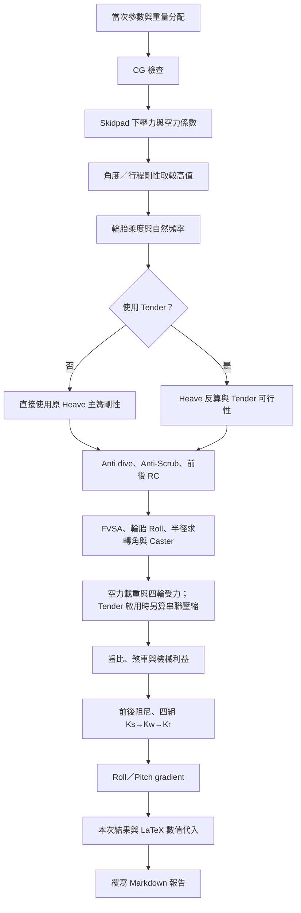

# 車輛初步設計估算報告

產生時間：2026-10-29T21:12:15+08:00（Asia/Taipei）。本報告由 `vehicle_initial_sizing.py` 本次執行結果自動產生。

修改腳本開頭的車重、幾何或其他參數後重新執行，整份報告的參數、數值代入與結果會重新生成。手動編輯本報告的內容會在下次執行時被覆寫。公式內角度使用 rad，度數另行換算；計算保留原始精度，報告數字顯示最多 12 位有效數字。

## 計算流程



## 分類報告

原報告依主題拆為以下 10 份 Markdown，所有原章節、公式、數值代入、表格、判定與完整結果均保留。各篇保留原章節編號，並提供返回主報告及前後篇連結。重新執行腳本會更新本主報告與全部分類檔案。

| 分類報告 | 原章節 |
| --- | --- |
| [輸入參數、質量與重心](01_inputs_cg.md) | 0、1 |
| [Skidpad 與空力需求](02_skidpad_aero.md) | 2、2.4 |
| [懸吊剛性、自然頻率與彈簧](03_suspension_stiffness.md) | 3、4、5、6、7、8、9 |
| [Anti、Roll Center 與轉向幾何](04_geometry_steering.md) | 9.3、10、11.1、11.2、11.3 |
| [空力壓縮與四輪受力](05_aero_wheel_loads.md) | 12、13 |
| [傳動齒比與煞車設計](06_drivetrain_braking.md) | 14、15、16 |
| [前後軸臨界阻尼](07_critical_damping.md) | 17 |
| [四種 Ks、Kw、Kr 比較](08_spring_rate_cases.md) | 18 |
| [Roll 與 Pitch gradient](09_roll_pitch_gradients.md) | 19 |
| [完整結果索引](10_results_index.md) | 20 |

原第 9.3 節同時包含 9.4 Anti-Scrub；原第 10 節同時包含第 11 節後 Roll Center。

## 21. 更新方式

在專案主資料夾執行：

```powershell
python "Initial settings/vehicle_initial_sizing.py"
```

終端仍會 print 全部結果，最後自動更新本檔。Markdown 本身不執行公式；本檔的主動更新由 Python 每次重新計算後完成。詳細模型說明見 [計算說明](../vehicle_initial_sizing_calculations.md)。

