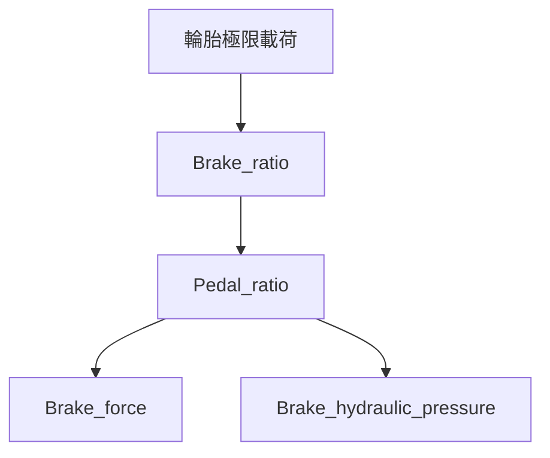

# 煞車分析

煞車流程依序建立理想前後軸煞車力分配、踏板與液壓需求、煞車力及鎖死邊界，並由踏板分析分支計算油管膨脹。流程圖如下：

每個節點的方程式說明是獨立的 `data/results/<node_id>/analysis.md` 檔案，可直接編輯。重新執行分析不會產生或覆寫這些 Markdown。

- `Brake_ratio`：軸荷轉移、輪胎極限煞車力與固定比例近似。
- `Pedal_ratio`：輪端扭矩、卡鉗／總泵液壓關係及踏板比需求。
- `Brake_force`：踏力到軸煞車力的增益與首次鎖死條件。
- `Brake_hydraulic_pressure`：油管壓力與單位長度體積膨脹的回歸模型。

計算函式位於 `models.py` 和 `workflow.py`；車輛參數、硬體參數及節點依賴定義於 `workflow.py`。油管擬合資料由 `data/input_data/brake_line_data.csv` 提供。
