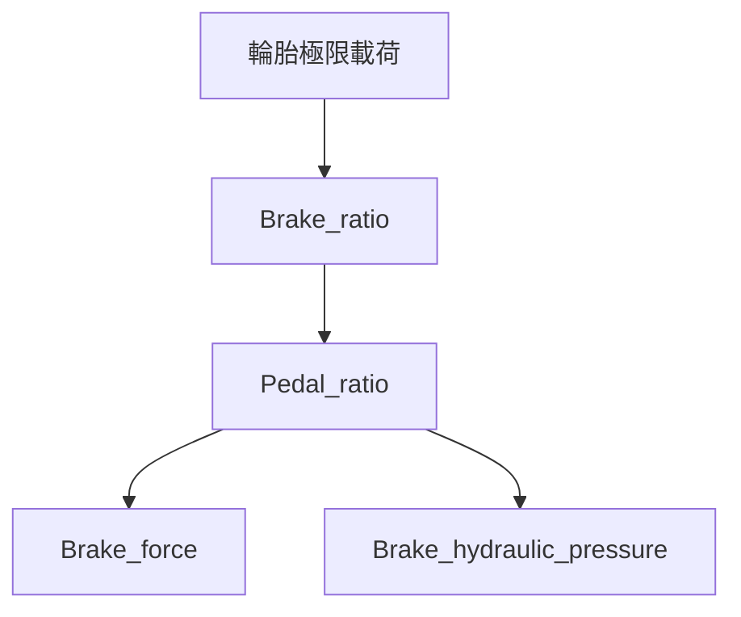

# 煞車分析

由 `new/` 的四支程式整合，流程為：

四個節點位於「煞車分析」群組。單擊可設定參數，執行後雙擊查看圖片、CSV 表格及公式說明。`Pedal_box` 未加入流程。單獨執行任一節點會重算必要前置分析，包括共用質量、重心與輪載來源；油管分支經過 `Brake_ratio` 與 `Pedal_ratio`，直接使用踏板分析的前後油路壓力，不必執行 `Brake_force`。

## 資料與參數

車重使用 `cog_total_mass_kg`，配重使用 `hl_front_weight_ratio`；`L`、`h_cog`、`mu_w`、`R_tire` 沿用共用車輛參數。輪載極限節點是流程入口；本套件以同一組車輛資料重新計算直線煞車載荷，不把過彎工況的輪載極值當成同時發生的煞車載荷。

新增參數列在 `data/analysis_parameters.csv`，亦補入 `data/analysis_parameters_last_set.csv`。原始程式所讀取的 `data.xlsx` 與 `load_data.ParameterLoader` 不在專案內，總泵、卡鉗、碟盤、踏力與比例的預設數值是可編輯示例，須替換成實際設計資料。

| 參數 | 原始名稱 | 定義／單位 |
|---|---|---|
| `brake_driver_force_N` | `F_driver` | 設計車手踏力，N |
| `brake_balance_bar_front_ratio` | `balance_bar` | 前總泵分配的推力比例，0～1，不含端點 |
| `brake_master_front_diameter_m`、`brake_master_rear_diameter_m` | `D_mc_f`、`D_mc_r` | 前後總泵缸徑，m |
| `brake_caliper_front_piston_diameter_m`、`brake_caliper_rear_piston_diameter_m` | `D_caliper_f`、`D_caliper_r` | 前後卡鉗活塞直徑，m |
| `brake_caliper_front_piston_count`、`brake_caliper_rear_piston_count` | `N_caliper_f`、`N_caliper_r` | 每顆對向固定式卡鉗兩側總活塞數，正偶數 |
| `brake_pad_mu` | `mu_pad` | 來令片摩擦係數 |
| `brake_disc_outer_diameter_m` | `r_disc_o` | 碟盤外徑，m；原名稱含 r，但公式使用直徑 |
| `brake_disc_contact_offset_m` | `d_gap` | 外緣至有效摩擦點的徑向距離，m |
| `brake_safety_factor` | `SF` | 踏板比設計安全係數，至少 1，預設 1.5 |

`PR` 改為 `Pedal_ratio` 的導出量 `brake_pedal_ratio_required`，由 `Brake_force` 自動使用；不會被舊 CSV 的數值覆蓋。`Pedal_ratio` 的固定比例比較曲線直接使用 `Brake_ratio` 回歸算出的 `brake_ideal_front_ratio`，不需要手動填寫前軸煞車力比例。此導出量在輸入面板隱藏，單獨執行時會先重算上游。Balance bar 推力比例與實際液壓煞車力比例仍各自保留。

## Brake_ratio：理想分配

以正值 $z$ 表示減速度的 g 倍數，$f$ 為靜態前軸配重，$W=mg$：

$$N_f=Wf+Wzh/L,\qquad N_r=W(1-f)-Wzh/L$$

$$F_{bf}=zN_f,\qquad F_{br}=zN_r$$

掃描上限為輪胎摩擦係數與後軸離地界限兩者較小值：$z_{max}=\min(\mu_w,(1-f)L/h)$；當 $h=0$ 時不設離地上限。沿用原本十點、通過原點的最小平方擬合：$k=\sum F_{bf}F_{br}/\sum F_{bf}^2$，等效前軸比例為 $1/(1+k)$。這是整段理想曲線的固定比例近似，不代表 Balance bar 的機械設定。

## Pedal_ratio：踏板比需求

固定比例曲線以回歸結果 $\beta_f$ 分配總扭矩：

$$\beta_f=\frac{1}{1+k},\qquad T_{fit,f}=\beta_f(T_f+T_r),\qquad T_{fit,r}=(1-\beta_f)(T_f+T_r)$$

其中 $k$ 由上游 `Brake_ratio` 擬合，$T_f$、$T_r$ 為各減速度下的理想前後軸扭矩。這組比例用於曲線比較；油路壓力仍依踏板比、Balance bar 與總泵規格計算。

依上述上限計算前後軸煞車力，單輪所需扭矩為 $T_i=F_{bi}R_{tire}/2$。碟盤有效半徑為 $r_e=D_{disc}/2-d_{gap}$。

本模型假設每軸兩顆相同的對向固定式卡鉗、每顆卡鉗兩側活塞對稱且等徑。兩側總活塞面積 $A_{c,i}=n_i\pi D_i^2/4$，因此單輪扭矩 $T_i=P_iA_{c,i}\mu_{pad}r_e$；不重複乘上兩側摩擦面的係數。總泵面積 $A_{m,i}=\pi D_{m,i}^2/4$，所需總泵推力 $F_{m,i}=P_iA_{m,i}$。

以 $b$ 表示前總泵推力比例，踏板比同時滿足前後回路需求：

$$PR_{required}=\frac{SF}{F_{driver}}\max\left(\frac{F_{m,f}}{b},\frac{F_{m,r}}{1-b}\right)$$

再以此踏板比與設定的車手踏力，計算前、後油路壓力：

$$P_{line,f}=\frac{F_{driver}PR_{required}b}{A_{m,f}},\qquad P_{line,r}=\frac{F_{driver}PR_{required}(1-b)}{A_{m,r}}$$

其中 $P_{req,i}=T_i/(A_{c,i}\mu_{pad}r_e)$ 是達到目標扭矩的需求油壓；$P_{line,i}$ 是設定踏力下，由踏板比與 Balance bar 產生的計算油路壓力。安全係數已含在踏板比內，不再重複乘上。此處使用理想液壓模型，忽略管路壓損。

結果圖「踏板比、前後油路壓力與扭矩需求」同時列出需求壓力與油路壓力。`pedal_line_pressure.csv` 提供前後回路的 Pa、MPa、bar 數值；$1\ \mathrm{MPa}=10^6\ \mathrm{Pa}=10\ \mathrm{bar}$。主要導出量 `brake_pedal_front_pressure_MPa`、`brake_pedal_rear_pressure_MPa` 也會顯示在主要結果表中。`pedal_sizing.csv` 原有的 `line_pressure_Pa` 欄位保留為需求油壓，新增 `pedal_line_pressure_*` 欄位記錄設定踏力下的油路壓力。

原始 `Pedal_ratio.py` 的靜態配重對調，以及扭矩曲線固定 50／50 的寫法，均改成共用前軸配重。扭矩圖明確使用整軸扭矩，需求表則提供單輪扭矩與各回路油壓。

## Brake_force：液壓煞車力與首次鎖死

套用上游踏板比，$P_f=F_{driver}PRb/A_{m,f}$，後側使用 $1-b$。每軸理論煞車力為 $F_{bi}=2P_iA_{c,i}\mu_{pad}r_e/R_{tire}$。

另求固定分配下首次達到 $F_{bi}=\mu_wN_i$ 的踏力，輸出首先鎖死的車軸、臨界踏力與減速度。圖表同時顯示液壓需求除以車重的理論減速度，以及限制在首次鎖死界限的曲線；後者代表可用的未鎖死操作界限，不是鎖死後車輛的滑動或 ABS 模擬。

沿用原始程式的無空力、平路、直線準靜態模型；未加入熱衰退、回生煞車、輪胎負載敏感度與壓力暫態。既有 `ax` 仍供懸吊工況使用，本套件的踏板設計上限沿用原程式的 `mu_w` 摩擦極限並檢查後軸接地，沒有把 `ax` 當成新輸入。

## Brake_hydraulic_pressure：油管膨脹

CSV 已由 `new/brake_line_data.csv` 移到 `data/input_data/brake_line_data.csv`，原始油管程式也改讀此位置。資料欄位為 `type,pressure_MPa,expansion_mm3_per_m`，保留 Low／High 六筆原始數據。

分析壓力直接取 `Pedal_ratio` 輸出的前、後油路壓力中較高值，以 Pa 轉換為 MPa 後帶入油管膨脹曲線：

$$P_{target}=\frac{\max(P_{line,f},P_{line,r})}{10^6}\quad\mathrm{MPa}$$

上游數值為 `brake_pedal_front_pressure_Pa`、`brake_pedal_rear_pressure_Pa`，使用設定踏力下的計算油路壓力。輸入面板隱藏這兩個導出量，移除手動目標壓力欄位。`brake_pressure_target_MPa` 改為本節點計算輸出，另以 `brake_pressure_source_axle` 記錄取用前軸、後軸或兩側相等；載入舊參數 CSV 時不採用其中的目標壓力快照。

分別對 Low／High 進行二次曲線擬合，計算此壓力下每米管長的體積膨脹量。`brake_line_target.csv` 同時列出前後壓力、選取來源與分析壓力。目前量測範圍為 6.9～20 MPa，範圍外會在圖中與結果表標示為外插。沒有額外加入管長，因此輸出是 mm³/m，不是完整回路的膨脹體積或踏板行程；圖中的零壓力外插值也不代表物理零點。

所有節點的圖、完整資料表與本說明會儲存在 `data/results/<node_id>/`。每張圖最多四個子圖，可由既有結果圖片選單切換。
