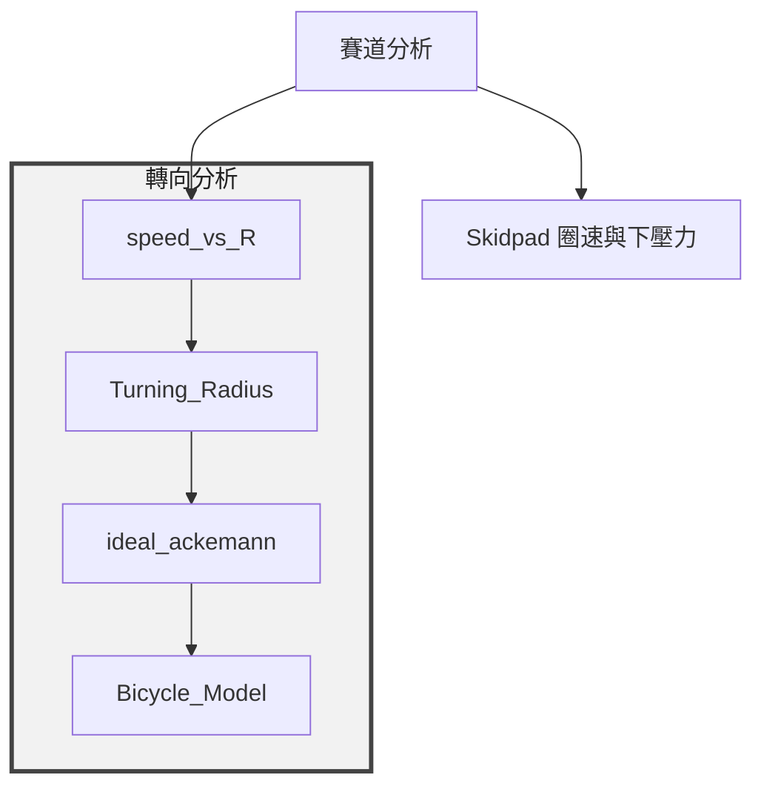

# 彎速、轉向與 Bicycle Model

四個 `new/` 程式已整合成 `analysis/` 插件，沿用來源檔名及圖表內容：

原有賽道分析到 Skidpad、懸吊與 PSD 的連線保留。箭頭表示分析流程關聯；數值前置分析由各插件宣告的參數來源決定。單獨執行 Bicycle Model 時，會先重算元件質量／重心，參考速度使用手動設定。四個新節點都支援單擊設定參數、執行分析、雙擊查看圖片與資料表，結果位於 `data/results/<node_id>/`。

## 共用資料

原程式引用的 `load_data.ParameterLoader` 與 `data.xlsx` 沒有附在專案內，已改接現有共用資料：

| 原變量 | 整合後來源 |
| --- | --- |
| `mu_y` | 共用 `mu_w`，也供賽道與 Skidpad 使用 |
| `L` | `COG_movable` 依手動輪心座標計算的軸距 |
| `tf` | 共用前輪距 `t` |
| `m` | Excel 全車元件總質量 `cog_total_mass_kg` |
| `Iz` | 全車元件繞總重心的偏航慣量 `cog_total_Izz_kg_m2` |
| `lf`、`lr` | 由軸距與全車前軸靜態配重 `p` 計算：`lf=L(1-p)`、`lr=Lp` |
| `v_ref` | Bicycle 節點的手動速度輸入，預設 40 km/h，內部以 `bicycle_v_ref_kmh` 儲存並轉為 m/s；獨立於 Skidpad 的導出量 `v_ref` |
| `Cf`、`Cr` | 可編輯的前／後**整軸**側偏剛性，N/rad |

Cf 與 Cr 依使用者確認，各預設 **40,000 N/rad 示例值**，應依輪胎資料調整。偏航慣量沿用既有集中元件質量近似，未包含元件自身慣量。

## 各分析

- `speed_vs_R`（`speed_vs_r`）：半徑掃描固定為 3–50 m、200 點，直接定義在 `analysis/speed_vs_R.py`，介面僅顯示共用摩擦係數 `mu_w`。計算 `v=sqrt(mu_w*g*R)`；此圖為純摩擦極限，賽道的時間分布另套用最高速度上限。兩者共用 `models.cornering_speed`。
- `Turning_Radius`（`turning_radius`）：轉角掃描固定為 10–60°、500 點，寫在 `analysis/Turning_Radius.py`，計算 `R=L/tan(theta)`。介面提供「車輛最大轉向角」輸入框，預設 45°，可設定大於 0°、小於 90° 的角度；圖中以紅色小點標記精確輸入角度，並標示角度與對應半徑，另輸出 `vehicle_turning_limit.csv`。標記超過掃描範圍時，座標軸會擴展以顯示該點，掃描曲線仍維持 10–60°。theta 為等效前輪轉角，R 以後軸中心的軌跡為基準。
- `ideal_ackemann`（`ideal_ackemann`）：半徑掃描固定為 3–30 m、51 點，直接定義在 `analysis/ideal_ackemann.py`；介面只保留前輪距 `t`（m），軸距 `L` 使用前置分析結果。計算 `delta_i=atan(L/(R-t/2))`、`delta_o=atan(L/(R+t/2))`。R 同樣以後軸中心為基準；與賽道中心線半徑比較時應注意座標基準。保留原程式 `(delta_i-delta_o)/delta_i*100` 的角差比例；此指標與慣用的 Ackermann 完成率不同，理想幾何不代表該角差比例為 100%。
- `Bicycle_Model`（`bicycle_model`）：直接共用 `Turning_Radius` 的「車輛最大轉向角」輸入；該角度同時標記在轉彎半徑圖上，並作為 Bicycle Model 的前輪轉向階躍角。轉向階躍開始時間固定為 0.5 s、模擬時間固定為 5 s、取樣固定為 1000 點，直接定義在 `analysis/Bicycle_Model.py`。參考速度 `v_ref（km/h）` 開放手動設定，預設 40 km/h，執行 Skidpad 或全流程時不會覆蓋此輸入。圖表顯示偏航角速度、側向速度及前後輪側滑角。ODE 以階躍開始時刻分段求解，確保開始前為零響應。

Bicycle Model 保留原線性輪胎及定速、小角度假設，未加入輪胎飽和、載荷轉移、下壓力或速度變化；輸出是指定模擬終點的數值，不保證所有參數設定都已達穩態。Turning_Radius 的車輛最大轉向角會同時作為 Bicycle 的轉向階躍角；ideal_ackemann 的輪距，以及 Bicycle 的 Cf、Cr 與參考速度可在介面修改。若輸入較大的最大轉向角，線性小角度近似的準確度會降低。

每個新節點輸出 `plot.png`、`plots.json`、`result.csv` 及完整曲線 CSV：`cornering_speed.csv`、`turning_radius.csv`、`ackermann_geometry.csv`、`bicycle_response.csv`。載入插件時不會讀取 Excel、計算、存圖或開啟 Matplotlib 視窗。
