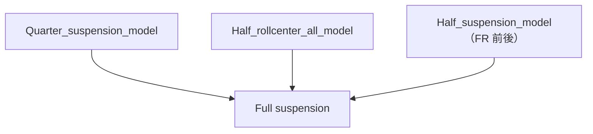

# Full suspension

`analysis/Full_suspension.py` 為桌面入口；`suspension_set/Suspension.py` 保留 `new/` 原始 `Suspension_A` 預設值，額外的設計映射集中在 `parameters.py`。輪胎阻尼依指定預設改為 50 N·s/m，車架扭轉阻尼固定 300 N·m·s/rad；其餘原始模型設定與求解流程保留。

流程圖保留三條模型擴展箭頭：



## 參數來源

| 來源 | 全車模型 |
| --- | --- |
| COG：`ms`, `mu_front`, `mu_rear` | 簧上質量及前／後每輪簧下質量；整車質量為 `ms + 2·mu_front + 2·mu_rear`。 |
| COG：`cog_total_Ixx_kg_m2`, `cog_total_Iyy_kg_m2`, `cog_total_Izz_kg_m2` | 直接使用既有全車慣量，與 LR／FR 模型的慣量來源一致。Ixx 按原始模型的 `[lr/L, lf/L]` 分配給前／後 Roll，Iyy 與 Izz 不再分半。節點不顯示慣量輸入框，三個值自動沿用 COG 結果；不需要新增的 `cog_sprung_I*` 結果。 |
| COG：前後輪心 x、`cog_total_x_m` | 以全車重心為參考，計算 `lf = x_front - x_cg`、`lr = x_cg - x_rear`。 |
| 共用設定：`t`, `hl_rear_track_m`, `h_cog` | 前後輪距及重心高度。 |
| Tire stiffness：`Ks_pitch_N_per_m` | 前軸 Heave 工作區軸簧率；後軸乘 `hl_rear_heave_spring_ratio`。 |
| Tender：`tender_bind_total_stroke_mm` | 前後 Heave 主／輔簧切換總行程，以 mm ÷ 1000 轉成 m，直接設定 SeriesKC 的 travel；不另設輸入框。 |
| 2_spring：`tender_to_heave_stiffness_ratio` | 前後 Heave 的輔簧／主簧剛性比，與 Tender 分析共用同一導出量。此參數不另設輸入框；前置執行會自動加入 2_spring。 |
| Tire stiffness：`Ks_roll_N_per_m` | 前軸 Roll 設計簧率；後軸乘 `hl_rear_roll_spring_ratio`。 |
| Tire stiffness 共用輸入：`Kt`, `MR` | 四輪輪胎剛性；Heave 與前／後 Roll 皆使用同一個 MR。Full suspension 不讀取 hl_front_roll_motion_ratio 或 hl_rear_roll_motion_ratio。 |
| 阻尼分析：`damped_sweep_selected_ratio_used` | Heave 依工作區軸剛性與簧上軸質量估算阻尼；Roll 依實際軸角剛性與前／後 Roll 慣量估算阻尼。 |
| Roll Center：`hl_front_roll_center_m`, `hl_rear_roll_center_m` | 前後 RC 幾何傳力高度。 |
| Tender 共用輸入：`anti_geometry_ratio` | 前軸 Anti-dive／lift 與後軸 Anti-squat／lift 都使用同一比例。Full suspension 隱藏此輸入框；在 Tender 修改後兩者共用該設定，目前參數 CSV 為 0.2。 |

## KC 換算與修正

`KCSystem.force` 自行乘上 MR²，映射僅傳入機械 KC 簧率與阻尼，避免重複計算運動比。

對 Heave，原始全車模型合併兩輪位移，再把同一模態力作用於兩輪，因此工作區等效軸剛性為 `4 × k_work × MR²`。給定軸設計簧率 K 和輔簧／主簧比 r，設定：

- `k_work = K / 4`。
- `k_main = k_work × (1+r)/r`，`k_tender = k_main × r`。這能讓串聯工作區剛性達到設計值；直接把 K/4 當成主簧率會再被串聯柔度降低。
- 工作區目標軸阻尼 `C_axle = 2ζ√(K·MR²·m_axle)`，機械 KC 阻尼為 `C_axle/(4MR²)`。

對 Roll，保留原始求解器的力矩公式 `Mx = (Fs_FL-Fs_FR) × track`。其等效角剛性為 `2 × k_roll_KC × MR² × track²`；設 `k_roll_KC = K_roll/2`，在相同運動比下可匹配 RC 模型的角剛性；Full suspension 一律代入共用 MR，不沿用 RC 分析的獨立 Roll 運動比設定。機械 KC 阻尼依 `2ζ√(K_angle·I_axle)` 換算，使角阻尼與選定阻尼比一致。

這些只是本模型座標下的係數換算；原始 `motion → Integration → logger` 與積分公式不變。原始全車模型與既有 LR／FR 的全車慣量慣例亦保持一致，未改成簧上慣量。

## 可編輯設定與輸出

節點提供共用幾何、共用 MR 與後軸簧率比輸入。沒有前序分析來源的設定提供模型專屬輸入：車架扭轉剛性（180000 N·m/rad）。高／低速阻尼切換速度固定為 0.05 m/s，不設輸入框。輪胎阻尼預設固定為 50 N·s/m，車架扭轉阻尼固定為 300 N·m·s/rad，兩者不設輸入框，也不讀取舊 CSV 的同名阻尼設定。Heave 彈簧行程限制、輪胎半徑、中央 Roll／Warp 及四角的 NullKC 保留原始值。

兩個工況模擬 1.5 秒，步長 0.001 秒，GIF 為 8 FPS、90 DPI（12 幀、1440 × 990 px）：

| 工況 | 輸入 |
| --- | --- |
| `road_acc` | t > 0.5 秒後，每輪 Fx、Fy 皆為 −1000 N，垂直力依映射後整車質量計算為 −m·9.81。 |
| `road_FL_bump` | 0.5 < t < 1 秒，左前輪路面抬高 0.05 m；沿用原始零 F_cg 設定。 |

輸出至 `data/results/full_suspension/`：兩個 GIF、姿態與四輪響應圖、完整時序 CSV／PKL、工況設定 JSON 與峰值摘要。JSON 的 `applied_model_parameters` 直接讀取已建立的 KC 物件，記錄實際簧率、運動比、阻尼與慣量。若積分發散或超出小角度範圍則中止，不會輸出該次無效動畫。路面與輪胎力保留原始符號，沒有加入新的接地或靜態平衡模型。

「所選分析＋前置分析」會按參數來源重算必要分析；「只執行所選分析」可讀取既有 COG 全車慣量快照。命令列會同時保存前置節點的結果與快取，避免下次開啟程式缺少剛計算的來源值：

```powershell
.venv/Scripts/python.exe -m analysis.full_suspension
```
