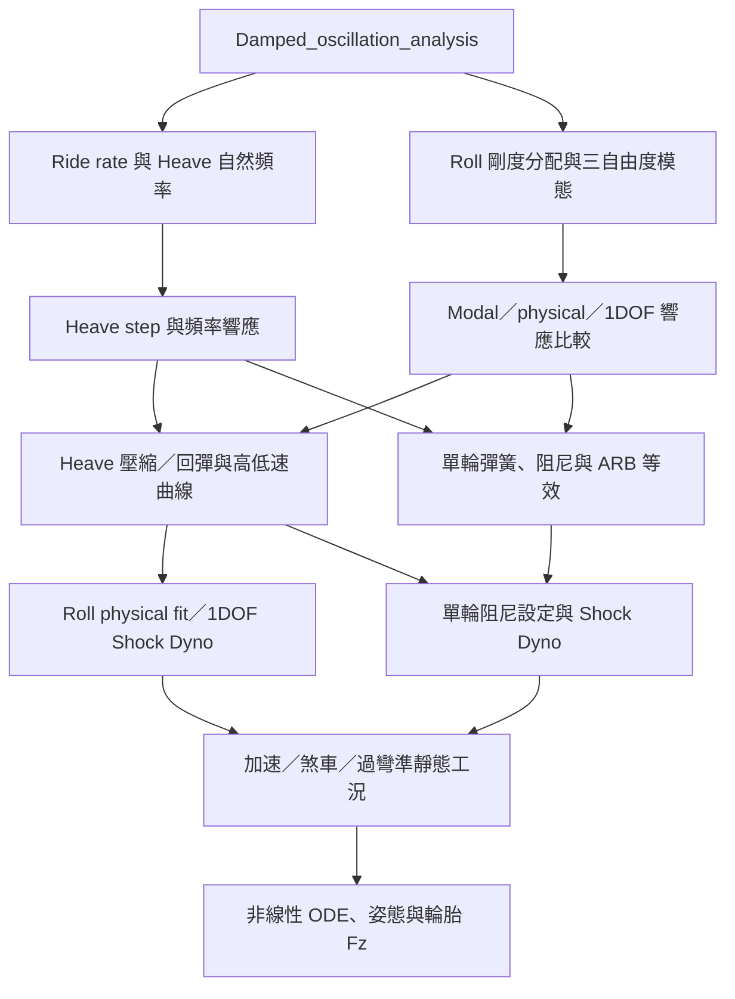

# 高低速阻尼完整分析

本套件整理自 `new/HL_damping`，整合進現有 `analysis` 插件與 CSV 資料流程。保留來源資料夾，正式執行的共用模型放在本資料夾，十個 `analysis/hl_*.py` 為流程圖入口。

## 五類輸出

1. [Heave 分析](https://taiwantechracing.github.io/Design-Reference/open/HL_damping/outputs/02_heave_analysis.html)：ride rate、heave natural frequency、step response 與頻率響應。細分為 **Ride rate 與 Heave 自然頻率**、**Heave step 與頻率響應**。
2. [Roll 分析](https://taiwantechracing.github.io/Design-Reference/open/HL_damping/outputs/03_roll_analysis.html)：sprung roll、front unsprung roll 與 rear unsprung roll 三個自由度，比較理想 modal damping、實體前後 roll damper 拓樸與 1DOF 簡化模型。細分為 **Roll 剛度分配與三自由度模態**、**Modal／physical／1DOF 響應比較**。
3. [阻尼器與 Shock Dyno 分析](https://taiwantechracing.github.io/Design-Reference/open/HL_damping/outputs/04_damper_analysis.html)：將目標阻尼比轉換為 damper force-velocity 曲線。細分為 **Heave 壓縮／回彈與高低速曲線**、**Roll physical fit／1DOF Shock Dyno**。
4. [獨立懸吊等效分析](https://taiwantechracing.github.io/Design-Reference/open/HL_damping/outputs/05_independent_equivalent.html)：將 roll、heave 等效變成單輪懸吊設定，用於分析單輪阻尼設定架構。細分為 **單輪彈簧、阻尼與 ARB 等效**、**單輪阻尼設定與 Shock Dyno**。
5. [工況與 ODE 時域模擬](https://taiwantechracing.github.io/Design-Reference/open/HL_damping/outputs/06_simulation_and_load_cases.html)：包含縱向加速、縱向煞車與側向過彎。準靜態計算檢查彈簧作動量與姿態角；ODE 模擬觀察暫態收斂、峰值與輪胎法向力變化。細分為 **加速／煞車／過彎準靜態工況**、**非線性 ODE、姿態與輪胎 Fz**。

上述連結為使用者指定的參考頁。**本次計算的結果**位於 [本機報告入口](../../data/results/hl_damping/index.html)，報告使用相同的五個 HTML 檔名，並附各節點的圖表及 CSV。

## 流程與使用方式



執行 `python main.py`，在 `Damped_oscillation_analysis` 後方可看到五個群組。單擊小節點設定參數，選擇「單獨執行所選分析」時會補跑缺少的前置計算；雙擊結果可切換多張圖與多份 CSV 明細表。修改輸入後會清除已計算導出量。

無視窗執行整套分析並匯出報告：

```powershell
.venv/Scripts/python.exe -X utf8 -m analysis.hl_damping
```

可使用 `--csv <path>` 與 `--output <directory>` 指定參數及輸出位置。此命令自動重算取得彈簧剛度所需的四項前置分析，接著執行十個新節點；不修改其他舊節點的結果。

## 參數來源與模型設定

| 來源 | 對應 |
| --- | --- |
| `ms` | 全車簧上質量；前後軸依 `hl_front_weight_ratio` 分配 |
| `mu` | 每輪簧下質量；總質量為簧上質量加四輪簧下質量 |
| `Ks_pitch_N_per_m` | `Tire stiffness` 的 pitch 彈簧輸出，作為前軸 heave spring rate；後軸乘 `hl_rear_heave_spring_ratio` |
| `Ks_roll_N_per_m` | `Tire stiffness` 的 roll 彈簧輸出，作為前軸 roll spring rate；後軸乘 `hl_rear_roll_spring_ratio` |
| `MR` | 前後軸 heave 運動比；roll 及 independent 使用各自新增的運動比 |
| `Kt`、`L`、`t`、`h_cog` | 每輪輪胎剛度、軸距、前輪距、重心高度；後輪距另設 `hl_rear_track_m` |
| `ax`、`ay` | 煞車及過彎最大工況，單位 g；`hl_acceleration_g` 為加速工況 |
| `hl_reference_case_g` | 準靜態參考工況及比較圖的側向參考階躍，預設 1 g |
| `hl_*_heave_*_zeta` | 前後軸、低／高速、壓縮／回彈四種 heave 目標阻尼比 |
| `hl_*_roll_*_zeta` | 前後軸低／高速 roll 目標阻尼比，以懸吊 roll 剛度分配加權後設定三個模態 |
| `hl_knee_velocity_mm_s` | 阻尼器軸速度轉折點，預設 50 mm/s |

新增的 `hl_*` 參數在 `data/analysis_parameters.csv` 中可調。舊 CSV 未提供新增參數時，程式使用 `parameters.py` 的預設值，並在節點輸入及輸出 CSV 中保留實際採用值。前軸重量比例 0.5、簧上 roll inertia 45 kg m²、roll center 高度及運動比為可修改的起始設定，須以實車資料校正。

`Damped_oscillation_analysis` 是流程上的延伸起點；新的 heave／roll 阻尼比由本套件分別設定，沒有把 quarter-car 掃描的最佳阻尼比直接當成三自由度 roll 模態的目標。前後軸 heave 是每軸一個解耦彈簧／阻尼器，輪胎為該軸兩輪並聯；independent 是每輪一組。

## 計算與判讀

- 「高／低速」指阻尼器軸速度。Heave 及 Roll 的線性響應分別使用高／低速係數；只有非線性 ODE 在速度跨過 knee 時會切換斜率。這些理論 Shock Dyno 曲線並非實測。
- Roll 的三自由度順序為簧上、前簧下、後簧下。Modal 目標阻尼矩陣通常無法由兩支前後實體 roll damper 完全重現；以非負最小平方法擬合被動阻尼係數，保留 Frobenius 與相對誤差，並輸出實際極點。
- 縱向 ODE 沿用原包的前後軸獨立 heave 模型及等效單輪模型，由位移差估算 pitch；沒有建立包含 pitch inertia 的整車耦合模型。過彎另加入使用實體分段 roll damper 的三自由度 ODE，並保留原始低速線性 Fz 圖供比較。
- 準靜態 heave stroke 包含靜態簧上承載；ODE 位移由靜態平衡位置起算。準靜態表的 roll travel 是 roll 彈簧／阻尼器行程。
- 2% settling time 以解析靜態平衡值判定，超過時間窗仍未收斂時 CSV 留空；不會誤記為 0 秒。
- 使用雙向線性輪胎彈簧，沒有離地後接觸切換、行程止擋或空力。若 Fz 小於零，該工況超出保持接地的模型假設；ARB 等效剛度若為負，表示單輪基礎 roll 剛度已高於目標，不能直接以一般正剛度 ARB 達成。

## 來源模組對照

| 來源模組 | 分析小節 |
| --- | --- |
| `heave_analysis.py` | Ride rate 與 Heave 自然頻率 |
| `state_space.py` | Heave step 與頻率響應、Modal／physical／1DOF 響應比較，以及 ODE 的原始線性 Fz 比較 |
| `roll_analysis.py` | Roll 剛度分配與三自由度模態 |
| `damper.py` | Heave 壓縮／回彈與高低速曲線、Roll physical fit／1DOF Shock Dyno、單輪阻尼設定與 Shock Dyno |
| `equivalent_independent.py` | 單輪彈簧、阻尼與 ARB 等效 |
| `simulation.py` | 加速／煞車／過彎準靜態工況、縱向非線性 ODE |
| `vehicle.py` | 共用模型結構，改由 CSV 組裝，移除缺少的 `load_data` 與 `data.xlsx` 依賴 |
| `workflow.py` | 分節執行、數據表、過彎非線性 ODE、響應指標與圖表收集 |

來源的 `main.py` 已拆成十個插件及本套件 `__main__.py`。頻率響應改以狀態空間直接求解，避免先轉換為高階多項式造成係數病態警告。
