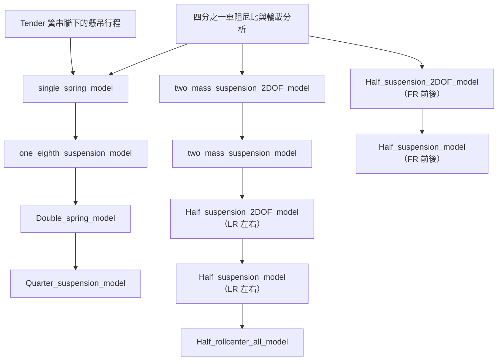

# 懸吊模型工況分析

桌面節點輸出靜態 PNG 圖表、完整時序 CSV／PKL、工況設定與峰值摘要；已移除 GIF 生成及播放功能，舊 GIF 也不再列入結果選單。`data_creator.py` 批次入口僅輸出 PKL 數據與執行清單，可用 `--resume` 沿用設定一致的數據。

本套件將數種四分之一車、左右半車與前後半車懸吊模型接入分析流程。每個流程節點呼叫一種模型，並以路面位移或車身加速度作為外部輸入。本文說明模型自由度、力的定義與運動方程式；模型使用的設定由分析輸入與既有參數換算而來，本文不列特定參數值或某次執行的數值結果。

模型、路面、狀態、工況目錄與批次引擎都位於 `analysis/suspension_models/`。修改模型請看 `model/`；懸吊參數結構請看 `Parameter_set/Suspension.py`；狀態積分請看 `Parameter_set/suspension_state.py`；各模型可執行的輸入情境與對應路面函式請看 `batch_cases.py`。`new/` 不再是分析執行時的程式依賴。

## 分析流程

`single_spring_model`、`one_eighth_suspension_model`、`Double_spring_model`、`Quarter_suspension_model` 的懸吊剛性 `ks` 統一使用 `Frequency_mass` 導出的 `Ks_required_target_frequency_N_per_m`（N/m）。流程依此參數自動納入 `frequency_mass` 前置分析，剛性沿用上游結果，不新增輸入框；輪端剛性仍由 `kw = ks × MR²` 換算，再與輪胎剛性串聯取得 `ride_rate`。

箭頭表示流程圖中的比較脈絡。各節點代表獨立模型，執行時會建立新的狀態；節點間不會傳遞前一模型的位移、速度或加速度時間序列。模型所需的共享物理參數則由其輸入與指定的前置分析提供。

## 符號與共同定義

位移、速度與加速度以向上為正。下標 $s$、$u$、$r$ 分別表示簧上、簧下與路面；$l,r$ 表示左、右側，$f,r$ 表示前、後軸。模型內的彈簧與阻尼力依相對位移及相對速度計算。下列方程式沿用程式的力與力矩正負號，因此不同簡化模型記錄的輪胎力 $F_t$ 不一定具有相同的分解方式。

一般的懸吊通道力與輪胎垂直力寫為

$$
F_s = k_s\,\Delta z_s+c_s\,\Delta\dot z_s,
\qquad
F_t = k_t\,\Delta z_t+c_t\,\Delta\dot z_t.
$$

此處 $k_s,c_s$ 與 $k_t,c_t$ 分別代表模型所採用的懸吊通道和輪胎通道係數；不含某項彈性或阻尼元件的模型，該項不會出現在對應方程式中。

四分之一車模型的輪端簧率由懸吊簧率與運動比換算；等效簧率再將輪端懸吊與輪胎彈簧串聯：

$$
k_w=K_s MR^2,
\qquad
k_r=\left(\frac{1}{k_w}+\frac{1}{k_t}\right)^{-1}
=\frac{k_w k_t}{k_w+k_t}.
$$

左右半車的升沉、側傾通道分別使用對應的 pitch／roll 輪端剛性，並依模型定義轉成半車模態剛性；前後半車則由 pitch 剛性建立前軸通道，再以後軸比例建立後軸通道。這些關係只定義參數如何進入模型，不指定任何固定數值。

## 四分之一車模型

### `single_spring_model`：單彈簧等效模型

以車身與路面的相對位移乘上等效簧率 $k_r$，忽略簧下自由度與阻尼：

$$
\Delta z_r=z_s-z_r,
\qquad F_s=k_r\Delta z_r,
\qquad F_t=F_s,
$$

$$
\ddot z_s=-\frac{F_s}{m_c},
\qquad \ddot z_u=\ddot z_s.
$$

其中 $m_c$ 是此簡化模型使用的角點等效質量；$F_t=F_s$ 是此模型的輪胎力定義，不代表另有獨立輪胎彈簧自由度。

### `one_eighth_suspension_model`：單自由度彈簧阻尼模型

在單彈簧等效模型上加入懸吊阻尼，阻尼相對速度以車身對路面計算：

$$
F_s=k_r(z_s-z_r)+c_s(\dot z_s-\dot z_r),
\qquad F_t=F_s,
$$

$$
\ddot z_s=-\frac{F_s}{m_c},
\qquad \ddot z_u=\ddot z_s.
$$

此模型仍將簧下響應與車身加速度設為相同，不另外積分簧下質量。

### `Double_spring_model`：雙彈簧、無阻尼模型

模型保留簧上與簧下質量，懸吊彈簧連接兩者，輪胎彈簧連接簧下質量與路面：

$$
F_s=k_w(z_s-z_u),
\qquad F_t=k_t(z_u-z_r),
$$

$$
\ddot z_s=-\frac{F_s}{m_s},
\qquad
\ddot z_u=\frac{F_s-F_t}{m_u}.
$$

### `Quarter_suspension_model`：四分之一車二自由度模型

在雙質量、雙彈簧模型中加入懸吊與輪胎阻尼。令

$$
\Delta z_s=z_s-z_u,\quad \Delta\dot z_s=\dot z_s-\dot z_u,
\qquad
\Delta z_t=z_u-z_r,\quad \Delta\dot z_t=\dot z_u-\dot z_r,
$$

則

$$
F_s=k_w\Delta z_s+c_s\Delta\dot z_s,
\qquad
F_t=k_t\Delta z_t+c_t\Delta\dot z_t,
$$

$$
\ddot z_s=-\frac{F_s}{m_s},
\qquad
\ddot z_u=\frac{F_s-F_t}{m_u}.
$$

## 左右半車模型（LR）

左右半車的角點量以 $l$、$r$ 表示。下列模態座標採用兩側相加與相減的定義，並非平均值：

$$
q_h=\Delta z_l+\Delta z_r,
\qquad q_\phi=\Delta z_r-\Delta z_l,
$$

速度座標 $\dot q_h,\dot q_\phi$ 依相同方式由相對速度構成。升沉與側傾模態力為

$$
F_h=k_hq_h+c_h\dot q_h,
\qquad
F_\phi=k_\phi q_\phi+c_\phi\dot q_\phi.
$$

### `two_mass_suspension_2DOF_model`：左右二質點模態模型

每側懸吊直接以簧上位移相對路面位移建立模態，沒有獨立簧下質量自由度。角點力由升沉、側傾模態力與角點通道力組合：

$$
F_{s,l}=F_h-F_\phi+F_{q,l},
\qquad
F_{s,r}=F_h+F_\phi+F_{q,r},
$$

$$
\ddot z_{s,i}=-\frac{F_{s,i}}{m_c},
\qquad
F_{t,i}=F_{s,i},
\qquad
\ddot z_{u,i}=\ddot z_{s,i},\quad i\in\{l,r\}.
$$

其中角點通道力 $F_{q,i}=k_{q,i}\Delta z_i+c_{q,i}\Delta\dot z_i$。模型函式將兩個模態力直接映射為左右角點力。

### `two_mass_suspension_model`：左右四自由度模型

此模型以每側簧上與簧下位移差建立升沉與側傾模態，並顯式積分兩側簧下質量。角點懸吊力為

$$
F_{s,l}=\frac{F_h-F_\phi}{2}+F_{q,l},
\qquad
F_{s,r}=\frac{F_h+F_\phi}{2}+F_{q,r}.
$$

輪胎力及運動方程式為

$$
F_{t,i}=k_t(z_{u,i}-z_{r,i})+c_t(\dot z_{u,i}-\dot z_{r,i}),
$$

$$
\ddot z_{s,i}=-\frac{F_{s,i}}{m_s},
\qquad
\ddot z_{u,i}=\frac{F_{s,i}-F_{t,i}}{m_u},
\quad i\in\{l,r\}.
$$

### `Half_suspension_2DOF_model（LR 左右）`：左右半車耦合模型

此模型以簧上對路面的相對位移建立左右懸吊模態力，再由角點力差形成車身側傾力矩。令輪距為 $t$、簧上質量總和為 $2m_s$：

$$
F_{s,l}=\frac{F_h-F_\phi}{2}+F_{q,l},
\qquad
F_{s,r}=\frac{F_h+F_\phi}{2}+F_{q,r},
$$

$$
F_z=F_{s,l}+F_{s,r},
\qquad
M_x=(F_{s,r}-F_{s,l})\frac{t}{2}+a_y(2m_c)h_{cg}.
$$

$$
\ddot z_b=-\frac{F_z}{2m_s},
\qquad
\ddot\phi=\frac{M_x}{I_x},
$$

$$
\ddot z_{s,l}=\ddot z_b+\frac{t}{2}\ddot\phi,
\qquad
\ddot z_{s,r}=\ddot z_b-\frac{t}{2}\ddot\phi.
$$

此模型不積分簧下自由度，角點加速度沿用對應車身角點加速度，輪胎力欄位沿用懸吊角點力。

### `Half_suspension_model（LR 左右）`：含 Roll Center 的左右半車模型

懸吊、輪胎與車身側傾方程式沿用左右半車四自由度形式。Roll Center 橫向慣性力矩為

$$
M_{x,rc}=-a_y(2m_s)h_{rc},
\qquad
\Delta F_{rc}=\frac{M_{x,rc}}{t}.
$$

總車身側傾力矩及升沉、側傾加速度為

$$
M_x=(F_{s,r}-F_{s,l})\frac{t}{2}+a_y(2m_s)h_{cg}+M_{x,rc},
$$

$$
\ddot z_b=-\frac{F_{s,l}+F_{s,r}}{2m_s},
\qquad \ddot\phi=\frac{M_x}{I_x}.
$$

左右簧下加速度受到相反方向的 Roll Center 力差：

$$
\ddot z_{u,l}=\frac{F_{s,l}-F_{t,l}-\Delta F_{rc}}{m_u},
\qquad
\ddot z_{u,r}=\frac{F_{s,r}-F_{t,r}+\Delta F_{rc}}{m_u}.
$$

車身角點加速度由 $\ddot z_b$ 與 $\ddot\phi$ 依輪距換算。

### `Half_rollcenter_all_model`：含柔性車架傳遞的 Roll Center 模型

此模型保留前述左右半車的四個自由度，另加一個 RC 車體彈簧支路的自由度，合計五個自由度。支路沿用 `roll_center_min_load_f` 的等效質量與彈簧概念：橫向輸入以半車簧上質量 $M_s=2m_s$ 計算，等效質量取 $M_s/4$；此質量是傳力支路的簡化參數，不額外加入整車質量。

$$
m_{frame}=\frac{M_s}{4},\qquad
k_{frame}=\rho_{frame}k_\phi,\qquad
\rho_{frame}=\texttt{k\_frame\_to\_roll\_ratio}.
$$

其中 $k_\phi$ 是 LR 模型既有的線性側傾通道剛性 `k_roll`，由共用 `Ks_roll_N_per_m` 的一半換算；剛性比預設為 10。車架阻尼比 `zeta_frame` 可在此節點設定，預設為 0.5。套用上游質量與剛性後，阻尼係數自動換算為 $c_{frame}=2\zeta_{frame}\sqrt{k_{frame}m_{frame}}$，使質量或剛性改變時仍維持指定阻尼比。車架命令力、彈簧／阻尼傳力及支路運動為

$$
F_{frame,cmd}=\frac{M_{x,rc}}{t},
\qquad M_{x,rc}=-a_yM_sh_{rc},
\qquad
F_{frame}=k_{frame}d_{frame}+c_{frame}\dot d_{frame},
$$

$$
\ddot d_{frame}=\frac{F_{frame,cmd}-F_{frame}}{m_{frame}}.
$$

簧下方程式將直接 Roll Center 力差改為車架傳遞力：

$$
\ddot z_{u,l}=\frac{F_{s,l}-F_{t,l}-F_{frame}}{m_u},
\qquad
\ddot z_{u,r}=\frac{F_{s,r}-F_{t,r}+F_{frame}}{m_u}.
$$

車身總側傾力矩仍包含懸吊力矩、重心高度造成的外力矩及 Roll Center 慣性力矩。

$$
M_x=(F_{s,r}-F_{s,l})\frac{t}{2}+a_yM_s(h_{cg}-h_{rc}).
$$

支路反應速度由 $\omega_{frame}=\sqrt{k_{frame}/m_{frame}}$ 與阻尼比決定；預設阻尼比 0.5 時為衰減振動。若將 `zeta_frame` 設為零，在零初始狀態、固定側向加速度下，傳力為 $F_{frame}=F_{frame,cmd}[1-\cos(\omega_{frame}\tau)]$，其中 $\tau$ 僅表示輸入開始後的經過時間。程式沒有額外的時間延遲參數；舊的未使用欄位 `tau_rc` 已移除。

此 LR 模型代表等效半車，RC 高度沿用前後最佳化高度的平均值。它保留輪胎與懸吊阻尼的完整時域反應，並記錄全部支路振動；RC 最佳化則以獨立軸模型的首次轉移率脈衝為搜尋目標，因此兩者不保證有相同的頻率或輪載曲線。這裡的車體彈簧是獨立的等效傳力支路，並未建立完整車架變形與前後軸耦合。

CSV／PKL 另記錄 `F_frame_cmd`、`F_frame_spring`、`F_frame_damper`、`dF_roll`、`d_frame`、`v_frame` 與 `a_frame`。各工況的「RC 車體彈簧傳力與變形」圖可直接比較輸入力、傳遞力與支路位移。

## 前後半車模型（FR）

前後軸以 $f$、$r$ 表示，軸距為 $L=l_f+l_r$，前後角點簧上質量總和為 $2m_s$。車身升沉與俯仰使用共同剛體自由度。

### `Half_suspension_2DOF_model（FR 前後）`：前後半車模態模型

模型以每軸簧上位移相對路面位移建立前後 heave 力，單軸力依程式定義為

$$
F_{s,f}=\frac{k_f(z_{s,f}-z_{r,f})+c_f(\dot z_{s,f}-\dot z_{r,f})}{2}+F_{q,f},
$$

$$
F_{s,r}=\frac{k_r(z_{s,r}-z_{r,r})+c_r(\dot z_{s,r}-\dot z_{r,r})}{2}+F_{q,r}.
$$

縱向加速度造成的慣性俯仰力矩與車身方程式為

$$
M_{y,spring}=F_{s,r}l_r-F_{s,f}l_f,
\qquad M_{y,inertia}=a_x(2m_c)h_{cg},
$$

$$
F_z=F_{s,f}+F_{s,r},
\qquad
M_y=M_{y,spring}+M_{y,inertia},
$$

$$
\ddot z_b=-\frac{F_z}{2m_s},
\qquad \ddot\theta=\frac{M_y}{I_y},
$$

$$
\ddot z_{s,f}=\ddot z_b+l_f\ddot\theta,
\qquad
\ddot z_{s,r}=\ddot z_b-l_r\ddot\theta.
$$

此模型不積分簧下自由度，前後軸輪胎力欄位沿用對應懸吊軸力。

### `Half_suspension_model（FR 前後）`：含簧下質量與 Anti 幾何的前後半車模型

前後懸吊力以簧上、簧下相對位移及相對速度計算：

$$
F_{s,i}=k_i(z_{s,i}-z_{u,i})+c_i(\dot z_{s,i}-\dot z_{u,i})+F_{q,i},
\quad i\in\{f,r\}.
$$

輪胎通道依程式的力方向定義為

$$
F_{t,f}=-k_t(z_{u,f}-z_{r,f})+c_t(\dot z_{u,f}-\dot z_{r,f})+F_{s,f},
$$

$$
F_{t,r}=-k_t(z_{u,r}-z_{r,r})+c_t(\dot z_{u,r}-\dot z_{r,r})+F_{s,r}.
$$

Anti 比例依縱向加速度方向選取。令

$$
M_{y,inertia}=a_x(2m_c)h_{cg},
\qquad
M_{geo}=\begin{cases}
\rho_{dive}M_{y,inertia}, & a_x>0,\\
\rho_{squat}M_{y,inertia}, & a_x\leq 0,
\end{cases}
$$

則車身俯仰與簧下加速度為

$$
M_y=F_{s,r}l_r-F_{s,f}l_f+M_{y,inertia}-M_{geo},
\qquad
\ddot z_b=-\frac{F_{s,f}+F_{s,r}}{2m_s},
\qquad
\ddot\theta=\frac{M_y}{I_y},
$$

$$
\ddot z_{u,f}=\frac{F_{t,f}}{m_u},
\qquad
\ddot z_{u,r}=\frac{F_{t,r}}{m_u}.
$$

驅動或煞車的前後縱向力會依程式的力臂項加入前後軸輪胎力；其符號依前後軸定義分別處理。

## 數值積分與輸入

每一步先以當前狀態計算模型加速度，再以 semi-implicit Euler 更新速度與位移：

$$
\dot z^{n+1}=\dot z^n+\ddot z^n\Delta t,
\qquad
z^{n+1}=z^n+\dot z^{n+1}\Delta t.
$$

車身側傾、俯仰及等效車架自由度也依相同的速度先更新、位移後更新規則積分。各模型的路面與車身輸入函式、工況相容性由 `batch_cases.py` 管理；單次模型分析會依該設定建立輸入與初始狀態，不共用其他節點的模擬狀態。

## 程式位置

- `model/quarter_model.py`、`model/LR_model.py`、`model/FR_model.py`：各模型的力和加速度計算。
- `Parameter_set/Suspension.py`：模型的懸吊參數欄位與預設結構。
- `Parameter_set/suspension_state.py`：狀態欄位及時間積分。
- `batch_cases.py`：模型與輸入情境的相容設定。
- `parameters.py`：流程節點、共用參數映射及模型參數組裝。
- `workflow.py`：將模型執行接入分析插件並建立圖表、動畫與資料表。

各模型的 `data/results/<node_id>/analysis.md` 是手動維護的方程式說明；執行分析不會建立或覆寫該檔案。
