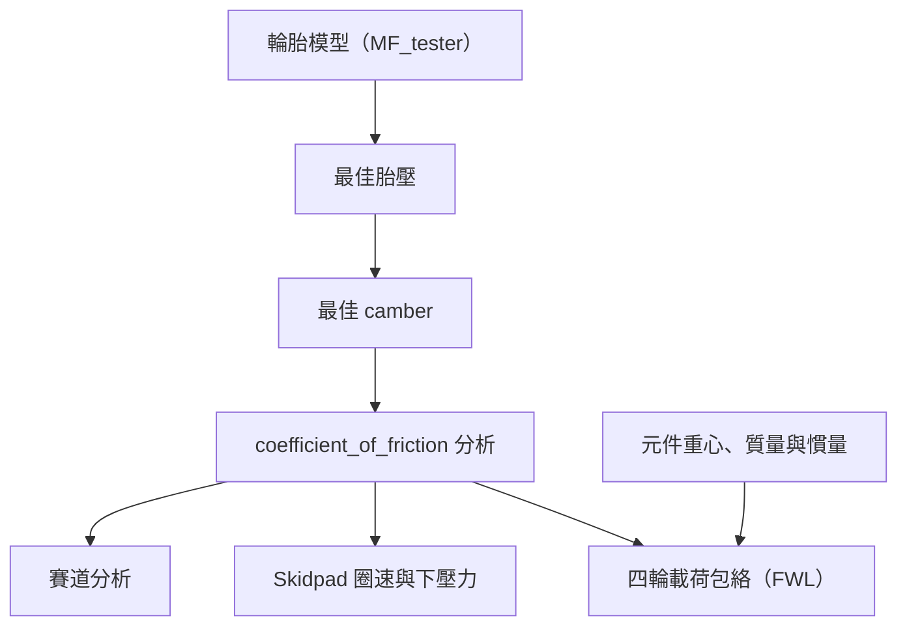

# 輪胎分析

整合來源為 `new/Pacejka_tire_model`、`new/Tire_pressure.py`、`new/Tire_camber.py` 與 `new/coefficient_of_friction`。可執行模型放在 `analysis/Pacejka_tire_model`，輪胎資料固定使用 `data/input_data/tire.tir`；原始 `new` 檔案保留。

這四個節點排在 `data/analysis_flow.csv` 最前方。單擊節點查看參數，雙擊查看圖表。最佳 camber 自動取得最佳胎壓；摩擦係數分析自動取得最佳胎壓與 camber；後續分析自動使用導出的 μx／μy。這些導出量不顯示輸入框。執行任一後續節點時，系統會先重算所需的輪胎分析，不使用先前 CSV 的摩擦係數快照。

## 輪胎模型

`Tire_model.py` 呼叫整合後的 `Pacejka_tire_model/MF_tester.py`。沿用原始掃描範圍及模型公式，改為一次計算 NumPy 網格，並移除匯入時執行、`plt.show()` 與直接寫檔行為；由共用結果儲存器輸出。

- 輪胎檔固定為 `data/input_data/tire.tir`，四個節點共用，不提供檔名或路徑輸入框。
- 展示胎壓固定為 82319 Pa、camber 固定為 0°，由 `workflow.py` 的 `MODEL_PRESSURE_PA`／`MODEL_CAMBER_DEG` 設定，不提供輸入框。

展示設定只控制第一階段圖表；最佳化階段依下列固定候選值獨立搜尋。輸出為原始 `Figures` 的全部 19 張圖：`FX`、`FY`、`MX`、`MZ`、`RRT` 各有 `alphafix`、`kappafix`、`Fzfix` 三張，共 15 張；另外有摩擦圓隨滑移率／載荷變化的曲面與曲線各兩張。圖片保留原檔名並列入 `plots.json`，`plot.png` 是 FY 固定滑移率圖的主要結果捷徑。

## 最佳胎壓與 camber

沿用來源程式的 **Fy RMS 最大值** 作為選擇準則，因來源說明側向 TTC 擬合資料較完整。胎壓候選值為 8、9、10、11、12、13、14 psi，在 camber=0°、純側滑下掃描；再固定最佳胎壓，搜尋 −4.5、−3、−1.5、0、1.5、3、4.5°。

兩步都以側滑角 −10～10°、載荷 0～1400 N 的 61×61 等間距網格計算：

$$\mathrm{RMS}(F_y)=\sqrt{\frac{1}{n}\sum_j F_{y,j}^{2}}.$$

「最佳」指這組候選值與掃描工況下的離散最佳值。若最佳點落在邊界，不能解讀為超出掃描範圍的全域最優。輸出包括最佳胎壓（psi／Pa）、camber（deg）、RMS 比較 CSV、Fy 曲面及 RMS 圖。

## 摩擦係數

使用前兩步結果重算 `Fx_mu.py`、`Fy_mu.py`、`mu.py` 的圖表。縱向掃描滑移率 −1～1（61 點），橫向掃描側滑角 −10～10°（81 點），載荷均為 0～1400 N（61 點）。保留原程式的選峰方式：Fx 取正向驅動峰值，Fy 取絕對值峰值；排除 Fz=0 後，採用固定通過原點的最小平方回歸：

$$\mu_{\mathrm{RL}}=\frac{\sum_i F_{z,i}F_{\mathrm{peak},i}}{\sum_i F_{z,i}^{2}},\qquad
\mu_{\max}=\max_i\frac{F_{\mathrm{peak},i}}{F_{z,i}}.$$

所有側滑角與 camber 輸入皆為 **度**；模型內部才轉為弧度，圖表不再重複轉換。

| 導出量 | 後續用途 |
| --- | --- |
| `tire_pressure_Pa` | camber 與摩擦係數分析 |
| `tire_camber_deg` | 摩擦係數分析 |
| `mu_x_RL` → `mu_w` | 縱向輪胎力上限、傳動、煞車 |
| `mu_y_RL` → `wl_mu_y` | 賽道、Skidpad、下壓力目標、彎速與橫向輪胎力上限 |
| `mu_x_max`、`mu_y_max` | 掃描中的峰值摩擦係數，供檢視比較 |

FWL 保留原有質量、重心、加速度與下壓力平衡式，輪胎分析是其必要前置分析；其後的 `max_load` 使用導出的 μx／μy 計算輪胎獨立方向力上限。FWL 的加速度範圍仍由 `ax`／`ay` 輸入控制，摩擦係數不會自行改寫加速度設定。

四個節點結果分別放在 `data/results/tire_model`、`tire_pressure`、`tire_camber`、`coefficient_of_friction`，包括圖表、輸入／導出參數 CSV 與比較表。摩擦係數節點另外輸出 `tire.json`，供後續程式讀取；流程內透過導出參數傳遞，不依賴這個檔案的舊值。
