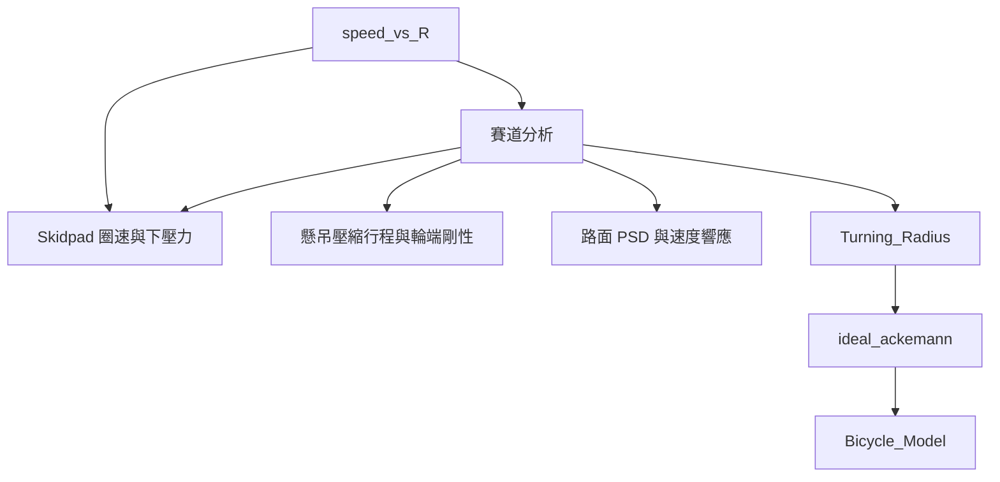

# 賽道分析

`new/` 的賽道分析已整理到共用分析流程：

- `analysis/TrackAnalysis.py`：介面插件入口（`track_analysis`）。
- `geometry.py`：由 Excel 重建中心線、平滑曲率、偵測 Apex、曲率 FFT 與半徑分布。
- `score_weight.py`：依彎道時間比例分配 Autocross／Endurance 分數，並加入 Skidpad 分數。
- `track_data.py`：集中保存賽道摘要與各半徑分布。
- `data/input_data/input_map.xlsx`：原 `new/input_map.xlsx`，預設賽道輸入；路徑集中在插件的 `INPUT_MAP`。

流程圖由 `speed_vs_R` 連入「賽道分析」，保留到三個既有節點的連線，並延伸轉向分析：



在流程圖單擊節點可調整網格大小、最高速度、統計半徑上限、共用輪胎摩擦係數 `mu_w`，以及三個賽事的分數。預設值沿用原程式：0.1 m、110 km/h、100 m、1.7，以及 75／100／250 分；這些分數是可編輯的分析設定。雙擊節點可開啟分析結果，圖片選單提供原有十張賽道圖與分數權重圖，共十一張。

三條箭頭表達分析流程；下游計算沿用各自資料：Skidpad 使用 18.25 m 直徑與目標圈速，懸吊使用 `ax`／`ay`，PSD 使用 `data/input_data/vt_data.csv`。賽道半徑、曲率 FFT 與分數權重供選擇分析工況參考。

## 計算與輸出

彎速估算使用 `v = min(sqrt(mu_w * 9.81 * R), track_max_speed_kmh / 3.6)`，各網格時間為 `dx / v`。原程式的 `sqrt(mu_y * R)` 缺少重力加速度，整合時已修正；`dx` 改用相鄰累積距離之差，讓網格長度總和等於賽道總長。

半徑統計以平滑曲率換算，僅累計半徑上限內的彎道，排除直線。時間估算未包含加減速、下壓力、坡度、Banking 或 Grip Factor 的速度修正，不能作為完整圈速。分數模型依這些彎道的時間比例分配 Autocross＋Endurance 分數，將全部 Skidpad 分數加在最接近 9.125 m 的非空半徑區間，再依總分排序。曲率 FFT 的單位是空間頻率（1/m），與 PSD 的時間激振頻率（Hz）分別顯示。

結果統一儲存在 `data/results/track_analysis/`：

- `plot.png`、其他十張 PNG、`plots.json`：接入既有圖片選單。
- `result.csv`：輸入與導出量。
- `radius_distribution_length.csv`、`radius_distribution_time.csv`、`radius_distribution_score.csv`：完整排序表。
- `OpenTRACK.npz`：各網格幾何、曲率、Apex 與賽道資訊。
- `track.json`：賽道摘要與三種分布；沿用原欄位名稱。
- `OpenTRACK.log`：計算摘要與文字地圖。

不需要預先產生 `track.json`，載入插件時也不會執行命令列或繪圖。

也可從命令列執行；`--output` 指定結果根目錄，其下建立 `track_analysis/`：

```powershell
.venv/Scripts/python.exe -X utf8 -m analysis.track_analysis
.venv/Scripts/python.exe -X utf8 -m analysis.track_analysis data/input_data/input_map.xlsx --mesh-size 0.2 --output data/results
```
