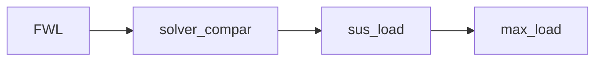

# 四輪載重與輪胎力：計算方程式

以下方程式對應 `models.py` 與 `workflow.py` 的實際計算。分析依序為 FWL、solver_compar、sus_load、max_load，先求四輪法向載重，再計算指定工況的輪胎力上限。

## 共用符號與單位

四輪索引固定為 $i\in\{FL,FR,RL,RR\}$。座標採 $x$ 向前、$y$ 向左、$z$ 向上；正縱向加速度使前軸卸載，正側向加速度使右側增載。

- $m_s$：全車簧上質量，對應 `ms`；$m_u$：單輪簧下質量，對應 `mu`，單位皆為 kg。
- $L$：軸距；$h$：全車重心高度；$t_f,t_r$：前、後輪距，單位皆為 m。依序對應 `L`、`h_cog`、`t`、`hl_rear_track_m`。
- $f$：前軸靜態重量比例，對應 `hl_front_weight_ratio`；後軸比例為 $1-f$。
- $D$：總下壓力，向下為正，單位 N，對應 `wl_downforce_N`；$\eta$：空力前軸分配比例，對應 `wl_aero_front_ratio`。
- $N_i$：第 $i$ 輪法向載重，向上為正，單位 N。

總質量與重力加速度為：

$$
m=m_s+4m_u,\qquad g=9.81\ \mathrm{m/s^2}
$$

CSV 的 `ax`、`ay` 是以 g 為單位的無因次輸入，以下以 $\gamma_x,\gamma_y$ 表示；代入方程式前先換算成 SI 加速度：

$$
a_x=g\gamma_x,\qquad a_y=g\gamma_y
$$

以下兩個量供四個節點共用：$W$ 為重力與下壓力的總承載，$\Delta_x$ 為前軸轉移到後軸的載重量。

$$
W=mg+D,\qquad \Delta_x=\frac{ma_xh}{L}
$$

前、後軸總載重分別為：

$$
N_f=mgf+D\eta-\Delta_x
$$

$$
N_r=mg(1-f)+D(1-\eta)+\Delta_x
$$

因此 $N_f+N_r=W$。前軸與後軸的縱向轉移量大小相等，保留正負號以涵蓋加速與煞車。下壓力視為固定工況值，作用點沒有橫向偏移。

## FWL：依重心比例求四輪載重

此方法假設橫向轉移力矩依前後靜態重量比例分配。總滾轉力矩及各軸的單側載重增減為：

$$
M_\phi=ma_yh
$$

$$
\Delta_f^{CG}=\frac{fM_\phi}{t_f},\qquad \Delta_r^{CG}=\frac{(1-f)M_\phi}{t_r}
$$

各軸左輪減載、右輪增載，得到四輪輪載：

$$
N_{FL}^{CG}=\frac{N_f}{2}-\Delta_f^{CG},\qquad N_{FR}^{CG}=\frac{N_f}{2}+\Delta_f^{CG}
$$

$$
N_{RL}^{CG}=\frac{N_r}{2}-\Delta_r^{CG},\qquad N_{RR}^{CG}=\frac{N_r}{2}+\Delta_r^{CG}
$$

各軸的左右輪載差是單側轉移量的兩倍：

$$
N_{FR}^{CG}-N_{FL}^{CG}=2\Delta_f^{CG},\qquad N_{RR}^{CG}-N_{RL}^{CG}=2\Delta_r^{CG}
$$

包絡在指定的加速度矩形範圍取樣，每個方向的點數為 `wl_grid_points`：

$$
a_x\in[-g|\gamma_x|,g|\gamma_x|],\qquad a_y\in[-g|\gamma_y|,g|\gamma_y|]
$$

各輪離地邊界與四輪非負輪載條件為：

$$
N_i(a_x,a_y)=0,\qquad \min_i N_i(a_x,a_y)\geq0
$$

輸出前、後軸輪載等高圖、三維疊圖與 `wheel_load_envelope.csv`。計算保留負輪載，以便辨認已超出四輪保持接地假設的工況。

## solver_compar：平衡方程式與最小範數解

### 幾何與三個平衡約束

以重心為原點，前、後輪的縱向座標為：

$$
x_{FL}=x_{FR}=L(1-f),\qquad x_{RL}=x_{RR}=-Lf
$$

左右輪的橫向座標為：

$$
y_{FL}=\frac{t_f}{2},\quad y_{FR}=-\frac{t_f}{2},\quad y_{RL}=\frac{t_r}{2},\quad y_{RR}=-\frac{t_r}{2}
$$

定義輪載向量，以及平衡矩陣的各元素：

$$
\mathbf{N}=(N_{FL},N_{FR},N_{RL},N_{RR})^{\mathsf{T}}
$$

$$
A_{1i}=1,\qquad A_{2i}=x_i,\qquad A_{3i}=y_i
$$

三個約束分別為垂向力平衡、縱向載重一階矩與橫向載重一階矩：

$$
\sum_i N_i=mg+D
$$

$$
\sum_i x_iN_i=-ma_xh+DL(\eta-f)
$$

$$
\sum_i y_iN_i=-ma_yh
$$

將右側依序定義為 $b_1,b_2,b_3$，即可寫成：

$$
A\mathbf{N}=\mathbf{b},\qquad \mathbf{b}=(b_1,b_2,b_3)^{\mathsf{T}}
$$

其中 $b_1$ 單位為 N，$b_2,b_3$ 單位為 Nm。空力項 $DL(\eta-f)$ 表示空力分配與靜態重量分配不同時，額外產生的縱向載重一階矩。

### 最小範數求解器

四個未知輪載只有三個獨立平衡約束，LSM 以最小化輪載向量的平方範數選取其中一個解：

$$
\min_{\mathbf{N}}\frac{1}{2}\mathbf{N}^{\mathsf{T}}\mathbf{N}\qquad A\mathbf{N}=\mathbf{b}
$$

在矩陣滿列秩時，解為：

$$
\mathbf{N}_{LSM}=A^{\mathsf{T}}(AA^{\mathsf{T}})^{-1}\mathbf{b}
$$

這是最小歐氏範數解。此步驟尚未施加輪載非負約束，也沒有以懸吊變形能決定四輪載重。

### 零空間方向與接地可行範圍

CG 與 LSM 滿足相同平衡約束，兩解差向量位於 $A$ 的零空間：

$$
\mathbf{V}=\mathbf{N}_{CG}-\mathbf{N}_{LSM},\qquad A\mathbf{V}=\mathbf{0}
$$

但當兩解相同時，$\mathbf{V}=\mathbf{0}$，沿差向量改變係數不會改變輪載，不能用來描述完整合法解空間。因此差向量僅用於求解器差異圖；可行係數改用下列非零基底。

由輪距建立一個固定方向：

$$
\mathbf{u}=(1,-1,-t_f/t_r,t_f/t_r)^{\mathsf{T}}
$$

以前述總承載的四分之一作為固定力尺度：

$$
\mathbf{v}=\frac{W}{4}\frac{\mathbf{u}}{\max_i|u_i|},\qquad A\mathbf{v}=\mathbf{0}
$$

$\mathbf{v}$ 的單位為 N，尺度在整個側向掃描中保持不變。其前、後軸內部的兩輪增量和皆為零，左右載重一階矩也互相抵消。因此可建立完整的一維平衡解族：

$$
\mathbf{N}(\alpha)=\mathbf{N}_{LSM}+\alpha\mathbf{v}
$$

接地條件要求每一輪皆非負：

$$
N_{LSM,i}+\alpha v_i\geq0
$$

係數 $\alpha$ 為無因次量。當 $v_i>0$ 時給出下界；當 $v_i<0$ 時給出上界，合併四輪得到：

$$
\alpha_{\min}=\max_{i:v_i>0}\left(-\frac{N_{LSM,i}}{v_i}\right)
$$

$$
\alpha_{\max}=\min_{i:v_i<0}\left(-\frac{N_{LSM,i}}{v_i}\right)
$$

合法解的上下界交集為：

$$
\alpha\in[\alpha_{\min},\alpha_{\max}],\qquad \alpha_{\min}\leq\alpha_{\max}
$$

圖中的陰影只填入交集非空的區域。上下界相交時，可行解縮成單點；若 $\alpha_{\min}>\alpha_{\max}$，則沒有滿足四輪非負輪載的平衡解，不再繪製陰影。

CG 解在此基底中的位置另以虛線表示：

$$
\alpha_{CG}=\frac{\mathbf{v}^{\mathsf{T}}(\mathbf{N}_{CG}-\mathbf{N}_{LSM})}{\mathbf{v}^{\mathsf{T}}\mathbf{v}}
$$

### 對稱工況的解析檢查

在 $t_f=t_r=t$、$f=1/2$、$D=0$、$a_x=0$、$a_y\geq0$ 時，上下界簡化為：

$$
\alpha_{\min}=-1+\frac{2ha_y}{gt},\qquad
\alpha_{\max}=1-\frac{2ha_y}{gt}
$$

因此可行區間寬度隨側向加速度線性縮小，收斂位置為：

$$
\frac{a_{y,lim}}{g}=\frac{t}{2h}
$$

目前預設 $t=1.25\ \mathrm{m}$、$h=0.3\ \mathrm{m}$，交點約在 2.083 g。這是三個剛體平衡約束下的非負輪載極限；若懸吊剛度分配固定為特定解，實際單輪可能更早達到零輪載。

比較圖使用指定的 $a_x,a_y$；側向與可行範圍掃描採 $a_x=0$、$a_y\in[0,g|\gamma_y|]$。輸出 `solver_comparison.csv` 與 `null_space_sweep.csv`，後者保留上下界、CG 係數、固定基底及有效性。圖軸依實際上下界自動縮放，不再使用固定 [-5, 5] 視窗。

## sus_load：依懸吊剛性分配輪載

### 由彈簧剛度換算軸端剛度

定義 $k_p$、$k_r$ 分別為 `Ks_pitch_N_per_m`、`Ks_roll_N_per_m`，單位 N/m；$R_h$ 為 `MR`；$\rho_h$、$\rho_\phi$ 分別為後軸 heave、roll 彈簧比例，對應 `hl_rear_heave_spring_ratio`、`hl_rear_roll_spring_ratio`。

前、後軸 heave 輪端剛度為：

$$
K_{hf}=k_pR_h^2,\qquad K_{hr}=\rho_h k_pR_h^2
$$

令 $R_{\phi f},R_{\phi r}$ 為前、後軸 roll motion ratio，對應 `hl_front_roll_motion_ratio`、`hl_rear_roll_motion_ratio`。懸吊端 roll 剛度為：

$$
K_{\phi f}=k_r(R_{\phi f}t_f)^2
$$

$$
K_{\phi r}=\rho_\phi k_r(R_{\phi r}t_r)^2
$$

$K_{hf},K_{hr}$ 單位為 N/m，$K_{\phi f},K_{\phi r}$ 單位為 Nm/rad。以上採既有解耦彈簧定義，未將其視為每輪各一支相同彈簧而另乘並聯倍率。

### 前後軸滾轉分配與四輪載重

以 roll 剛度比例決定前軸承擔的滾轉力矩：

$$
\beta_f=\frac{K_{\phi f}}{K_{\phi f}+K_{\phi r}}
$$

兩軸的單側載重轉移量為：

$$
\Delta_f^{sus}=\frac{\beta_fma_yh}{t_f},\qquad \Delta_r^{sus}=\frac{(1-\beta_f)ma_yh}{t_r}
$$

因此四輪載重為：

$$
N_{FL}^{sus}=\frac{N_f}{2}-\Delta_f^{sus},\qquad N_{FR}^{sus}=\frac{N_f}{2}+\Delta_f^{sus}
$$

$$
N_{RL}^{sus}=\frac{N_r}{2}-\Delta_r^{sus},\qquad N_{RR}^{sus}=\frac{N_r}{2}+\Delta_r^{sus}
$$

其中 $N_f,N_r$ 沿用共用軸載重方程式。與 CG 法的差異在於橫向力矩分配由 $f$ 改為 $\beta_f$；兩者都維持總垂向力與載重一階矩平衡。

### 縱向轉移造成的增量位移與 pitch

縱向轉移量仍由剛體平衡決定：

$$
\Delta_x=\frac{ma_xh}{L},\qquad \Delta N_f=-\Delta_x,\qquad \Delta N_r=+\Delta_x
$$

前、後軸 heave 剛度用於估算載重轉移造成的增量壓縮量：

$$
\Delta z_f=-\frac{\Delta_x}{K_{hf}},\qquad \Delta z_r=\frac{\Delta_x}{K_{hr}}
$$

以小角度近似取得正加速時的抬頭角：

$$
\theta=\frac{\Delta z_r-\Delta z_f}{L}=\frac{\Delta_x}{L}\left(\frac{1}{K_{hf}}+\frac{1}{K_{hr}}\right)
$$

$$
\theta_{deg}=\frac{180}{\pi}\theta
$$

此角度僅表示縱向慣性轉移造成的增量，不含靜態車高或下壓力造成的基準姿態。前後剛度不同時，載重轉移量仍等量反向，變化的是位移大小。

此準靜態模型未另計 roll center 幾何轉移、簧下獨立轉移或輪胎順應性。輸出 `suspension_load_envelope.csv`、`stiffness.csv`，並以 `operating_point.csv` 記錄指定 $a_x,a_y$ 的四輪原始輪載，交給 max_load 使用。

## max_load：指定工況的輪胎力上限

讀取 sus_load 在指定工況的輪載，定義原始垂向力及截零後的接觸力參考值：

$$
F_{z,i}^{raw}=N_i^{sus},\qquad F_{z,i}^{+}=\max(F_{z,i}^{raw},0)
$$

令 $\mu_x$ 對應 `mu_w`、$\mu_y$ 對應 `wl_mu_y`；兩者由前置 `coefficient_of_friction` 輪胎分析的回歸結果導出。各輪縱向、側向獨立力上限為：

$$
F_{x,i}^{lim}=\mu_xF_{z,i}^{+},\qquad F_{y,i}^{lim}=\mu_yF_{z,i}^{+}
$$

因此單一方向分別滿足：

$$
|F_{x,i}|\leq F_{x,i}^{lim},\qquad |F_{y,i}|\leq F_{y,i}^{lim}
$$

### 摩擦橢圓示意

當兩個方向上限皆大於零時，示意性的組合力限制為：

$$
\left(\frac{F_{x,i}}{\mu_xF_{z,i}^{+}}\right)^2+\left(\frac{F_{y,i}}{\mu_yF_{z,i}^{+}}\right)^2\leq1
$$

橢圓邊界圖使用參數 $\psi\in[0,2\pi]$：

$$
F_{x,i}=\mu_xF_{z,i}^{+}\cos\psi,\qquad F_{y,i}=\mu_yF_{z,i}^{+}\sin\psi
$$

兩方向的獨立上限不能同時取滿。若某方向摩擦係數為零，該方向力上限即為零；若輪載截零，則兩方向力上限皆為零。橢圓僅為組合力示意，沒有輪胎負載敏感度或操穩極限求解。

### 輸出摘要與有效性

程式的三個最大值輸出是在目前工況比較四輪：

$$
F_z^{max}=\max_i F_{z,i}^{+},\qquad F_x^{max}=\max_i F_{x,i}^{lim},\qquad F_y^{max}=\max_i F_{y,i}^{lim}
$$

這些值沒有對整個加速度包絡再取全域最大。整車接地有效性以所有原始輪載皆非負為條件：

$$
\min_i F_{z,i}^{raw}\geq0
$$

滿足時 `contact_valid` 為 1，否則為 0。若存在負輪載，截零會增加四輪接觸力的總和：

$$
\sum_i F_{z,i}^{+}=mg+D-\sum_{i:F_{z,i}^{raw}<0}F_{z,i}^{raw}
$$

因此截零後的力只能作為參考值，沒有重新求解離地後的接觸力分配。`tire_force_limits.csv` 同時保留原始輪載、截零輪載、方向力上限與接地旗標。

## 流程與執行方式



四個節點共用 `data/analysis_flow.csv`，使用 `flow_row=tertiary`；第一個 FWL 的 `branch_from=cog_movable`，並透過 `extra_from=coefficient_of_friction` 接收輪胎分析分支，其餘節點依序串接。執行 FWL 或其後續節點時，會先重算輪胎模型、最佳胎壓、最佳 camber 與摩擦係數。`COG_movable` 從 Excel 元件資料計算 `ms`、平均單輪 `mu` 與慣量；前軸配重比例和軸距使用手動輸入的前、後輪中心 x 座標，Excel 元件重心座標不代替輪心。重心離地高度 `h_cog` 也直接手動輸入。單擊節點編輯獨立輸入，雙擊查看圖表、CSV 與本節方程式。

主視窗只有一張流程圖，輪載群組接在共用的重心資料起點。使用既有的「Run 全流程」或「單獨執行所選分析」，後者會重讀 Excel 並重算必要的前置分析。`Ks_pitch_N_per_m`、`Ks_roll_N_per_m` 仍取自共用剛性分析的輸出。

無視窗執行：

```powershell
.venv/Scripts/python.exe -B -X utf8 -m analysis.wheel_load
```

支援 `--csv <參數路徑>` 與 `--output <結果根目錄>`。完整方程式與圖表報告位於 `data/results/wheel_load/index.html`；每個節點的 `analysis.md` 僅保留共用定義與該節計算方程式。
