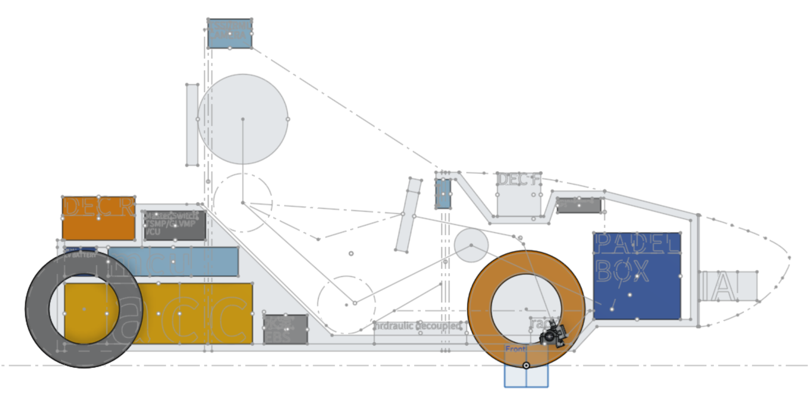
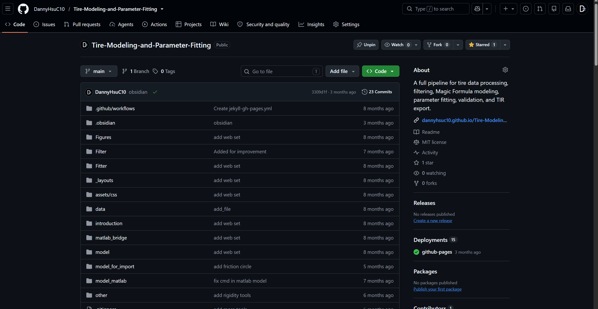

# Basic data source

## 車體

1. Center_of_gravity_LP03_sprung : 初始車輛布局評估
1. Center_of_gravity_LP03_unsprungfront : 初始車輛布局評估
1. Center_of_gravity_LP03_unsprungrear : 初始車輛布局評估

## 輪胎

1. tire.tir : 輪胎模型fitting
1. tire_force_map.pkl : 從tir mapping

## lapsim

1. vt_data : lapsim速度資料

## 其他

1. input_map.xlsx : 地圖圖資 by lap tool
1. motor_speed_vs_torque : 馬達實驗 by raw motor data fitting
1. brake_line_data : 煞車實驗

## 目前還沒建立
1. aero map : 目前還沒有建

