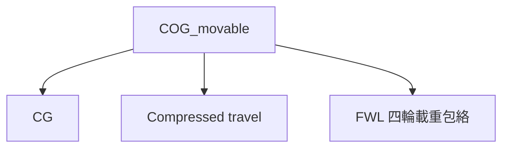

# COG_movable：元件質量、重心與慣性

此分析是整個流程的資料起點，讀取 `data/input_data` 中的三份 LP03 Excel。第一列為欄位、第二列為單位；每列代表一個元件的質量與質心位置。來源檔案保持不變，輸出的 `mass_components.csv` 保留檔案、工作表與原始列號。

側視圖以 `component_id` 標註元件，同一側視位置的左右元件合併標註；完整名稱可在結果的「mass_components」表查閱，避免長名稱重疊。

## 座標與幾何

Excel 的 `(0,0,0)` 是原設定重心，x 朝前、y 朝左、z 朝上。元件加總得到的是相對原設定重心的新偏移，不強制把加總偏移歸零。**重心離地高度 `h_cog` 完全由使用者手動設定**，預設 **0.3 m**；Excel 的 z 偏移只用於相對重心與慣量分析，不會加到 `h_cog`。

在 `COG_movable` 節點的「重心高度 h_cog（m）」輸入高度，後續節點共用同一值。簧上／簧下質量不顯示輸入框；三份 Excel 檔案路徑固定在 `analysis/COG_movable.py`，不存於 CSV。Excel 使用 `data/input_data` 中既定的三份檔案，質量計算值可在結果表查看。

前、後輪中心 x 座標由使用者在 `COG_movable` 節點手動輸入，基準為 Excel 原點；Excel 的 dx 是各零件重心座標，特別是輪端零件重心，不作為輪心座標。軸距 `L` 由手動輸入的前輪中心 x 減後輪中心 x。簧上元件的 `dy` 直接使用 m；簧下表的 `dy/y` 依原程式與單位列 m/m，乘以該軸輪距。所有元件的一次矩、二次矩與圖表都使用同一組換算後座標。

$$
L=x_f-x_r,\qquad y_{u,f}=(dy/y)t_f,\qquad y_{u,r}=(dy/y)t_r
$$

初始輸入值沿用原參數檔的 1.53 m 軸距，設為前輪中心 x = 0.765 m、後輪中心 x = −0.765 m；請在輸入框改成實際輪心座標。Excel 的輪端元件 dx 不會被當作輪心位置。

## 質量與重心

$$
m=\sum_i m_i,\qquad \mathbf{M}=\sum_i m_i\mathbf{r}_i,\qquad
\mathbf{r}_{CG}=\frac{\mathbf{M}}{m}
$$

$$
ms=m_{sprung},\qquad mu=\frac{m_{u,f}+m_{u,r}}{4},\qquad
mu_{front}=\frac{m_{u,f}}{2},\qquad mu_{rear}=\frac{m_{u,r}}{2}
$$

`ms` 是全車簧上質量；`mu` 是四輪平均，供原有四分之一車與總質量公式使用。Heave／Roll 的前後軸模型改用各軸的 `mu_front`、`mu_rear`。目前這些軸模型仍假設同軸左右質量相同。

$$
f_f=\frac{x_{CG}-x_r}{L}
$$

`hl_front_weight_ratio` 是**全車前軸靜態重量比例**，用於 FWL 與輪胎靜態承載。為保持前後簧下質量不同時的軸載重一致，簧上前軸承載比例另外計算：

$$
f_{s,f}=\frac{m f_f-m_{u,f}}{ms}
$$

此值輸出為 `hl_sprung_front_weight_ratio`，供前後軸 heave 的簧上質量與靜態彈簧承載使用。

## 慣性張量

$$
\mathbf{I}_{CG}=\sum_i m_i\left[(\mathbf{q}_i\cdot\mathbf{q}_i)\mathbf{1}
-\mathbf{q}_i\mathbf{q}_i^T\right],\qquad
\mathbf{q}_i=\mathbf{r}_i-\mathbf{r}_{CG}
$$

$$
I_{xx,s}=\sum_{i\in sprung}m_i\left[(y_i-y_{CG,s})^2+(z_i-z_{CG,s})^2\right]
$$

`hl_sprung_roll_inertia_kg_m2` 使用**僅簧上元件、繞簧上重心的 x 軸**的慣量。`mass_properties.csv` 同時提供簧上、前簧下、後簧下、全車的重心、一次矩、原點與各自重心處的慣性張量。

Excel 只提供元件質量與位置，因此這是**元件集中質量近似**，未包含每個元件繞自身質心的慣量。Heave／Roll 既有簧下 roll 模型仍採輪距處的集中質量近似；本次沒有把全車 Ixx 誤當簧上 Ixx。

## 初始資料結果

| 導出量 | 數值 |
| --- | ---: |
| 全車簧上質量 ms | 260.55 kg |
| 前／後軸簧下質量 | 29.0／28.6 kg |
| 平均單輪簧下質量 mu | 14.4 kg |
| 全車總質量 | 318.15 kg |
| 簧上重心處 roll 慣量 | 7.917820 kg m² |
| 全車前軸重量比例 | 51.588111% |
| 簧上前軸承載比例 | 51.862435% |

`h_cog` 是獨立手動輸入，預設 0.3 m，不列為 Excel 導出量。

## 流程與更新

舊 CSV 中的質量、配重、慣量與軸距不再覆寫來源結果；手動 `h_cog` 保留並傳遞所有下游分析。質量輸入框已移除，其他導出欄位顯示為唯讀。選跑下游節點時，重新讀取 Excel 並重算必要前置分析，避免繼續使用修改資料前的質量或剛性。
