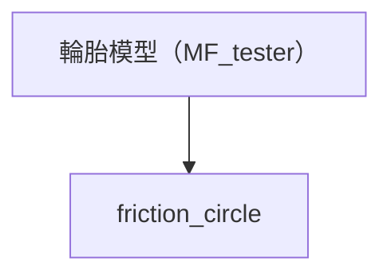

# friction_circle 摩擦圓分析

以 Magic Formula 輪胎模型計算不同側滑角、滑移率及垂直載荷下的縱向力 Fx 與橫向力 Fy，呈現聯合滑移時兩個方向輪胎力的變化。

## 分析流程

選擇「所選分析＋前置分析」時，MF_tester 是必要前置分析。此節點沿用 MF_tester 的固定展示設定，輪胎資料讀取 `data/input_data/tire.tir`。

## 預設展示參數

- 胎壓：82319 Pa。
- Camber：0°。
- 車速：10 m/s。
- 側滑角：−10°～10°。
- 每張曲面使用 50×50 網格。

這些設定用於展示，沒有額外參數輸入框；本節點不使用最佳胎壓或最佳 camber 的搜尋結果。

## 圖表解讀

### 摩擦圓隨滑移率變化

固定垂直載荷 Fz=800 N，掃描側滑角 −10°～10°、滑移率 κ=−0.25～0.25。曲面的 X、Y、Z 軸依序為 Fx（N）、Fy（N）與滑移率 κ。

可觀察固定輪載下，增加驅動或煞車滑移時，縱向力與橫向力如何共同變化。主圖 `plot.png` 對應此圖，完整檔名為 `Friction_Circle_vs_Slip_Ratio.png`。

### 摩擦圓隨垂直載荷變化

固定滑移率 κ=0.1，掃描側滑角 −10°～10°、垂直載荷 Fz=0～1400 N。曲面的 X、Y、Z 軸依序為 Fx（N）、Fy（N）與垂直載荷 Fz（N）。

可比較不同輪載下的聯合滑移輪胎力及載荷敏感性。檔名為 `Friction_Circle_vs_Fz.png`，可從結果區圖片選單切換。

兩張圖都以模型計算的 Fx、Fy 直接繪製網格曲面。「摩擦圓」是圖表名稱，實際形狀由輪胎模型及掃描範圍決定；此分析未搜尋所有工況下的最大力包絡，也不額外擬合圓形或橢圓形邊界。

## 輸出結果

- `friction_circle_figure_count`：分析產生的圖表數，預設為 2；`plot.png` 是主圖捷徑，不重複計數。
- `result.csv`：記錄圖表數導出量。
- `plots.json`：提供結果區圖表選單的檔名與標題。

圖表來源為 `new/friction_circle.py`，整合程式為 `analysis/tire_analysis/friction_circle.py`。完整輪胎分析方法見 [輪胎分析說明](../../../analysis/tire_analysis/README.md)。
