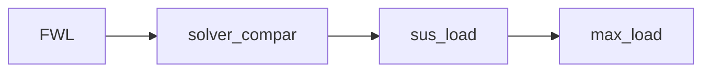

# solver_compar 求解器與零空間比較：計算方程式

## 共用符號與單位

四輪索引固定為 $i\in\{FL,FR,RL,RR\}$。座標採 $x$ 向前、$y$ 向左、$z$ 向上；正縱向加速度使前軸卸載，正側向加速度使右側增載。

- $m_s$：全車簧上質量，對應 `ms`；$m_u$：單輪簧下質量，對應 `mu`，單位皆為 kg。
- $L$：軸距；$h$：全車重心高度；$t_f,t_r$：前、後輪距，單位皆為 m。依序對應 `L`、`h_cog`、`t`、`hl_rear_track_m`。
- $f$：前軸靜態重量比例，對應 `hl_front_weight_ratio`；後軸比例為 $1-f$。
- $D$：總下壓力，向下為正，單位 N，對應 `wl_downforce_N`；$\eta$：空力前軸分配比例，對應 `wl_aero_front_ratio`。
- $N_i$：第 $i$ 輪法向載重，向上為正，單位 N。

總質量與重力加速度為：

$$
m=m_s+4m_u,\qquad g=9.81\ \mathrm{m/s^2}
$$

CSV 的 `ax`、`ay` 是以 g 為單位的無因次輸入，以下以 $\gamma_x,\gamma_y$ 表示；代入方程式前先換算成 SI 加速度：

$$
a_x=g\gamma_x,\qquad a_y=g\gamma_y
$$

以下兩個量供四個節點共用：$W$ 為重力與下壓力的總承載，$\Delta_x$ 為前軸轉移到後軸的載重量。

$$
W=mg+D,\qquad \Delta_x=\frac{ma_xh}{L}
$$

前、後軸總載重分別為：

$$
N_f=mgf+D\eta-\Delta_x
$$

$$
N_r=mg(1-f)+D(1-\eta)+\Delta_x
$$

因此 $N_f+N_r=W$。前軸與後軸的縱向轉移量大小相等，保留正負號以涵蓋加速與煞車。下壓力視為固定工況值，作用點沒有橫向偏移。

## solver_compar：平衡方程式與最小範數解

### 幾何與三個平衡約束

以重心為原點，前、後輪的縱向座標為：

$$
x_{FL}=x_{FR}=L(1-f),\qquad x_{RL}=x_{RR}=-Lf
$$

左右輪的橫向座標為：

$$
y_{FL}=\frac{t_f}{2},\quad y_{FR}=-\frac{t_f}{2},\quad y_{RL}=\frac{t_r}{2},\quad y_{RR}=-\frac{t_r}{2}
$$

定義輪載向量，以及平衡矩陣的各元素：

$$
\mathbf{N}=(N_{FL},N_{FR},N_{RL},N_{RR})^{\mathsf{T}}
$$

$$
A_{1i}=1,\qquad A_{2i}=x_i,\qquad A_{3i}=y_i
$$

三個約束分別為垂向力平衡、縱向載重一階矩與橫向載重一階矩：

$$
\sum_i N_i=mg+D
$$

$$
\sum_i x_iN_i=-ma_xh+DL(\eta-f)
$$

$$
\sum_i y_iN_i=-ma_yh
$$

將右側依序定義為 $b_1,b_2,b_3$，即可寫成：

$$
A\mathbf{N}=\mathbf{b},\qquad \mathbf{b}=(b_1,b_2,b_3)^{\mathsf{T}}
$$

其中 $b_1$ 單位為 N，$b_2,b_3$ 單位為 Nm。空力項 $DL(\eta-f)$ 表示空力分配與靜態重量分配不同時，額外產生的縱向載重一階矩。

### 最小範數求解器

四個未知輪載只有三個獨立平衡約束，LSM 以最小化輪載向量的平方範數選取其中一個解：

$$
\min_{\mathbf{N}}\frac{1}{2}\mathbf{N}^{\mathsf{T}}\mathbf{N}\qquad A\mathbf{N}=\mathbf{b}
$$

在矩陣滿列秩時，解為：

$$
\mathbf{N}_{LSM}=A^{\mathsf{T}}(AA^{\mathsf{T}})^{-1}\mathbf{b}
$$

這是最小歐氏範數解。此步驟尚未施加輪載非負約束，也沒有以懸吊變形能決定四輪載重。

### 零空間方向與接地可行範圍

CG 與 LSM 滿足相同平衡約束，兩解差向量位於 $A$ 的零空間：

$$
\mathbf{V}=\mathbf{N}_{CG}-\mathbf{N}_{LSM},\qquad A\mathbf{V}=\mathbf{0}
$$

但當兩解相同時，$\mathbf{V}=\mathbf{0}$，沿差向量改變係數不會改變輪載，不能用來描述完整合法解空間。因此差向量僅用於求解器差異圖；可行係數改用下列非零基底。

由輪距建立一個固定方向：

$$
\mathbf{u}=(1,-1,-t_f/t_r,t_f/t_r)^{\mathsf{T}}
$$

以前述總承載的四分之一作為固定力尺度：

$$
\mathbf{v}=\frac{W}{4}\frac{\mathbf{u}}{\max_i|u_i|},\qquad A\mathbf{v}=\mathbf{0}
$$

$\mathbf{v}$ 的單位為 N，尺度在整個側向掃描中保持不變。其前、後軸內部的兩輪增量和皆為零，左右載重一階矩也互相抵消。因此可建立完整的一維平衡解族：

$$
\mathbf{N}(\alpha)=\mathbf{N}_{LSM}+\alpha\mathbf{v}
$$

接地條件要求每一輪皆非負：

$$
N_{LSM,i}+\alpha v_i\geq0
$$

係數 $\alpha$ 為無因次量。當 $v_i>0$ 時給出下界；當 $v_i<0$ 時給出上界，合併四輪得到：

$$
\alpha_{\min}=\max_{i:v_i>0}\left(-\frac{N_{LSM,i}}{v_i}\right)
$$

$$
\alpha_{\max}=\min_{i:v_i<0}\left(-\frac{N_{LSM,i}}{v_i}\right)
$$

合法解的上下界交集為：

$$
\alpha\in[\alpha_{\min},\alpha_{\max}],\qquad \alpha_{\min}\leq\alpha_{\max}
$$

圖中的陰影只填入交集非空的區域。上下界相交時，可行解縮成單點；若 $\alpha_{\min}>\alpha_{\max}$，則沒有滿足四輪非負輪載的平衡解，不再繪製陰影。

CG 解在此基底中的位置另以虛線表示：

$$
\alpha_{CG}=\frac{\mathbf{v}^{\mathsf{T}}(\mathbf{N}_{CG}-\mathbf{N}_{LSM})}{\mathbf{v}^{\mathsf{T}}\mathbf{v}}
$$

### 對稱工況的解析檢查

在 $t_f=t_r=t$、$f=1/2$、$D=0$、$a_x=0$、$a_y\geq0$ 時，上下界簡化為：

$$
\alpha_{\min}=-1+\frac{2ha_y}{gt},\qquad
\alpha_{\max}=1-\frac{2ha_y}{gt}
$$

因此可行區間寬度隨側向加速度線性縮小，收斂位置為：

$$
\frac{a_{y,lim}}{g}=\frac{t}{2h}
$$

目前預設 $t=1.25\ \mathrm{m}$、$h=0.3\ \mathrm{m}$，交點約在 2.083 g。這是三個剛體平衡約束下的非負輪載極限；若懸吊剛度分配固定為特定解，實際單輪可能更早達到零輪載。

比較圖使用指定的 $a_x,a_y$；側向與可行範圍掃描採 $a_x=0$、$a_y\in[0,g|\gamma_y|]$。輸出 `solver_comparison.csv` 與 `null_space_sweep.csv`，後者保留上下界、CG 係數、固定基底及有效性。圖軸依實際上下界自動縮放，不再使用固定 [-5, 5] 視窗。

## 流程與執行方式



四個節點共用 `data/analysis_flow.csv`，使用 `flow_row=tertiary`，`branch_from` 與 `merge_from` 留空，與原流程之間沒有箭頭。單擊節點編輯參數，雙擊查看圖表、CSV 與本節方程式。

主視窗只有一張流程圖，輪載群組與原流程分離顯示。使用既有的「Run 全流程」或「單獨執行所選分析」，缺少剛性輸出時會補算必要的前置分析。`Ks_pitch_N_per_m`、`Ks_roll_N_per_m` 仍取自共用剛性分析的輸出。

無視窗執行：

```powershell
.venv/Scripts/python.exe -B -X utf8 -m analysis.wheel_load
```

支援 `--csv <參數路徑>` 與 `--output <結果根目錄>`。完整方程式與圖表報告位於 `data/results/wheel_load/index.html`；每個節點的 `analysis.md` 僅保留共用定義與該節計算方程式。
