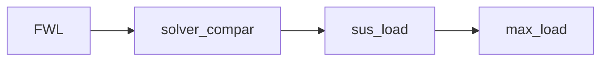

# sus_load 懸吊剛性輪載：計算方程式

## 共用符號與單位

四輪索引固定為 $i\in\{FL,FR,RL,RR\}$。座標採 $x$ 向前、$y$ 向左、$z$ 向上；正縱向加速度使前軸卸載，正側向加速度使右側增載。

- $m_s$：全車簧上質量，對應 `ms`；$m_u$：單輪簧下質量，對應 `mu`，單位皆為 kg。
- $L$：軸距；$h$：全車重心高度；$t_f,t_r$：前、後輪距，單位皆為 m。依序對應 `L`、`h_cog`、`t`、`hl_rear_track_m`。
- $f$：前軸靜態重量比例，對應 `hl_front_weight_ratio`；後軸比例為 $1-f$。
- $D$：總下壓力，向下為正，單位 N，對應 `wl_downforce_N`；$\eta$：空力前軸分配比例，對應 `wl_aero_front_ratio`。
- $N_i$：第 $i$ 輪法向載重，向上為正，單位 N。

總質量與重力加速度為：

$$
m=m_s+4m_u,\qquad g=9.81\ \mathrm{m/s^2}
$$

CSV 的 `ax`、`ay` 是以 g 為單位的無因次輸入，以下以 $\gamma_x,\gamma_y$ 表示；代入方程式前先換算成 SI 加速度：

$$
a_x=g\gamma_x,\qquad a_y=g\gamma_y
$$

以下兩個量供四個節點共用：$W$ 為重力與下壓力的總承載，$\Delta_x$ 為前軸轉移到後軸的載重量。

$$
W=mg+D,\qquad \Delta_x=\frac{ma_xh}{L}
$$

前、後軸總載重分別為：

$$
N_f=mgf+D\eta-\Delta_x
$$

$$
N_r=mg(1-f)+D(1-\eta)+\Delta_x
$$

因此 $N_f+N_r=W$。前軸與後軸的縱向轉移量大小相等，保留正負號以涵蓋加速與煞車。下壓力視為固定工況值，作用點沒有橫向偏移。

## sus_load：依懸吊剛性分配輪載

### 由彈簧剛度換算軸端剛度

定義 $k_p$、$k_r$ 分別為 `Ks_pitch_N_per_m`、`Ks_roll_N_per_m`，單位 N/m；$R_h$ 為 `MR`；$\rho_h$、$\rho_\phi$ 分別為後軸 heave、roll 彈簧比例，對應 `hl_rear_heave_spring_ratio`、`hl_rear_roll_spring_ratio`。

前、後軸 heave 輪端剛度為：

$$
K_{hf}=k_pR_h^2,\qquad K_{hr}=\rho_h k_pR_h^2
$$

令 $R_{\phi f},R_{\phi r}$ 為前、後軸 roll motion ratio，對應 `hl_front_roll_motion_ratio`、`hl_rear_roll_motion_ratio`。懸吊端 roll 剛度為：

$$
K_{\phi f}=k_r(R_{\phi f}t_f)^2
$$

$$
K_{\phi r}=\rho_\phi k_r(R_{\phi r}t_r)^2
$$

$K_{hf},K_{hr}$ 單位為 N/m，$K_{\phi f},K_{\phi r}$ 單位為 Nm/rad。以上採既有解耦彈簧定義，未將其視為每輪各一支相同彈簧而另乘並聯倍率。

### 前後軸滾轉分配與四輪載重

以 roll 剛度比例決定前軸承擔的滾轉力矩：

$$
\beta_f=\frac{K_{\phi f}}{K_{\phi f}+K_{\phi r}}
$$

兩軸的單側載重轉移量為：

$$
\Delta_f^{sus}=\frac{\beta_fma_yh}{t_f},\qquad \Delta_r^{sus}=\frac{(1-\beta_f)ma_yh}{t_r}
$$

因此四輪載重為：

$$
N_{FL}^{sus}=\frac{N_f}{2}-\Delta_f^{sus},\qquad N_{FR}^{sus}=\frac{N_f}{2}+\Delta_f^{sus}
$$

$$
N_{RL}^{sus}=\frac{N_r}{2}-\Delta_r^{sus},\qquad N_{RR}^{sus}=\frac{N_r}{2}+\Delta_r^{sus}
$$

其中 $N_f,N_r$ 沿用共用軸載重方程式。與 CG 法的差異在於橫向力矩分配由 $f$ 改為 $\beta_f$；兩者都維持總垂向力與載重一階矩平衡。

### 縱向轉移造成的增量位移與 pitch

縱向轉移量仍由剛體平衡決定：

$$
\Delta_x=\frac{ma_xh}{L},\qquad \Delta N_f=-\Delta_x,\qquad \Delta N_r=+\Delta_x
$$

前、後軸 heave 剛度用於估算載重轉移造成的增量壓縮量：

$$
\Delta z_f=-\frac{\Delta_x}{K_{hf}},\qquad \Delta z_r=\frac{\Delta_x}{K_{hr}}
$$

以小角度近似取得正加速時的抬頭角：

$$
\theta=\frac{\Delta z_r-\Delta z_f}{L}=\frac{\Delta_x}{L}\left(\frac{1}{K_{hf}}+\frac{1}{K_{hr}}\right)
$$

$$
\theta_{deg}=\frac{180}{\pi}\theta
$$

此角度僅表示縱向慣性轉移造成的增量，不含靜態車高或下壓力造成的基準姿態。前後剛度不同時，載重轉移量仍等量反向，變化的是位移大小。

此準靜態模型未另計 roll center 幾何轉移、簧下獨立轉移或輪胎順應性。輸出 `suspension_load_envelope.csv`、`stiffness.csv`，並以 `operating_point.csv` 記錄指定 $a_x,a_y$ 的四輪原始輪載，交給 max_load 使用。

## 流程與執行方式



四個節點共用 `data/analysis_flow.csv`，使用 `flow_row=tertiary`；第一個 FWL 的 `branch_from=cog_movable`，並透過 `extra_from=coefficient_of_friction` 接收輪胎分析分支，其餘節點依序串接。執行 FWL 或其後續節點時，會先重算輪胎模型、最佳胎壓、最佳 camber 與摩擦係數。`COG_movable` 從 Excel 元件資料計算 `ms`、平均單輪 `mu` 與慣量；前軸配重比例和軸距使用手動輸入的前、後輪中心 x 座標，Excel 元件重心座標不代替輪心。重心離地高度 `h_cog` 也直接手動輸入。單擊節點編輯獨立輸入，雙擊查看圖表、CSV 與本節方程式。

主視窗只有一張流程圖，輪載群組接在共用的重心資料起點。使用既有的「Run 全流程」或「單獨執行所選分析」，後者會重讀 Excel 並重算必要的前置分析。`Ks_pitch_N_per_m`、`Ks_roll_N_per_m` 仍取自共用剛性分析的輸出。

無視窗執行：

```powershell
.venv/Scripts/python.exe -B -X utf8 -m analysis.wheel_load
```

支援 `--csv <參數路徑>` 與 `--output <結果根目錄>`。完整方程式與圖表報告位於 `data/results/wheel_load/index.html`；每個節點的 `analysis.md` 僅保留共用定義與該節計算方程式。
