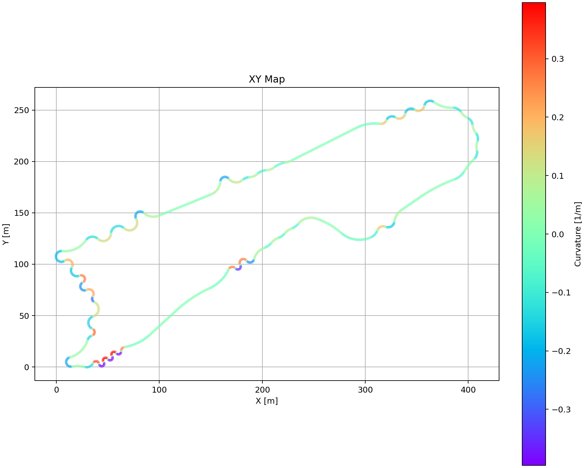
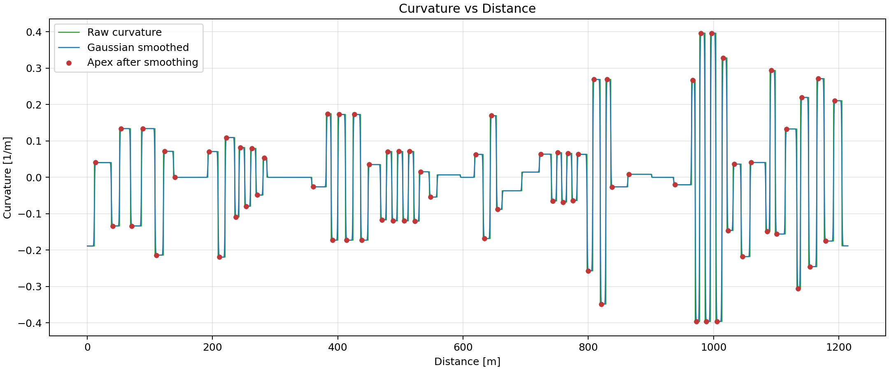
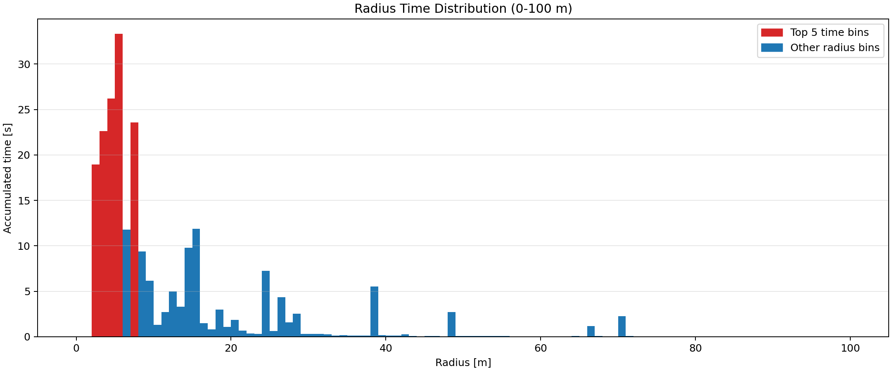
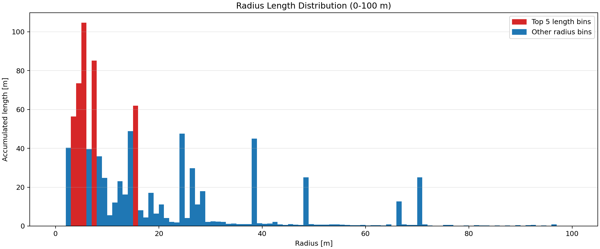
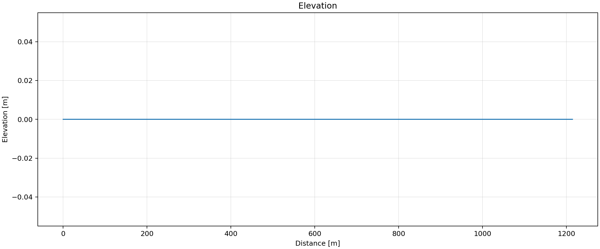
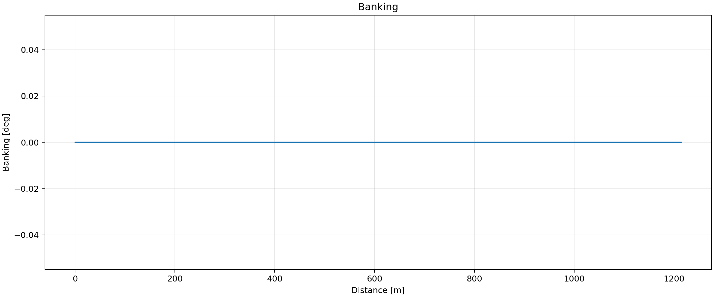
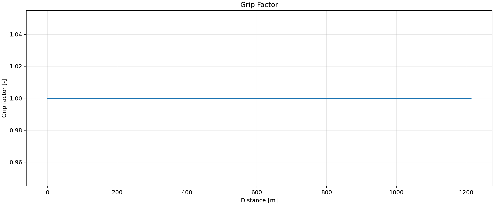
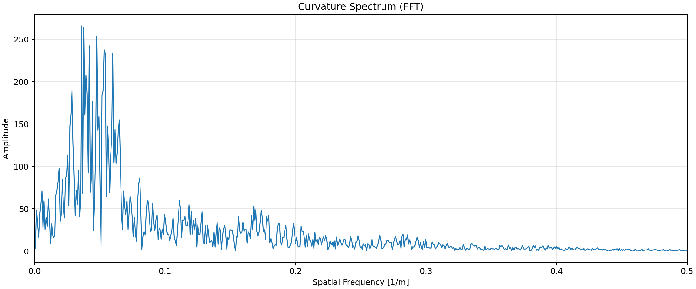
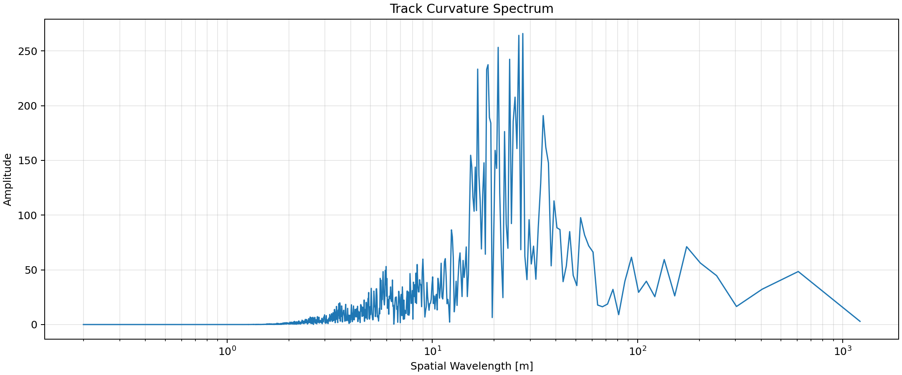

# OpenTRACK

## 重要輸出檔案

- `OpenTRACK.npz`：主要數值資料檔／可供後續分析的 NumPy 壓縮檔。
- `OpenTRACK.log`：運行紀錄，含參數與 ASCII 賽道地圖。
- 多張 PNG 圖像：本報告已引用全部圖片，讓分析結果可視化。

## XY Map

這張圖展示賽道中心線與平滑曲率顏色分佈。左彎與右彎會以正/負曲率色彩區分，可以快速確認轉向密集區域。

## 曲率 vs Distance

原始曲率與 Gaussian 平滑後曲率疊加，並標示 apex 位置。可觀察到多段轉彎區間與直線段的曲率變化。

## 半徑時間分佈

此圖以半徑區間顯示累積通過時間，反映賽車在不同轉彎半徑下的時間耗費。較小半徑通常代表高轉向負載區段。

## 半徑長度分佈

此圖顯示各半徑區間的累積距離分布，可用於衡量賽道在不同曲率強度下的長度比例。

## Elevation

高程隨距離變化圖，可看出賽道的上坡、下坡段落，對速度策略與懸吊設定影響明顯。

## Inclination

坡度角度圖對應高程變化，較大的坡度會影響重力分佈與煞車/加速策略。

## Banking

角度圖顯示賽道傾斜變化
## Grip Factor

抓地係數圖顯示路面附著力變化。若抓地係數維持穩定，代表賽道安全性與操控預測較容易。

## 曲率頻譜（Frequency）

使用 FFT 分析曲率的空間頻率，揭示賽道在不同尺度上的曲率週期性。此圖有助於判斷賽道是否包含多層次短域與長域轉彎結構。

## 曲率頻譜（Wavelength）

以空間波長呈現曲率能量分布，便於理解賽道上不同尺寸轉彎的影響範圍。